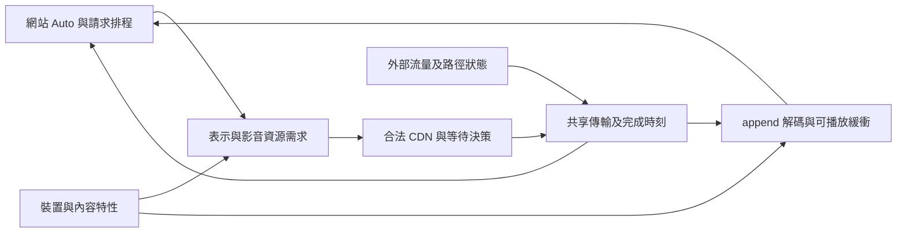

# BiliCDN_TW Auto 播放與 CDN 選路數學模型研究

## 研究結論

選路應建模為網站 Auto、影音內容、共享網路及播放器處理能力共同作用的閉環。只比較主機 Mbps 或固定大小請求，無法判斷起播、停滯與換站效用。所需資源必須由實際選擇的表示、分段／Range、影音相依、播放倍率及已可重用的緩衝決定；下載完成也不等於資料已可播放。

本研究建立兩層模型：完整參考模型描述影格／資料相依與事件時間；可觀測模型只使用本專案確實取得的資料，其他參數保留區間或未知。完整模型不是要求產品解析每個影格、建立歷程或新增收集器。

主要結果為：

1. 解析度、FPS、codec、編碼碼率及實際分段大小均影響工作負載；已知壓縮碼率時再乘 FPS 會重複計算網路需求。FPS 另進入解碼及呈現模型。
2. Auto 可能因下載表現改變後續畫質與請求大小。因此固定工作負載比較與包含網站 ABR 的閉環比較必須分開，不能將降畫質換來的流暢直接算成選路改善。
3. 平均容量足夠不保證每段趕上期限。同為平均 8 Mbps 的兩段內容，在明列的相同網路條件下，僅改變 VBR 分段順序即可得到 0.2 或 1.4 秒停滯。
4. 短探測速度、含 TTFB 的整體吞吐與媒體請求的條件完成時間是不同量。主機排名可以隨請求大小交叉；沒有適用所有大小的單一「最快主機」。
5. 起播等待、換站與提前重試應以包含不確定性及交接成本的效用差判定。三秒、五分鐘、兩筆、25% 及 1.35 倍目前都是產品政策參數，沒有因既有驗收通過而成為最優值。
6. 現行十二筆窗口重建 EWMA 有可計算的窗口邊界效應；兩個不同請求也不代表統計獨立或某個百分比的可靠度。估計器的「保守」不能直接解讀為機率保證。
7. 可以確定驗證的是所有權、安全限制、額度及終態；沒有未來網路服務下界及網站 ABR 資料時，無法證明永不停滯或普遍最優。後續方案須寫清假設、可觀測輸入、推導與反例，而非只增加測試數。
8. 現行完成比較沒有扣除緩衝快照年齡；同組共用期限時的 fits 優先與耗時排序等價，容量組別卻仍優先於期限。這些可定位的時間近似及政策取捨，能轉成具體研究案例。

## 研究基準與證據類型

日期為 2026-11-04，基準為 `main` 提交 `304c63196a2110943387848765cf5156a01af066`，產品 v2.2.8。研究依使用者一小時授權進行，開始於 01:58:43、截止於 02:58:43 Asia/Taipei。工作狀態由 [TODO](../../../docs/TODO.md#自動畫質與選路數學模型研究) 維護，現行產品契約仍由 [ARCHITECTURE](../../../docs/ARCHITECTURE.md) 與 [SECURITY](../../../SECURITY.md) 維護。

本文區分四種內容：固定提交可核對的程式事實、一手來源的既有結果、明列前提下的本研究推導，以及尚待校準的候選。數值案例為離線算例，不是安裝版表現；v2.2.8 已通過的 [R2 專項](../../../docs/TEST_REPORT.md#v228-r2-專項完成2026-11-0304) 保持原判定。

研究沒有修改產品、正式測試、工具、設定、儲存格式、版本或 Release，沒有啟動網站服務、IAB、CDN 探測或已停止窗口。私有算術腳本只使用 Python 標準函式庫，不匯入產品；不構成新正式評估工具。

### 固定程式依據

下表連結均固定在本輪基準，使用具名函式定位。這是模型相關路徑核對，不宣稱全儲存庫重新安全審查。

| 固定來源 | 核對範圍與模型意義 |
| --- | --- |
| [playurl-contracts](https://github.com/YUIAOI7592/BiliCDN_TW/blob/304c63196a2110943387848765cf5156a01af066/src-v2/application/playurl-contracts.ts)、[vault-contracts](https://github.com/YUIAOI7592/BiliCDN_TW/blob/304c63196a2110943387848765cf5156a01af066/src-v2/state/vault-contracts.ts) | `PlayurlItem`、`RegisterRepresentationInput`、`VaultGroupSnapshot`；高度、codec、bandwidth，沒有獨立 FPS、逐段時長或影格大小欄位 |
| [playurl adapter](https://github.com/YUIAOI7592/BiliCDN_TW/blob/304c63196a2110943387848765cf5156a01af066/src-v2/adapters/playurl.ts) | `normalize`；讀取表示 id／codec／高度／bandwidth，不能據此宣稱已建模 FPS 或 VBR |
| [playback-demand](https://github.com/YUIAOI7592/BiliCDN_TW/blob/304c63196a2110943387848765cf5156a01af066/src-v2/domain/playback-demand.ts) | 完整函式；控制缺值政策與 UI 實際值分離，主要需求為 bandwidth × rate × 1.25，保留最低需求 |
| [player-media](https://github.com/YUIAOI7592/BiliCDN_TW/blob/304c63196a2110943387848765cf5156a01af066/src-v2/adapters/player-media.ts) | 原生媒體快照；目前位置所在 buffered 區間、倍率、尺寸；`playableBufferSec` 已除以倍率，不能再除一次 |
| [route-completion](https://github.com/YUIAOI7592/BiliCDN_TW/blob/304c63196a2110943387848765cf5156a01af066/src-v2/domain/route-completion.ts) | 完整檔案；閉合單一 Range 長度、兩秒緩衝資料期限、本文速度與 TTFB 公式 |
| [evidence](https://github.com/YUIAOI7592/BiliCDN_TW/blob/304c63196a2110943387848765cf5156a01af066/src-v2/domain/evidence.ts) | 完整檔案；十二筆、TTL、近期充分程度、二／五筆 EWMA 重建、本文速度 |
| [route-capacity](https://github.com/YUIAOI7592/BiliCDN_TW/blob/304c63196a2110943387848765cf5156a01af066/src-v2/domain/route-capacity.ts) | 完整檔案；分組、探索名額、同組完成預測資料不齊時整組退回吞吐 |
| [RouteCoordinator](https://github.com/YUIAOI7592/BiliCDN_TW/blob/304c63196a2110943387848765cf5156a01af066/src-v2/application/route-coordinator.ts) | `#demandFor`、倍率更新、`observePlaybackFacts`／`completionBudget`；控制需求及目前身分的窄事實接線 |
| [MeasurementController](https://github.com/YUIAOI7592/BiliCDN_TW/blob/304c63196a2110943387848765cf5156a01af066/src-v2/application/measurement-controller.ts) | 起播租期、結果接納與 `#probeStartup`；共用截止與有界候選，短驗證不刷新完整速度 |
| [range-probe](https://github.com/YUIAOI7592/BiliCDN_TW/blob/304c63196a2110943387848765cf5156a01af066/src-v2/adapters/range-probe.ts) | 完整檔案；送出前時計、Fetch 回應可用時刻、讀取／取消及計入 bytes 上限 |
| [early-retry](https://github.com/YUIAOI7592/BiliCDN_TW/blob/304c63196a2110943387848765cf5156a01af066/src-v2/domain/early-retry.ts) | 完整檔案；剩餘資料估計、完整請求重試大小、0.8 倍緩衝及一秒收益門檻 |
| [routing-evaluation](https://github.com/YUIAOI7592/BiliCDN_TW/blob/304c63196a2110943387848765cf5156a01af066/scripts/evaluation/routing-evaluation.mts) | 完整檔案；固定需求與首段比較，沒有 Auto／影音／解碼閉環，reload 為建構常值零 |

## 時間狀態與可觀測性

### 兩個時鐘與三種表示

`t` 為牆鐘秒，`u` 為媒體時間秒，`p(t)` 為實際播放倍率。正常前進且沒有 seek 時：

```text
du/dt = p(t) * I(實際播放前進)
```

seek、換片、暫停及恢復是獨立事件。seek 是媒體位置跳變，不是突然下載完成或負停滯。

| 符號 | 單位與定義 |
| --- | --- |
| `t,u,p` | 牆鐘秒、媒體秒、媒體秒／牆鐘秒 |
| `b_q` | bit／媒體秒，隨內容及表示變動 |
| `S_j,X_j` | bytes，請求總長及已取得的本文量 |
| `c_j,C_body` | byte／牆鐘秒與 Mbps，兩者換算須包含 8 及 10^6 |
| `B_m,B_w` | 連續可用的媒體秒與按倍率換算的牆鐘秒 |
| `L,W,K,T` | 秒，首回應延遲、gate 等待、額外交接與完成耗時 |
| `d_k,fps_q` | 分段媒體秒與每媒體秒影格數 |

模型分開保存 `q_play`（正在呈現）、`q_buffer(u)`（各已緩衝區間）、`q_request,j`（第 j 筆請求所屬表示）。它們在 Auto 升降階時可以不同。產品的「兩筆成功才確認表示」是控制／顯示資格，不能被當成瀏覽器在確認前不會下載或播放該表示的物理假設。

### 完整狀態與觀測投影

```text
x(t) = (
  媒體位置與播放意圖,
  表示集合與 Auto 內部狀態,
  已取得 bytes 與其媒體／依賴對應,
  活躍影音請求及其進度,
  各軌可用時間區間,
  初始化／append／decode 工作,
  共享網路與連線狀態,
  記憶體／裝置限制,
  generation／epoch／授權／政策／選擇修訂及額度
)

y(t) = O(x(t))        # 本專案能讀到的投影
Theta(I_t)           # 與目前資訊 I_t 一致的未知狀態／未來集合
```

`I_t` 是數學上的當前資訊條件，不要求產品保存無界事件歷程。正式控制只使用既有有界狀態；完整參考模型可以在離線指定合成隱藏真值。

完整性與可用性分開判定。若當前請求大小、媒體種類、當前期限及候選計時已有可靠輸入，局部路線比較未必需要額外 FPS；FPS／ABR 未知只限制依賴它們的閉環結論，不否定獨立成立的請求或控制契約，也不要求新增持久欄位。

| 量 | 目前可取得程度 | 模型處理 |
| --- | --- | --- |
| 表示高度、codec、宣告 bandwidth、當前倍率 | 已有正式輸入；仍須核對目前請求／身分 | 區分宣告值、確認值與實際消耗 |
| FPS、位元深度、HDR、逐段媒體時長 | 現有上述表示契約沒有獨立欄位 | 參考模型明列；可觀測模型保留未知，不由畫質名稱猜測 |
| 單一閉合 Range 的請求 bytes | 可由精確 Range 取得 | 只證明大小，不證明涵蓋多少媒體秒 |
| 開放／suffix／多重 Range、逐影格依賴 | 未由現行完成模型提供 | 不補猜大小或可播放時間 |
| 原生 buffered、currentTime、playbackRate | 已有媒體快照 | 不能從一個秒數還原各表示緩衝分布或個別音軌缺口來源 |
| 解碼服務率、網站 ABR 內部狀態、未選 CDN 的未來表現 | 未觀測或僅部分可見 | 使用明列範圍與反例；不能默認充足或給出無依據的機率 |
| 原生 timeout、等待及取消 | 既有程式與 R2 有限定證據 | 分開 native fetching 時計與頁面取消，不推定取消來源的通用規則 |

## 表示與資源需求

### 壓縮資料與 FPS

每個影片表示以 `q=(id,width,height,fps,codec,bitDepth,HDR,bandwidthDeclared)` 描述。可變 FPS 或 `60000/1001` 之類有理數不能一律截成整數。對媒體區間 `[u0,u1)`，最可靠的大小是已知編碼樣本與容器資料的實際 byte 集合：

```text
S_v(q,[u0,u1)) = containerBytes + sum(encodedFrameBytes_i)
N_frames       ≈ fps_q * (u1-u0)                   # 固定 FPS 的近似
S_v            ≈ N_frames * meanFrameBytes + containerBytes
```

若以整體壓縮碼率函式表達並一致計入容器成本：

```text
S_v(q,[u0,u1)) = integral(b_q(u),u0,u1) / 8        # b: bit/media-second
```

兩種寫法不能同時重複加容器成本。已知 `b_q` 後再乘 `fps_q`，量綱與實際位元需求都不正確。相同壓縮碼率的 30／60 FPS 在相同媒體時長具有相同平均資料量；每影格平均大小及處理負荷則不同。

一般 DASH 的 bandwidth 與 minBufferTime 共同描述內容供應條件，並非每段固定大小或通用平均碼率定義。DASH-IF 也明列分段粒度與 HTTP 排程等理想化限制。不能直接把這套 MPD 語意套給 B 站 JSON 同名欄位，後者的精確編碼意義仍須由合法資料另行核對。[DASH-IF 第 3.2.8 節](https://dashif.org/docs/DASH-IF-IOP-v4.2-clean.htm)

### 時間窗需求與真正缺少的資料

對接下來 H 秒牆鐘時間，若不中斷，媒體消耗為 `Delta_u=integral(p(s),t,t+H)`。依網站已提出的請求及候選 Auto 軌跡，求該區間播放所需資料的依賴閉包 `Req_H`，再扣除仍可重用的資料：

```text
D_H = size(union(Req_H byte objects) minus ReusableCachedObjects)
```

`Req_H` 包含所需影音、初始化、參考影格／隨機存取點及必須完整取得的 parser 單位；同一 byte 物件去重，不用相同媒體時間將不同表示的 bytes 當作可互換。HTTP 請求若只能整段取得，網路下載量可能大於理論最小播放依賴量。

`D_H/H` 是平均缺口，不能取代各資料的播放期限。舊緩衝只扣除其相容且仍可使用的部分；切表示不必然清空所有舊緩衝，也不保證任何 codec／時間戳切換都能無成本沿用。相容性是明確輸入，不是任意布林假設。

### 長期需求只是必要近似

固定表示、倍率及平穩平均碼率下，維持緩衝所需平均影音 goodput 約為 `p*(b_video+b_audio)`；25% 裕度是政策，而非物理恆等式。此量是接入端合計需求，不能將同一份總容量分別完整配給影片及音訊。現行影片／音訊證據與控制所有權仍保持隔離。

## 請求與可播放資料的相依

Range、編碼分段、可 append 單位與可解碼影格不是同一種物件。一筆 Range 可能涵蓋多個媒體單位，也可能只有初始化／索引；大型回應是否可在 EOF 前產生可播放資料，取決於網站消費及 parser 流程。

完整模型以依賴圖表示 `bytes -> parse/append -> decode -> presentation`。對工作 j，`a_j` 是資料或工作最早可用時刻；以各資源的一個合法排程表示：

```text
start_j >= max(a_j, all finish_i for i in predecessors(j), resourceAvailable_j)
finish_j = start_j + serviceTime_j
```

多核心／硬體解碼可平行處理，不能強制整台裝置只有一個 FIFO。排程未知時以可行上下界處理。影格依賴按 DTS／PTS 及 codec 處理；不得假定呈現順序就是解碼順序。[MSE 的 coded frame、timestamp、初始化與隨機存取點定義](https://www.w3.org/TR/2016/REC-media-source-20161117/)

首畫面時間是所需初始影音與相關處理全部就緒後，瀏覽器／網站允許呈現的時刻。它未必等於第一筆 XHR 的 load，也未必需要整支影片或整個 Range 完成。完整分段到齊才增加緩衝的模型只能作明確標記的 atomic-append 情境。

## 共享傳輸與緩衝動態

### 網路服務模型

對第 j 筆請求，`s_j` 是真正原生送出時刻，`L_j` 是首本文可用前的延遲；`c_j(t)` 是當時該流取得的本文 goodput，單位 byte/s。完成時刻為：

```text
X_j(t) = 0                                        # t < s_j+L_j
X_j(t) = min(S_j, integral(c_j(v),s_j+L_j,t))       # 其他情況
F_j    = inf {t : X_j(t) >= S_j}

sum(c_j(t) for all flows sharing link l) <= availableCapacity_l(t)
```

`c_j` 同時受 CDN／來源路徑、接入瓶頸、其他流、HTTP 多工優先權、連線冷暖及伺服器／快取回應影響；它可能受本次策略改變。探測、影音及重試不能各自獲得完整接入容量。已在 `L_j` 計入的連線／TLS 成本，不可又在換站成本重複加一次。

未完成的集合取空時 `F_j=+infinity`；abort 則另有請求終態及截尾時刻，不能把無完成時間自動轉成主機故障。完整物理模型中的開始／首本文界線與適配器可觀察時刻亦須分開。

固定速度公式 `T=L+8S/(10^6*C_body)` 是此模型的條件特例。現有 RangeProbe 的 `ttfbMs` 是 Fetch 回應可用時間減開始時間，可能受瀏覽器與排程影響；不能將其當作精確 TCP RTT。現行控制數值仍依原契約使用。

計入 bytes、交給應用的 bytes 及線路實際耗用也要分開。RangeProbe 讀取時對計入值取上限，但一次 reader chunk 或已在途資料可能超過最後剩餘量；合成成本可指定實際傳輸上界／overshoot，不得把邏輯計入上限宣稱為精確線路耗用。

### 可播放區間

對仍啟用的必要影音軌，在時間 t 已 append 且符合依賴的媒體區間分別為 `E_v(t)`、`E_a(t)`。正常非 ended 情境的參考交集為：

```text
E(t) = E_v(t) intersection E_a(t)               # 可信純音訊只取 E_a
B_m(t) = sup {z>=0 : [u(t),u(t)+z) is contained in E(t)}
B_w(t) = B_m(t)/p(t)                            # p 在預測期間固定的特例
```

有洞的區間不能相加當作連續緩衝。倍速變動時使用積分求耗盡時間，不能用新倍率回算整段過去時間。MSE 有 ended、軌道啟用等細節；參考模型採相應規則，可觀測模型以瀏覽器實際 buffered 為準，不另造一個更寬鬆讀值。[MSE 緩衝交集](https://www.w3.org/TR/2016/REC-media-source-20161117/#htmlmediaelement-extensions)

現行 `playableBufferSec` 已是牆鐘秒。額外除以倍率會將兩倍速需求再放大一次。`buffered` 也不是逐影格已解碼／已呈現完成的保證。

目前 `completionBudget()` 在兩秒有效期內原樣傳回採樣時的 `playableBufferSec`，完成比較也未扣除樣本年齡。在持續播放、倍率不變、無新資料且無 seek／eviction 的條件下，當前緩衝應為 `max(0,B_w,sampled-age)`；若倍率改變則須回到媒體時間計算。這是可確認的時間近似，不代表已證實現場故障。一般情況不能只做一律相減：暫停、新資料、換片及緩衝移除均要分開。

### 兩種有條件的簡化及界限

僅對固定倍率、順序下載、每段到齊才可用、影音相依已滿足的孤立情境：

```text
stall_k = max(0,T_k-B_w,k)
B_w,k+1 = max(0,B_w,k-T_k) + d_k/p
```

僅對沒有分段阻塞、可連續補入的 fluid 放鬆模型：

```text
dB_m/dt = C_video/b_video - p
```

後式不能用來消除前式的 VBR／分段期限反例。一般零停滯條件是所有需要的媒體資料與處理在各自期限前就緒，不是整段平均速度超過碼率即可。

後式的 `C_video` 為 bit／牆鐘秒，`b_video` 為 bit／媒體秒，必須同尺度換算；兩者都以 Mbit 表達時比值不變。不可把 Mbps 的數值直接除以未換算的 bit/s。

若另有「持續有可送資料、單一服務瓶頸、沒有處理瓶頸」及真正服務下界 `beta(t)=C*(t-L)^+`，內容需求上界為 `sigma+rho*p*t`，則提前下載 `T_prefetch` 秒的一個充分條件為 `C>=rho*p` 且 `T_prefetch>=L+sigma/C`。這由逐時間檢查 `beta(T_prefetch+t)>=sigma+rho*p*t` 得到；C 為 bit／牆鐘秒、rho 為 bit／媒體秒、sigma 為 bits。此處是實際預先下載，不是 gate 只等待探測的 W。未知請求排程或無服務下界時不能套用。這是 network calculus 形式的條件界限，網際網路上的 EWMA 並未提供該服務保證。[作者的 network calculus 說明](https://leboudec.github.io/netcal/)

## 解碼呈現與記憶體

FPS 的作用包括每媒體秒的樣本數、解碼相依、處理成本及呈現節奏。無 decode skipping、固定 FPS 的情境，處理需求約為 `p*fps` frames/wall-second；裝置容量 `mu(q,device)` 也取決於尺寸、codec、位元深度與硬體路徑。`mu>=p*fps` 只是一個平穩必要檢查，不能保證每個影格期限或初始化切換皆成功。

60 FPS 兩倍速的內容進度對應 120 個來源影格／秒，但 60 Hz 螢幕最多每秒更新約 60 次。呈現可有正常抽樣，不能把這個差異直接定義成 CDN 失敗。若允許跳過部分解碼，必須保留被呈現影格所需的參考依賴，不能假設成本隨意歸零。

壓縮緩衝記憶體是已保存的壓縮資料；解碼影格池則依像素格式、尺寸及隊列長度計。理想未填補的 3840×2160、8-bit YUV420 每影格約 11.865 MiB，六個影格約 71.191 MiB，並非「碼率乘緩衝秒數」；實際配置尚有 stride、表面與解碼器成本。

W3C Media Capabilities 的輸入分開列碼率、幀率、尺寸及 HDR 等參數，但其 capability 結果也不等於當下完整處理容量。本模型不要求新增能力輪詢、掉幀收集或以 codec 檢查阻擋 playurl。[2026-10-18 工作草案的 VideoConfiguration](https://www.w3.org/TR/2026/WD-media-capabilities-20261018/#videoconfiguration)

## 自動畫質與選路的閉環



```text
(q_next, requestSchedule_next, z_ABR,next)
  = F_ABR(z_ABR, visibleHistory, buffer, device, websitePolicy)

x_next = F_system(x, websiteAction, scriptAction, exogenousConditions)
```

網站控制畫質及原請求排程；腳本只在合法能力內決定路線、既有 gate 與有界介入。`F_ABR` 目前未知，不能用一個自行設定的門檻冒充 B 站 Auto。模型至少比較吞吐導向、緩衝導向、混合／有遲滯三類明列規則，另加入尚未確認表示、升降階、codec 切換及倍率變動的壓力案例；其結果只對該假設族成立。

### 可計算的 ABR 假設族

對已為情境明定偏好順序的表示集合 Q，一個吞吐導向參考規則為：

```text
q_next = highestPreferred {q in Q : p*b_q <= lambda*C_est and deviceFeasible(q)}
```

沒有符合者的退路須明定，不能產生不存在的表示。`lambda`、偏好及裝置條件皆為假設參數；例如不能將不同 codec 的 bitrate 大小直接當作偏好順序。緩衝導向族則以 `B_down<B_up` 的遲滯及各段就緒期限定義升降階；混合族再同時要求容量／處理條件。這些規則只在離線扮演網站，不授予腳本改畫質能力。

即使網路固定，表示選擇映射也可以存在多個固定點。假設僅隔離影片路徑、每段四媒體秒、本文容量 20 Mbps、TTFB=0.3 秒、表示碼率為 4 與 12 Mbps，並採 `lambda=0.8` 的上述規則。每段量到的整體吞吐為：

```text
C_est(q) = (b_q*d)/(L+b_q*d/C_body)
```

4 Mbps 表示會量到約 14.545 Mbps，乘 0.8 後不足以升至 12；12 Mbps 表示則量到約 17.778 Mbps，乘 0.8 後足以保持 12。因此一倍速時兩個起點可分別保持 4 與 12；同一網路不是唯一畫質結果。改成兩倍速，這個假設規則的兩個起點都回到 4。這是表示映射的固定點，不是整個緩衝／排程狀態都已平衡：緩衝累積到上限後仍需網站排程 idle。此反例的 `lambda=0.8` 只用來展示回饋，不是建議門檻，也不是 B 站實際 ABR。

### 局部穩定性與觀測延遲

僅在固定 codec／FPS 附近、碼率可連續近似、段長 d 相同、影片取得固定 C Mbps、TTFB 固定 L、沒有停滯／idle／裁切的局部模型，設 `b_k` 為第 k 段碼率，`B_k` 為牆鐘緩衝：

```text
T_k = L+b_k*d/C
B_k+1 = B_k+d/p-T_k
b* = C*(d/p-L)/d                              # 正平衡需 d/p>L
b_k = b*+K*(B_k-B*)                            # K>0，單位 Mbps/牆鐘秒
a_gain = K*d/C
```

沒有延遲時，小偏差滿足 `deltaB_k+1=(1-a_gain)*deltaB_k`，局部漸近穩定需 `0<a_gain<2`。若只多一個請求事件的觀測延遲，則為 `deltaB_k+1=deltaB_k-a_gain*deltaB_k-1`，特徵式 `z^2-z+a_gain=0`，穩定範圍縮為 `0<a_gain<1`。

例如 C=20、d=4、L=0.3、p=1、K=7.5，平衡碼率 18.5 Mbps，無延遲根為 -0.5；一事件延遲的根模長約 1.225，局部偏差增大。這只證明延遲會改變穩定範圍，沒有將此 K 配給網站或腳本。實際離散畫質、FPS／codec 邊界、在途請求及 buffer 上下限要回到事件／混合模型，不能用這個局部條件保證全域穩定。

固定請求序列比較可回答某種資源工作負載下的選路成本，不能估計 Auto 改變後的全部效果。閉環比較應固定外部容量、競爭流與內容集合，讓網站請求在各策略下重新產生；不能把策略 A 量到的每主機 throughput 序列，直接當作策略 B 不變的網路真值。FESTIVE 指出排程／估計回饋偏差；CausalSim 的正式研究也處理既有策略對 trace 的影響。[FESTIVE](https://users.ece.cmu.edu/~vsekar/assets/pdf/conext12_festive.pdf)、[CausalSim 官方摘要](https://www.usenix.org/conference/nsdi23/presentation/alomar)

## 目標與不可違反條件

### 效用比較

先輸出指標向量，再討論權重：起播時間、首畫面後的停滯時間、實際主機切換、額外下載、重載、Auto 表示軌跡及表示切換。起播不再次算入「首畫面後停滯」，避免雙重計時。

固定媒體區間比較需報告完成該區間的牆鐘成本；固定牆鐘窗口則另報實際播放的媒體長度與未完成／未起播比例。沒有起播不能填成零秒停滯後稱為成功；未觀察到的完成時間不得以窗口末端冒充。使用者 seek、暫停、倍率與停止意圖須明列其對齊時鐘，避免不同策略被安排不同外部操作。

```text
J(pi,theta) = a*T_start + b*R_after_start + c*N_host_switch
            + d*D_extra_MiB + e*N_reload
            + f*L_quality + g*N_representation_switch
```

`L_quality` 只有在具備內容相依的品質效用或已選定偏好時才使用。不同 codec／FPS 的品質不能直接以 bitrate 或解析度單一排序代替；缺少參考品質時報告各表示的實際媒體時長與參數分布，不捏造 VMAF／SSIM 分數。亦不能把下載了、卻未播放的高畫質資料計入觀看品質。

各成本權重非負，尚未由本輪資料識別。先排除 Pareto 被支配方案，再提供有取捨方案的成本前緣，不自行指定一秒等待等於多少畫質損失。已知只有小範圍情境時，同時列出最差反例及對基準的 regret；不要用平均改善掩蓋大幅退步。

若未來有可信的條件分布，可在有限分析期間比較 `E[J(pi,theta) given I_t]`；只有明列的不確定集合時，可比較 `sup(J(pi,theta) for theta in Theta(I_t))` 或對基準的最壞成本差。兩者回答的問題不同。分布未知時不得自行填機率；集合過寬時也不能把毫無區別的無界最壞值稱為最佳方案。分析期間未完成的工作與未起播另列，不能刪掉後再計平均。

BOLA 將緩衝與品質置於同一效用，但其基本模型具有固定媒體段長、單次一段下載及由演算法選碼率等前提；其最優性界限不能移植為本腳本的保證。[BOLA v3 第 II 至 IV 節](https://arxiv.org/html/1601.06748v3)

### 控制契約

所有公式先限制在合法動作集合 `A_legal(x)`：禁止／固定規則、Native 精確授權、影音隔離、唯一所有者、現有額度及停用語意均不以效用分數抵銷。具體應驗證：

- 每次提交都有當前 generation／epoch／授權／政策／選擇與工作所有權；合法舊證據保存不取得新控制權。
- 每筆請求 metadata 終態不可被晚到工作復活，原生 send 最多一次；XHR 重用的新 metadata 是另一筆請求。
- 探測及重載不超額，不為估計或機率校準追加流量；健康探索不更換流暢播放親和。
- 三秒是起播結果接納期限，`now>=deadline` 拒絕結果；排程公平性不足時不能保證實際放行精確在三秒完成。
- 所有等待在公平排程與現有事件／期限下前進或有界結案；取消與失效拒絕後沒有控制副作用。

## 決策條件與推導

### 起播等待及探索

起播是有限額度、具有截止與取消的停止問題。對當前狀態，直接比較 `J_release` 與 `E[J_wait_then_act]`；等待會改變網站及網路狀態，因此不能僅將資訊品質提高視為免費收益。

在影片為關鍵路徑、大小與 Auto 不變、無競爭／取消／額外交接的孤立特例，等待 W 秒有利當且僅當 `T_old-T_new>W`。對實際影音，應比較各必要工作的最晚就緒與處理時刻；音訊若已是最慢的一端，影片更快可能完全不減少首畫面時間。

純資訊價值可定義為「新資訊到達後改善決策的預期成本差」。總等待決策還須扣除剩餘等待造成的播放損失、探測競爭、額外下載與取消影響。已付出的等待是 sunk cost，不是繼續等完整窗口的理由；未知候選也不能被賦予未有資料支持的改善機率。

沿用現有候選、bytes 與三秒接納限制。Catalog-only 足速提前放行已存在；後續研究的是各合法模式的釋放條件與探測收束，不是重新加入該既有能力。

### 網站取消與 native timeout

對每筆等待者分開記錄 gate 等待 W、實際 native fetching 及網站取消事件。native timeout 大致從真正 fetching 起點計，動態更新仍以該起點判定；網站自己的 abort 可能在 gate 時發生，且其分布可以受網站策略與等待影響，不能假定獨立。

v2.2.8 R2 的首筆影片於等待 2.054 秒後由頁面取消，第二筆共用窗口後以原 13,000 ms timeout 送出成功。這支持特定等待／取消交錯，不能識別通用「網站兩秒看門狗」，也不能作六秒或兩秒新門檻的依據。[原生 timeout 規格](https://xhr.spec.whatwg.org/#the-timeout-attribute)、[R2](../../../docs/TEST_REPORT.md#v228-r2-專項完成2026-11-0304)

### 新決策的完成時間排序

若候選 A 具有低延遲但較低本文速度，B 具有高延遲但較高本文速度，兩者的勝負交點為：

```text
S* = (L_B-L_A) / (8/(10^6*C_A) - 8/(10^6*C_B))
```

正交點及固定速度條件下，小於交點偏向 A，大於交點偏向 B。未知大小或不可比較計時不能代入零。完整決策還要比較可播放期限、目前主機沿用與切換成本，不能用微小預測差取代合法健康親和。

現行同一容量組共用同一期限 D，先比較 `T<=D`，再比較 T。對有限正值，這與直接按 T 排序等價：若兩者落在 D 的兩側，較小的 T 本來就排前；若同側，仍比較 T。因此「是否趕上期限」在此組內沒有額外改變排序。另一方面，容量充分程度分組排在完成時間之前，充分且足速的來源仍可排在單筆且足速、但預測更早的來源之前。這是現行政策優先序，不是完成模型已保證選到最可能準時的來源；未來要更改必須先定義信心與期限風險的取捨。

### 換站條件

設剩餘工作在目前主機的預測時間為 `T_i`，替代為 `T_j`，額外交接時間為 K，已標準化的損失函式為 `g_B(T)=a*T+b*max(0,T-B)`。若有可用的預測區間，一個矩形區間下的保守充分條件為：

```text
g_B(lower(T_i)) > g_B(upper(T_j)+K) + extraByteCost + otherSwitchCost
```

此式只是在本次工作、B 固定且後續需求相同時，對局部代理損失的充分條件，不是完整 Auto 閉環的最優性結論。它也不是目前可直接採用的門檻，因為區間尚未校準；不需要假定兩條路徑獨立。更完整比較應使用共同網路狀態下的成對成本差分布。硬失敗、禁止或所有權失效依硬限制處理，不等待效用證明。

### 提前重試條件

當已有 x bytes、總長 S，持續速度近似僅作局部估計：

```text
T_continue ≈ 8*(S-x)/(10^6*C_current_future)
T_retry    ≈ K + L_alt + 8*S_retry/(10^6*C_alt_future)
```

原請求已過首回應時不再加一次 TTFB；重試按網站真正提出的大小計算，不能預設只下載剩餘量。S_retry 未知時不捏造收益。取消／重試失敗的機率、重下載及原路線即將恢復的情境都進入成本。

只用「已慢多久」也不夠，相關量是條件剩餘時間 `E[T-t given T>t,I_t]`，不默認無記憶分布。若將未來簡化為「持續慢」機率 p，判對收益 G、誤判損失 L、固定介入成本 C，則介入需 `p*G>(1-p)*L+C`，等價於 `p>(L+C)/(G+L)`；只有在這些定義及共同成本尺度成立時才能使用。

現有資格、1.35 倍、0.8 倍緩衝、至少一秒、成功帳本及額度全部保持。公式建立後仍須由 held-out 反例評估誤介入，不能只檢查程式是否真的觸發重試。

### 可證明範圍與不可識別

同一組已知過去，可以接上「原路線持續慢十八秒」或「原路線 0.2 秒後恢復」；替代完成同為 0.3 秒。任何只讀取相同過去的確定性決策，對兩個未來都會作同一選擇，無法同時保證零 regret。這不影響狀態機可重現性，卻排除了「程式寫得嚴謹就能確知未來網路」的要求。

同樣地，若未來網路可無限期歸零、網站可任意升階或裝置可任意停頓，有限緩衝與任何 CDN 演算法都不能保證永不停滯。應明列分析期間及可接受的環境集合；廣到包含無界中斷的集合，會使最壞成本失去決策價值。

## 估計器與不確定性

### 時間條件與樣本尺度

現行整體 Mbps 含 TTFB；近期且計時完整時，另算 `bytes*8/(elapsed-ttfb)` 的本文速度，再加一次 TTFB 預測完成。後者避免明顯重複，但仍假設本文速度可遷移至新大小／連線／範圍；TCP 暖機、快取與並行可能使此假設失效。

Fugu 將擬下載大小放進傳輸時間分布的預測，而不只預測一個與大小無關的 throughput；其伺服器端 TCP 資料及訓練環境並非本腳本現成能力。本研究借鑑「條件完成時間與不確定性」的建模，不提出引入其 DNN、伺服器或持久 telemetry。[Fugu 第 4.2 至 4.4 節](https://www.usenix.org/system/files/nsdi20-paper-yan.pdf)

### 現行 EWMA 的可計算行為

```text
alpha_H = 1-2^(-1/H)
E_H,k = (1-alpha_H)*E_H,k-1 + alpha_H*x_k
safe = min(E_2,E_5,latest)                       # 單筆再乘 0.7
```

固定初始化且未被窗口裁切的持續升速序列，`E_H,n=x_high+(x_low-x_high)*2^(-n/H)`。本專案每次只用保留十二筆從第一筆重建，因此不能把無界遞迴公式外推到第十七筆再聲稱是實際反應時間。十二筆全部變成新值時，估計會直接完全採新值；舊值移出也可能造成跳升。最新低值會直接限制估計，反應與回升並不對稱。

候選比較包括現有筆數權重、有效耗時權重、截斷耗時權重、大小條件化完成時間，以及近期估計／歷史參考分離。hls.js 的雙 EWMA 按下載耗時給權重；這是可比較的設計，並不構成其在本專案較佳的證明。[固定提交的 hls.js 原始碼](https://github.com/video-dev/hls.js/blob/598ebdd7e7c220d07c49b711648c712b354ae446/src/utils/ewma-bandwidth-estimator.ts)

### 樣本充分程度不是可靠度百分比

`sufficient` 是現行「五分鐘內兩個不同請求」的操作分類，不是統計信賴區間。不同請求可能共用連線、瓶頸及同一短暫突發；樣本 ID 去重不能消除相關性。

僅在固定 n、獨立且同一失敗機率的 Bernoulli 假設下，零失敗的一側 95% 上界由 `(1-p)^n=0.05` 得到 `p_upper=1-0.05^(1/n)`。兩筆為 77.64%、十二筆為 22.09%；這些數字不是實際 CDN 失敗率，而是小樣本不能提供強機率保證的算例。不能為了達到某個樣本數增加產品探測額度。

預測校準應以後續實際完成時間的誤差、期限違約率及不同大小／連線／年齡分組評估。時間區塊與內容／裝置群組要分離，不能將相關請求隨機拆散後當獨立驗證。沒有樣本的群組維持未知，不生成 95%／99% 宣稱。

對有限正完成時間，可定義 `z=log(T_actual/T_predicted)`；正值代表低估耗時。保留資料上的正誤差尾端、`P(T_actual>deadline)` 與實際介入成本，比只計 Mbps 的平方誤差更直接對應決策。若用誤差分位數構造 `T_upper=T_predicted*exp(q_(1-epsilon)(z))`，仍須檢查校準條件、相依及分布改變，經驗分位數不能自行成為未來覆蓋保證。只有十二筆有界狀態，尤其不能假裝足以穩定估每個主機／大小／codec 的尾端分布。

取消請求的完成時間受到截尾，網站取消也可能取決於網速與本次決策。不能將 abort 時間當作實際完成時間、當作任意主機失敗，或直接刪掉全部取消後只估成功者。未選來源的結果是未觀測，不是零速度。

## 數值核算與反例

本輪共核算三十一筆明列假設的算術記錄，其中共同期限排序另列舉 2,880 組有限排列；沒有執行產品測試或真實 CDN 比較。以下公開輸入與公式可獨立重建；MB 為十進位、MiB 為 2^20 bytes，不混用。

### 畫質 FPS 與 VBR

前三案假設 CBR、音訊 0.2 Mbps、兩倍速及十秒牆鐘緩衝，尚無可重用資料，不含初始化與額外封裝。數字是合成值，不是 B 站碼率表。

| 算例 | 輸入 | 結果及用途 |
| --- | --- | --- |
| Q1 | 720p／30 FPS，video 4 Mbps | 需 20 媒體秒、10.5 MB；維持平均需 8.4 Mbps |
| Q2 | 1080p／60 FPS，video 10 Mbps | 同一緩衝目標需 25.5 MB、20.4 Mbps |
| Q3 | 2160p／60 FPS，video 25 Mbps | 同一緩衝目標需 63 MB、50.4 Mbps |
| F1／F2 | 固定 8 Mbps、四媒體秒，30／60 FPS | 兩者均 4 MB；影格數為 120／240，兩倍速無 skipping 的解碼工作為 60／120 FPS |
| V1 | 大小 4、4 MB，均四媒體秒 | 下列共同條件下，停滯合計 0.6 秒 |
| V2 | 大小 2、6 MB，均四媒體秒 | 相同總長及平均 8 Mbps，停滯 0.2 秒 |
| V3 | 大小 6、2 MB，均四媒體秒 | 相同總長及平均 8 Mbps，停滯 1.4 秒 |
| U1 | 下一段四媒體秒由 4 升至 24 Mbps；C=20 Mbps、兩倍速、現有 B_w=2 秒 | 舊表示推估 0.8 秒完成；新段實為 4.8 秒，造成 2.8 秒停滯 |
| A1 | 前述合成 ABR，Q=4／12 Mbps、段長四媒體秒、C=20 Mbps、L=0.3 秒、lambda=0.8 | 一倍速的表示映射有兩個固定點；兩倍速均回到 4。這不是整個緩衝狀態的穩態保證 |
| A2 | 前述局部連續碼率模型，C=20、d=4、L=0.3、p=1、K=7.5 | 無延遲根 -0.5 為穩定；一請求事件延遲的根模約 1.225 為不穩定，適用範圍限上述局部條件 |

V1–V3 假設音訊已可用、順序下載、整段 append、TTFB=0、C=20 Mbps、兩倍速、初始 B_w=1 秒；按前述 buffer 遞迴計算。這是對「只看平均需求即可保證零停滯」的反例，不是對所有 parser 的實測結論。

### 緩衝與處理

| 算例 | 假設 | 結果 |
| --- | --- | --- |
| B1 | 媒體位置 0，video `[0,12)`，audio `[0,3)` 與 `[5,12)`，兩倍速 | 共同連續區間只有三媒體秒，可播放 1.5 牆鐘秒；不能將音訊兩段相加得到五秒 |
| B2 | 有二十媒體秒，先一倍速播放四牆鐘秒，再改兩倍，沒有新資料 | 改速時剩十六媒體秒，還能播放八牆鐘秒；合計十二秒耗盡 |
| B3 | fluid 模型，video 25 Mbps、影片分得 20 Mbps、兩倍速、初始二十媒體秒 | 每牆鐘秒淨消耗 1.2 媒體秒，約 16.667 秒耗盡；不能只以初始十秒緩衝預測耗盡 |
| B4 | 採樣 B_w=2 秒，持續播放、倍率不變、無新資料／seek／eviction，經過 1.5 秒後比較 0.8 秒下載 | 未扣年齡會預測可趕上；實際只剩 0.5 秒，停滯 0.3 秒 |
| P1 | 60 FPS、兩倍速、無 decode skipping、裝置僅能 90 FPS | 參考工作需 120 FPS，處理隊列每秒多三十影格；60 Hz 顯示更新上限仍是另一個量 |
| M1 | 3840×2160、8-bit YUV420，忽略 stride 等成本 | 一個解碼影格約 11.865 MiB，六個約 71.191 MiB；不代表瀏覽器實際配置量 |

### 網路與決策

| 算例 | 假設 | 結果 |
| --- | --- | --- |
| S1／S2／S3 | 本文固定 20 Mbps、TTFB=0.2 秒，大小 64 KiB／1 MiB／8 MiB | 整體吞吐分別約 2.318／13.542／18.875 Mbps；相同本文能力也有大小效應 |
| H1 | A 為 10 Mbps／20 ms，B 為 40 Mbps／300 ms | 交點約 466,667 bytes；64 KiB 時 A=0.0724 秒、B=0.3131 秒，8 MiB 時 A=6.7309 秒、B=1.9777 秒 |
| W1 | 一 MiB、TTFB 均 0.1 秒，20 升至 40 Mbps，等待 0.5 秒；影片為唯一關鍵路徑 | 立即送出 0.5194 秒，等待後 0.8097 秒；快主機反使此案慢 0.2903 秒，等待損益交點約 0.2097 秒 |
| C1 | 一 MiB 影音工作與三個各 0.5 MiB 探測同時競爭；20 Mbps 理想等分，TTFB=0 | 媒體獨占 0.4194 秒，競爭後 1.0486 秒，多 0.6291 秒；等分是合成假設，不是 HTTP 多工保證 |
| E1 | 十二筆由一筆 10 Mbps 加十一筆 30 Mbps，變成十二筆 30 Mbps | 依現有公式由 25.6472 升至 30 Mbps，新值未變快；窗口初始化是差異來源 |
| E2 | 一筆 10 Mbps 恰好在 TTL 邊界，另十一筆 30 Mbps 仍近期；下一毫秒舊值過期，沒有新傳輸 | 同樣由 25.6472 升至 30 Mbps；時效重建可以改變數值，並非當時重新測得更快 |
| D1 | 同組共同 D，正耗時集合 0.01／0.05／0.1／0.5／1／5 秒的全部排列；D=0.05／0.1／0.5／2 秒 | 共 2,880 組，`(not fits,T,序號)` 與 `(T,序號)` 排序相同；另有前述一般性證明 |
| D2 | 同屬足速，充分組 A 為本文 10 Mbps／TTFB 0.5 秒，單筆組 B 為 28 Mbps／0.02 秒；64 KiB、D=0.1 秒，沒有固定／沿用例外 | A 預測 0.5524 秒、B 約 0.0387 秒；現行容量組順序先選 A。此案只呈現信心優先的取捨 |
| I1／I2／I3 | 前述獨立固定 n、零失敗的二項式算例，n=2／12／59 | 一側上界 77.64%／22.09%／4.95%；只用於說明假設與資訊量，未估計真實路線風險 |
| X1 | 同樣過去，原請求未來完成時間為 18 或 0.2 秒，替代為 0.3 秒 | 選繼續在慢世界損失 17.7 秒；選重試在恢復世界多 0.1 秒及額外下載；不能由相同過去確知哪個世界 |

私有核算保存在 `.work/math-model-research-2026-11-04/calculations.py` 與 `CALCULATIONS.json`。腳本 SHA-256 為 `f53863584aa214619dd9119e1f2fad6e1ea3f20e85ac875a1dde5a361587bf16`，結果為 `69914900fba60dc34a29f9f8f140c30163f1afb7d4d640663ce4f889dc53193c`。此路徑不作公開文件連結或正式建置／測試輸入。

## 後續驗證與研究順序

### 可反駁命題

| 命題 | 本輪判定與反例 | 後續應檢查的具體問題 |
| --- | --- | --- |
| 相同平均碼率代表相同停滯風險 | 在 atomic-append 情境被 V1–V3 推翻 | 分段大小、順序、時長及現有緩衝是否都進入事件模型？ |
| 壓縮碼率之外應再乘 FPS 得下載量 | 由量綱及 F1／F2 排除 | FPS 是否放在表示與處理模型，且沒有雙重計數？ |
| Mbps 更高的主機對任何請求都更快 | 在固定速度條件被 H1 推翻 | 大小、延遲與連線條件是否足以比較該請求？ |
| 測到更快來源就值得等待 | 被 W1 推翻 | 剩餘資訊收益能否支付當次等待與競爭成本？ |
| 兩秒內的緩衝樣本等於現在緩衝 | 在 B4 條件下不成立 | 採樣年齡、倍率、前進及可能新資料如何界定期限？ |
| 雙 EWMA 可視為全程平滑或可靠度下界 | E1／E2 與初始化公式不支持 | 裁切、TTL、樣本相依與預測尾端是否另行處理？ |
| fits 優先在共同期限組內額外改善排序 | 一般性推導及 D1 顯示與時間排序等價 | 期限應用於可行性、信心風險或停止條件，目的是否明確？ |
| 足速與信心分組等於最可能準時 | D2 呈現分組優先的取捨 | 是否明列容量信心與當次就緒期限之間的目標？ |
| 固定網路只有唯一 Auto 結果 | A1 的假設 ABR 表示映射有兩個固定點 | 起點、大小、倍率與回饋是否在閉環重算？ |
| 無延遲穩定便能保證有延遲仍穩定 | A2 的局部模型給出反例 | 觀測延遲、在途請求與離散邊界是否被納入？ |
| 相同過去可以確知原路線是否即將恢復 | X1 排除一般性保證 | 用何種可驗證分布／集合表達風險，而非保證選對？ |

這些判定限於命題及明列模型，不是新增安裝 FAIL。它們排除不成立的理論捷徑，並指定下一步實驗到底要辨識什麼。

### 分層驗證與適用結論

| 層次 | 應驗證內容 | 可支持的結論 |
| --- | --- | --- |
| M0 量綱及退化情境 | bits／bytes、媒體／牆鐘、倍率、TTFB 不重複、相同碼率不同 FPS、零大小／未知／溢位 | 算式一致性，不能宣稱播放效用 |
| M1 固定工作負載 | 同一表示／影音資源與依賴、外部容量及預算下，替換估計或決策 | 已指定資源需求下的條件效果 |
| M2 Auto 閉環 | 同一內容與外部狀態，請求／表示隨各策略重新生成；多種 ABR 假設、VBR／FPS／codec／倍率交錯 | 指定 ABR 模型族下的結果與敏感度 |
| M3 所有權與狀態 | 兩主機／兩表示／並行、換片、儲存等待、失效、取消、重入、晚到與額度 | 控制契約與有界結案，不代表預測永遠準 |
| M4 專項自然驗收 | 未來另行授權後，只檢查模型所需且能合法取得的實際前提 | 對應窗口／版本的 installed 結果；取證不足只限制相關問題 |

每個未來案例應列：要反駁的假設、控制變數、未知量、共同外部條件、兩策略可用資訊、預算、預期不等式及可觀察結果。實際未選路線的未來不得灌給決策器；oracle 僅為合成環境參考，且服從相同合法目標及資源限制。合成上界不能當作產品可達承諾。

參數校準與驗證資料按時間、內容及裝置群組分離，保留突發恢復、大段前置、編碼切換、音軌缺口與未知大小。報告配對差、分位數及最差反例；資料不足以穩定估尾端時直接列限制，不用小樣本 p95／p99 裝成可靠結論。外部文獻已指出少量現場資料與重尾結果對結論的影響。[Fugu 的統計分析](https://www.usenix.org/system/files/nsdi20-paper-yan.pdf)

### 現有參數的研究問題

| 參數／能力 | 目前意義 | 下一個必須回答的問題 |
| --- | --- | --- |
| 三秒窗口／最多三候選 | 硬上限及既有資源政策 | 哪些資訊與播放狀態下，剩餘等待的預期收益為正？ |
| 五分鐘近期、24 小時 TTL | 時效分類及保留政策 | 速度誤差如何隨年齡、大小、路徑與連線情境改變？ |
| 兩筆充分、十二筆窗口 | 操作分類及容量上限 | 去重後的相關性、窗口跳變及預測誤差有多大？ |
| 二／五筆半衰、單筆七折 | 估計器反應與折扣 | 哪種權重在指定反例與保留資料下有較低期限違約及過度保守成本？ |
| 25% 裕度、一般 1 倍 | 現行足速政策 | 對不同 VBR、分段時長及倍率是否具有一致的風險／畫質取捨？ |
| 提前重試 1.35 倍、0.8 緩衝、一秒收益 | 嚴格資格及介入政策 | 如何降低突發恢復誤介入，且保留持續慢速時的淨收益？ |
| 完成時間模型 | 新決策的條件預測 | Range 大小可知但媒體時長未知、串流 append 或 Auto 升階時，預測還能支持哪種決策？ |

### 建議次序

第一步先固定資料字典及觀測邊界，將「實際可取得」「可合法補入的內容中繼資料」「需要假設」逐項分開。FPS 應優先從表示中繼資料建模，不能靠掉幀／歷程收集補出一套新產品診斷。

第二步建立能退化回 M0 算例的離線事件模型：表示及媒體時間、影音 interval、分段／Range、初始化／append、共享服務及處理成本。先證明資源守恆、時間順序與相依，再接入選路。此為後續實作建議，本輪未新增正式模型工具。

第三步先比較起播停止條件及大小條件化預測，再比較 EWMA／時效，最後處理換站與提前重試的風險門檻。三者必須共用成本與資訊定義，不能各加一個互相衝突的保守係數。

第四步在多種明列 ABR 假設與保留反例下做閉環敏感度分析。對網站 ABR、解碼能力或未選路線仍不可識別的結論保持條件範圍；沒有依據選定的新數值不進入產品計畫。安裝版專項另行授權，沒有重新開啟本次瀏覽器工作。

## 一手來源與閱讀範圍

| 來源 | 本輪閱讀範圍 | 支持與限制 |
| --- | --- | --- |
| [DASH-IF IOP v4.2](https://dashif.org/docs/DASH-IF-IOP-v4.2-clean.htm) | 第 3.2.7–3.2.10、4.3.3.2 的相關段落 | 時間線、bandwidth／minBufferTime、切換與加速；不證明 B 站 JSON 同名欄位語意 |
| [DASH-IF restricted timing model](https://dashif.org/Guidelines-TimingModel/) | 2024-10-24 快照的表示、分段及 addressing 定義 | 區分表示、初始化、索引與媒體時間；不提供本片的精確大小 |
| [MSE 2016 Recommendation](https://www.w3.org/TR/2016/REC-media-source-20161117/) | coded frame／DTS／PTS、初始化、隨機存取點及 buffered 交集；另對照現行草案交集 | 支持管線及時間相依，非瀏覽器內部處理耗時量測 |
| [Media Capabilities 2026-10-18 草案](https://www.w3.org/TR/2026/WD-media-capabilities-20261018/) | VideoConfiguration 與 smooth／supported 的用途 | 尺寸／碼率／FPS／HDR 分離；草案及能力結果非當下速度保證 |
| [BOLA v3](https://arxiv.org/html/1601.06748v3) | 第 II–IV 節模型／目標、段落固定前提與後續比較邊界 | 緩衝效用建模；不移植其最優性保證 |
| [Fugu 作者論文](https://www.usenix.org/system/files/nsdi20-paper-yan.pdf) | 第 3 節統計限制及 4.1–4.6 的目標、大小條件、分布與控制 | 完成時間及不確定性；未重現其實驗、模型或訓練 |
| [FESTIVE 作者論文](https://users.ece.cmu.edu/~vsekar/assets/pdf/conext12_festive.pdf) | 摘要、問題分解與排程／估計回饋的相關段落 | 量測受策略影響；未採其隨機排程或宣稱其收益適用本專案 |
| [CausalSim NSDI 2023](https://www.usenix.org/conference/nsdi23/presentation/alomar) | 官方摘要及問題定義搜尋段；完整 PDF 本輪逾時 | 支持 trace 反事實偏差問題；不宣稱完成其證明或能由本專案資料識別模型 |
| [hls.js 固定提交](https://github.com/video-dev/hls.js/blob/598ebdd7e7c220d07c49b711648c712b354ae446/src/utils/ewma-bandwidth-estimator.ts) | 估計器完整檔案，與本輪 master 內容核對 | 耗時權重與雙 EWMA 結構，非獨立效用證明 |
| [Network Calculus 作者入口](https://leboudec.github.io/netcal/) | 作者的適用範圍及 deterministic queue 說明 | 條件服務曲線的建模來源；本輪未重現全書定理 |
| [WHATWG XHR](https://xhr.spec.whatwg.org/#the-timeout-attribute) | timeout 與 fetching 時計定義 | native timeout 語意；不推定網站自有取消函式 |

MPC 作者 PDF 入口本輪仍返回 502，只確認書目，不以未讀全文支持本研究推導。各公式的本專案延伸均以上述明列前提為限；文獻的實測改善百分比未當作本腳本收益。

## 同輪補充自動畫質與預留裕度

這個推導補足 Auto 碼率選擇與腳本足速分類之間的直接關係。前述三十一筆核算及初版正文保持，以下另有三組係數算例。

設 `C_ABR` 是網站用於選畫質的影片容量估計，`C_route` 是腳本的影片保守容量，`rho=C_route/C_ABR`。若最低需求 floor 未生效，腳本使用 `m=1.25`，當次表示碼率為 b、實際倍率為 p：

```text
required = m*p*b
margin = C_route/(m*p*b)
```

在連續或足夠密的畫質階梯、Auto 選擇接近其容量預算的條件下，假設 `p*b ≈ lambda*C_ABR`，便得到：

```text
margin ≈ rho/(m*lambda)
達到 margin>=1 的貼近上限條件：rho>=m*lambda
```

| 假設的 Auto 使用比例 lambda | 兩估計器比值 rho | m | 推導 margin |
| --- | --- | --- | --- |
| 0.8 | 1 | 1.25 | 1 |
| 0.9 | 1 | 1.25 | 約 0.889 |
| 0.9 | 0.7 | 1.25 | 約 0.622 |

這說明「網路足以傳送目前內容」與「符合腳本預留裕度」可以不同。若 Auto 在換站後提高碼率，原本達標的容量也可能再次未達預留目標。這只是可檢驗的耦合機制：網站 lambda、rho 及實際升階目前未由本輪資料識別，不能宣稱已找到現場多輪換站根因。

有限離散階梯可能選到明顯低於上限的 b，此時 margin 可以較大，lambda 大於 0.8 不會必然導致不足速。兩套估計器的媒體種類、時刻、連線條件或速度定義不同，也會使 rho 改變。判斷必須使用當次請求表示與倍率，不能以舊已確認畫質代替新請求。

提前重試的 1.35 倍仍比較含 25% 裕度的 required，因而單就這兩個係數相乘是 `1.25*1.35=1.6875`；它另有實傳帳本、期限及額度條件。單筆七折是不同的證據政策，不能與提前重試資格混為同一套樣本假設。

後續要驗證的是：固定同一表示需求時的收益，以及 Auto 升階後的需求改變，是否被正確區分；若不足速來自預留政策與估計差，而非傳輸無法趕上期限，換站是否仍有淨收益。這不直接支持降低 25%、取消 1.35 或改寫網站 ABR。

補充算術保存於 `.work/math-model-research-2026-11-04/reserve_coupling.py` 與 `RESERVE_COUPLING.json`，SHA-256 分別為 `da3b3becfb0e1c80812e862dd31e8b6878c967fc22521eca1af5167e613ffe22` 與 `3b6ee69e0887822679fb8b8c9454878c6e299a15378ef5f4832862faaa5d4614`。全部為合成參數，沒有新增正式工具或產品流量。

## 模型參數驗證與保留資料結果

2026-11-04 追加。判定為 **Share with caveats／Partial**：已取得實際表示階梯、影片索引、倍率及請求計時資料，支持模型必須保留 VBR、表示切換與請求大小條件；部分耗時預測可在保留資料上檢查。尚未識別網站 ABR、物理鏈路容量、解碼服務率及換站的因果收益，不能宣稱整個閉環模型已完成校準或全域驗證。原研究、推導、合成算例與 v2.2.8 原安裝驗收結論保持。

### 本輪範圍與中斷處理

使用者先批准限定唯讀量測，之後暫停目標，再於當日要求重啟。前輪私有紀錄 `.work/math-model-validation-2026-11-04/` 保留 69 筆媒體讀值、131 筆請求摘要；原 P1 最後保存點早於預定終點，列為中斷／INVALID，P2 未執行。沒有把斷線前後接成完整窗口；也沒有由中斷直接判定電腦確實休眠。

重啟輪次單獨保存於 `.work/math-model-validation-2026-11-04-r2/`，以 main `304c63196a2110943387848765cf5156a01af066` 及既有未提交研究文件為基準。T0 為 22:04:22 Asia/Taipei，22:29:22 停止新觀察，22:34:22 硬截止；實際於 22:17:04 完成瀏覽器清理。指定 `BV1tFZZBQE57`／P1／Auto，僅以下各一個三分鐘窗口，未補跑。

| 窗口 | Asia/Taipei 起訖 | 有效媒體讀值 | 最大採樣間隔 | Network／用途 |
| --- | --- | --- | --- | --- |
| P1，1 倍 | 22:08:41.046–22:11:41.046 | 107 | 44.696 秒 | 有截斷，完整 Network 窗口 INVALID；獨立完整請求與實際取得的媒體讀值保留 |
| P2，2 倍 | 22:12:27.013–22:15:27.013 | 150 | 30.516 秒 | 游標沒有截斷；僅支持當輪網站參數觀察，不替代完整安裝身分 |

全部已取得的上述媒體讀值均為 Auto、真正媒體靜音且未暫停／尋位；讀值間的空隙不能宣稱一秒連續採樣或全程沒有停滯。相鄰間距不超過兩秒、且符合播放前提的覆蓋僅 P1 83.110 秒、P2 119.192 秒。窗口時間、採樣覆蓋與完整傳輸證據分開記錄。

新文件已載入本體與正式 v2.2.8 的完整 474,008 bytes 發行文字逐字相同，SHA-256 為 `7573766cb33a425a109b5edb2649998e1cf90b6d7f3d8dddf052e338c6bd6027`。原生管理器／singleton 的完整身分仍未重新取得：先前自動審查拒絕列舉核心物件，重啟不重試相同方法；不把本輪資料稱為新的 I 層安裝 PASS。這個缺口不否定可獨立讀取的網站表示、媒體數字及原生 Network 計時。

沒有注入常駐頁內收集器、保存核心物件、改 timeout、控制器、預算、產品設定或強制畫質。臨時 Network／Debugger 最後均停用；倍率恢復 1、真正媒體暫停且保持靜音，唯一自有分頁已關閉，讀回自有分頁數為零。只解析已自然下載且仍可取得的索引回應；較早音訊回應已被 inspector 淘汰，沒有重取該資源。

### 實際參數與資源大小

頁面提供 21 個影片、3 個音訊表示；解析度、編碼、FPS、宣告碼率分欄保存。初始可精確連結的影片請求對應 3840×2160、AV1、宣告 59.935 FPS、11,642,829 bit/s。P1 的尺寸讀值後來改為 1280×720，P2 的已取得尺寸均為 1280×720。這不是播放全部階梯的證據，也不把宣告 FPS 寫成已量得的解碼／呈現 FPS。

網站更新後的部分簽名 URL 變體無法直接連回初始 playinfo 的同一識別；分析保留 `resource-26`、`resource-27` 的獨立分組，不靠檔長猜測正式表示或授權。初始 4K 請求與索引則有相同總檔長及可對齊的 byte 邊界，且索引平均碼率與上述 4K 宣告一致，足以支持以下資源大小對照。

| 索引量 | 實際值與判讀 |
| --- | --- |
| 時間基準／索引項 | timescale 16,000；781 筆，全部為直接媒體參照 |
| 媒體時長／本文總量 | 3,909.777 秒；5,690,108,579 bytes |
| 含初始資料的檔長 | 5,690,118,892 bytes，與該批 4K 回應的 Content-Range total 一致 |
| 段長 | 最短 1.986、median 5.005、最長 8.493 媒體秒；不是每段恆定五秒 |
| 單段大小 | 550,857–27,540,166 bytes |
| 平均／單段碼率 | 全片 11.642830 Mbps；單段 0.880315–33.750817 Mbps；p90 21.230451 Mbps |
| 單段最高相對全片平均 | 約 2.899 倍，不能用平均碼率替代每段大小 |
| 四個相鄰索引項的平均碼率 | 778 組重疊窗口，1.506018–29.657622 Mbps；重疊組不是獨立樣本 |
| 實際 Range 對照 | 22 筆已捕捉 Range 可精確對齊一個索引項，包含重複下載；不外推所有 Range 都是一個片段 |

此處的索引範圍涵蓋全片內容中繼資料，不代表已下載、解碼或觀看全片；沒有為此下載 5.69 GB。索引按實際 bytes 與媒體時間計算，FPS 不再乘進壓縮網路需求。若條件式假設整段都維持該表示、兩倍速且沒有既有相容緩衝，僅影片的平均長期傳送量約 23.285660 Mbps；這是由索引推導的條件需求，不是 P2 實際維持 4K 的量測，更不能把單段尖峰當成有緩衝時的必要鏈路下界。

### 完成時間的保留資料檢查

共捕捉 278 筆請求摘要。要求閉合 Range、206、非已知快取／service worker／編碼／轉址、起訖與本文計時完整、Content-Length／Content-Range／接收量相符，並在窗口內完整完成後，保留 226 筆：P1 83、P2 143。排除 13 筆未成功完成、38 筆不在完整窗口內、1 筆已知快取等狀況；沒有把排除者當零耗時或主機失敗。P1 的未捕捉請求總數未知。

每個「窗口、主機、可連結的媒體種類或未知資源」獨立分組。前 90 秒已完成的請求估計參數；後 90 秒請求才作測試，跨分界的訓練請求排除，不使用測試結果更新估計。至少三筆訓練且有測試的四組共 103 筆訓練、107 筆保留測試；其餘 16 筆不進入配對預測比較。初始 4K 資料沒有形成可評分的後段組，不能把下面誤差外推到 4K。

估計有效等待 `L` 時，以 CDP 的送出觀察起點至首回應標頭計算，可能包含排隊／連線等成本；`C_body` 是該請求的有效本文 goodput，並非獨立識別的物理鏈路容量。

```text
整體速度對照：T_hat = Range_bytes*8 / median(C_total_train)
分離等待模型：T_hat = median(L_train) + Range_bytes*8 / median(C_body_train)
非負仿射對照：T_hat = a + b*Range_MB，a>=0、b>=0，僅以訓練資料估計
EWMA 家族對照：最近最多十二筆訓練值，H=2／5，取快線、慢線、最新值最小值
```

上述速度的單位換算使用 bit/s；呈現採 Mbps。EWMA 是捕捉資料的離線參考，不是正式 EvidenceStore 合法提交帳本或現行決策的重播；也不把保守估計的 MAE 直接解讀成政策效用。

以下集中呈現 `resource-27`／`upos-sz-mirrorbos.bilivideo.com`，避免將短小、低等待的另一組混入後掩蓋主要請求誤差。它是尺寸切到 720p 後的主要資源分組，未補造當前 API 的精確表示授權。

| 預測方式 | P1：20 筆保留請求 MAE | P2：35 筆保留請求 MAE |
| --- | --- | --- |
| 整體速度中位數直接換算 | 270.40 ms | 184.00 ms |
| 分離等待與本文速度 | 31.25 ms | 45.46 ms |
| 非負仿射 | 38.58 ms | 29.24 ms |
| EWMA 家族保守速度直接換算 | 351.48 ms | 298.60 ms |

P2 該組訓練中位數為有效等待 276.039 ms、整體 12.583 Mbps、本文 158.320 Mbps，大小約 150,770–931,557 bytes。這些相差很大的速度數字並不矛盾：整體速度包含每筆等待，本文速度排除該段等待。獨立 Node 計算直接重讀原生請求數字，重建 36 筆訓練、35 筆保留測試，核對分離模型的 45.455710 ms MAE；沒有只重跑同一個 Python helper。

四組合併的分離模型 MAE 為 P1 17.89 ms／37 筆、P2 23.66 ms／70 筆，屬該次組成的摘要，不能取代上表逐組值。相鄰請求及同源 CDN 並不獨立；沒有以這些樣本建立正式信賴區間。此比較支持在這個工作負載內分離等待與大小，不證明本文速度可跨大小、連線、併發或時間任意外推；亦未比較同一時刻未選主機，不能得出換站因果收益或普遍最優排序。

### 倍率與緩衝的一致性

符合播放前提且相鄰不超過兩秒的讀值，以獨立的單調時間比較 `delta currentTime - playbackRate*delta wallTime`，RMSE 為 P1 3.370 ms、P2 9.155 ms。當連續緩衝終點未變時，另有 P1 82、P2 88 組可檢查；`buffer_wall=(range_end-currentTime)/rate` 的減少量與牆鐘時間吻合在本次採樣誤差內。後者含有定義上的代數關係，只是實作／時鐘一致性，不能當成獨立證明 MSE append、音軌交集或解碼管線正確。

P1 已觀察牆鐘緩衝為 68.774–75.114 秒，P2 為 34.188–38.093 秒。順序固定、影片位置不同且緩衝大致維持相近媒體秒，不能把這兩組當成隨機對照實驗或因果效果。這些都是高緩衝觀察，未識別低緩衝安全門檻、起播最佳等待、提前重試或重載的實際淨收益。

### 校準結論與下一步

| 項目 | 本次結論 | 後續要補的證據 |
| --- | --- | --- |
| 表示與 VBR 資源量 | 已取得真實索引參數；固定碼率／固定段長不足以描述該資源 | 其他內容、codec 與 FPS 的索引，保留精確來源映射 |
| 倍率與牆鐘緩衝 | 採樣內一致，必須依實際倍率換算 | 倍率切換邊界、個別音軌與 append 時刻；不以 getter 偽造 |
| 大小條件完成時間 | 本次保留資料支持分離等待；仿射也有可用範圍 | 不同連線／大小／併發條件的外部保留資料與誤差界 |
| Auto 表示切換 | 已觀察 2160p→720p，固定表示閉環假設不適用該段 | 網站選擇輸入、限制及更新時點；目前無法由降階單獨識別原因 |
| 網站 lambda、估計器 rho、遲滯／回授增益 | 未識別 | 網站實際可合法取得的輸入，或明確外部可反駁設計 |
| 解碼能力 mu、顯示／記憶體上限 | 未識別，沒有收集掉幀或核心歷程 | 獨立允許的方法及裝置條件，不能由宣告 FPS 倒推出容量 |
| 25% 裕度、1.35、探索名額與最佳等待 | 仍為政策，沒有估出新的最優數值 | 相同資訊與資源上限下的反事實／閉環評估及風險偏好 |
| 全域不會停滯／普遍最佳 CDN | 不成立的通用保證；本輪沒有取得足以識別的條件 | 明列服務／處理下界及 ABR 假設，依前文反例限制結論 |

下一步先把這份索引的實際大小／時長與目前可用觀測接入離線事件模型，再測試跨大小與跨連線的外部預測誤差；網站 ABR 與未選來源仍保持未知，不填入任意真值。當下資料不足以修改 25%、1.35、起播三秒或探測上限。以上為研究建議，沒有新建正式模型工具或修改產品。

本次查核範圍的品質記錄如下。分母是所列四類已觀測結果或四類待識別主張，不是完整模型的覆蓋率；`0 / N` 只表示沒有觀察到殘存計算錯誤，不代表所有物理假設都成立。

| 研究呈現與完整性 | 觀察缺陷 | 評估 |
| --- | --- | --- |
| 四類觀測的可用性 | 0 / 4 | 索引、倍率、完成時間及 Auto 切換均附來源與條件；完整性為 Partial |
| 四類待識別主張的說明 | 0 / 4 | ABR、處理容量、政策效用及全域保證明列限制，沒有補造參數 |
| 儀表板互動與視覺 | N/A | 本輪交付儲存庫文字研究及數值檔，未建立儀表板 |

| 分析正確性與穩健性 | 觀察缺陷 | 評估 |
| --- | --- | --- |
| 來源權威及信心 | 0 / 4 | 來源層級分開；安裝身分與 P1 Network 缺口保留 |
| 數值與單位 | 0 / 4 | 索引整數和與一組保留預測經獨立 Node 重算；其他組仍屬 Python 計算 |
| 同表與跨組一致性 | 0 / 2 | MAE 分開列主要資源及混合摘要，不用短請求稀釋主要誤差 |
| 資料品質與結論支持 | 0 / 4 | 排除、採樣空隙、簽名變體未連結、關聯與因果界線均保留 |
| 圖表及來源 UI | N/A | 沒有此類交付，不用本項表示模型通過 |

優先處理的風險仍為：平均碼率掩蓋 VBR、把有效 goodput 當物理容量、把固定 Auto 表示當閉環真值，以及把小樣本／單次健康播放當政策效用證明。本輪以索引、保留資料及明列缺口修正這些解讀；尚未授權或未識別的實作不提前進入產品。

### 重建與保存

私有資料、分析與獨立核對均在 `.work/math-model-validation-2026-11-04-r2/`；重建命令為 `python .work/math-model-validation-2026-11-04-r2/analyze.py` 及 `node .work/math-model-validation-2026-11-04-r2/independent.mjs`，均只讀本機數字資料，不開網站服務或網路工作。這些未追蹤研究輔助檔不是正式產品工具或 Node 契約套件。

| 檔案 | SHA-256 |
| --- | --- |
| PROTOCOL.json | `95453e0b4a5823b9c5b6f441bf1cf6e34e3c73d117d463137ffafce16196c903` |
| MEDIA.json | `394d7e81f3cad20e041d04917432651d3bcedcdd1206560fb29bba44eb3b0393` |
| REQUESTS.json | `bdab9830dc57befb95b9f0422e6bfa3acab10ece4d49d83e444c35020858e802` |
| METADATA.json | `4d3e2d89a9725c793b91fcefeef811dd1981f7115cafa86d70dafc53d3a70fd8` |
| INDICES.json | `c5d09afb5dc7e119f32e025e7be65e60630132bdd786a192b7740aab95fcc7c5` |
| INDEPENDENT.json | `625cf908e9bc470cce7f7adb8e15a9e44ebb743b6084dab1484b3008c298d8e4` |
| CLEANUP.json | `586d14d8fc61716b4bce50001d4ad7335b11d409d7f9971443eb9084ff0efcf5` |

本輪不提交推送、不升版、不發布；最新版完整產品驗收報告與 Release 原件不變。文件、封存、差異及原始 bytes 保護另依現行流程核對；不把文件檢查當成新產品測試。

## Auto 結構識別與換站收益界限

2026-11-04 後續追加。使用者要求繼續校準尚未識別的部分，之後明確選擇「只做離線分析」。本節使用已保存的實際播放器來源與既有去敏數字；暫定 Auto 觀察點及固定 CDN 的 ABBA 對照均未執行，不視為已批准。來源檢查前後沒有修改產品，後續工作狀態僅由 [TODO](../../../docs/TODO.md#auto-決策與換站收益校準) 維護。

### 來源身分與可證明範圍

在使用者選擇離線之前，唯一 IAB 自有分頁曾於 22:37:09–22:39:19 Asia/Taipei 進行來源辨識；導覽後真正媒體靜音、暫停，結束解除 Debugger 並關閉分頁，自有分頁數為零。未建立播放驗收窗口、非暫停斷點、頁內收集器或固定 CDN 設定。新文件的使用者腳本完整本體仍與 v2.2.8 發行原件相同；完整管理器／singleton 身分未重新取得，不作新的安裝 PASS。

本次直接保存已載入的[網站播放器核心](https://s1.hdslb.com/bfs/static/player/main/core.befa0edb.js)，2,077,107 bytes，SHA-256 `83d1e34b9bfd028d5ceff391e8d2b6d31bbd14288ad49a73b1503162450149a5`。不是由套件名稱推測 B 站採用哪套 ABR。格式化只供閱讀，未執行整份 bundle；以下行號指私有格式化副本，重建仍須先核對原始雜湊。先前 W3C 主辦的 B 站 2019 簡報因網頁工具檔案大小限制未讀全文，不用它證明現行演算法。

從來源定位的 Dash 啟動路徑明確傳入 BOLA，並另設起播選擇、吞吐調整與上限。這證明該段程式的結構；當前使用者究竟命中哪些實驗、偏好與裝置限制，仍缺少有效執行期輸入。不能把下列來源預設直接寫成每個使用者目前的設定。

### Auto 分為起播、穩態與上限

| 層次 | 已識別結構 | 原始來源的閱讀位置 |
| --- | --- | --- |
| 起播模型 | 17 個特徵的固定分類器，提出 64／80／116／120 四類畫質；其特徵來自歷史、裝置及影片屬性。該分類器本身不讀當前傳輸速度，fresh_rate 在呼叫處固定為 0 | 29,449–58,265；呼叫接線 6,066–6,094 |
| 起播覆寫 | 模型分數門檻、近期手動選擇、前次會話及最近七天手動降階保護，之後再套內容上限；模型分數不是已校準的可播放機率 | 58,158–58,265 |
| 緩衝決策 | 以碼率的對數效用及正規化緩衝提出候選，再結合吞吐與升降階限制 | 93,504–93,949 |
| 升階限制 | 近期最小速度折扣、切換後片段完成數及緩衝門檻；條件不滿足可維持目前畫質，也有避免下載超期的降階路徑 | 93,809–93,895 |
| 吞吐歷史 | 來源預設採滑動平均，最多保留五個更新值；另有 EWMA 分支。完成傳輸與達門檻的進度更新都可進入，不能把更新筆數當成不同請求數 | 94,190–94,538 |
| 畫質上限 | 另依登入／嵌入、裝置能力、偏好群組、近期手動選擇、內容與設定決定；其後控制器仍可裁切規則提出的畫質 | 27,013–27,109、27,912 起、94,953–94,992 |

這將前文的未知 Auto 函數拆得更具體，但不把 17 個使用者輸入補成任意真值。來源中存在的網站歷史／偏好功能也不構成恢復本專案診斷、歷程或掉幀收集的理由；本輪沒有讀取實際使用者的這些儲存內容。

### 可重建的穩態決策公式

以來源的畫質索引 q、碼率 b_q 定義 `u_q=1+ln(b_q/b_0)`。該規則讀取的 F 是最後一個原生緩衝區間終點減去目前媒體位置，p 為實際倍率，E 為有效緩衝目標。程式所採候選分數可寫成：

```text
beta = min(1, F*p/E)
beta_q = min(1, beta + (q < previousQuality ? 0.1 : 0))
score_q = ((u_q+3)/(u_max+3) - beta_q) / u_q
```

這是對網站程式決策的重建，與物理模型的牆鐘可播放時間 `F_contiguous/p` 分開。F 的來源採最後區間；若有緩衝洞，不能直接當成目前位置的連續可播放區間。本輪未觀察到足以評估這種差異的洞，也不憑公式直接判定網站故障。

來源的有效緩衝目標同時受穩定緩衝設定、起播／尋位後時間及影片剩餘時間影響，上限為三十秒。候選提出後還會經吞吐限制與最小／最大畫質裁切，因此即使原始分數改變，最後畫質也可以保持。

讀到的吞吐更新函式將速度限制在 30,000 kbit/s；其安全係數來源預設為 0.8，升階另可採近期最小值的 0.7 倍。這些不是本腳本的樣本七折、25% 需求裕度或 1.35 提前重試規則。EWMA 備用分支的吞吐半衰參數為 3／8，更新權重與本文耗時相關；不能拿本腳本按樣本數的 2／5 半衰直接當成同一估計器。當前實際模式與外部覆寫仍未量得。

### 精確來源函式的離線檢查

以 AST 從已雜湊的來源擷取函式，在沒有 DOM、網路、檔案或真實儲存能力的 VM 中，接入合成的窄資料與事件介面。沒有在網站上建立控制器或改變預算；它不是安裝測試，也不是產品正式契約測試。

| 檢查 | 結果與限制 |
| --- | --- |
| BOLA／吞吐 64 組合成向量 | 涵蓋 8 種媒體緩衝、1／2 倍及 4 種輸入吞吐；其中 48 組穩態候選由獨立 Python 公式重算一致。輸入階梯採已保存 AV1 階梯，不宣稱當時實際可選清單相同 |
| 倍率改變 | 4 組的原始 BOLA 候選不同，但該 64 組的最終規則輸出皆受其他條件限制而相同；不能推成倍率在所有情況都無效 |
| 上限與容量的可見等價 | 合成的「高吞吐、上限 720p」及「低吞吐、可到高畫質」均輸出 720p。這只證明畫面畫質不足以唯一識別隱藏原因，未宣稱兩者都擬合全部現場資料 |
| 起播五組合成偏好 | 固定來源分類器可重建。某組原提出 4K，加入近期手動降階紀錄後，最終起播與上限都變成 720p；未讀取或更改真實使用者紀錄 |
| 吞吐截限算例 | 兩筆合成輸入為 8,000、40,000 kbit/s，來源保留為 8,000、30,000；滑動平均 19,000、安全值 15,200。這是軟體轉換，不是物理網路容量量測 |

另有兩項來源一致性限制需要保留。降階分支檢查歷史回傳值的 length，但該回傳是包含 throughput／latency 的物件，沒有該欄位；針對確實進入降階分支的合成反例，一筆與兩筆歷史都得到同一降階結果。模型不能因此假設該分支具有有效的「至少兩個樣本」保障。

此外，所讀 BOLA 函式雖有 state 3 的處理，函式內未見設定成 3 的轉移；尋位事件在此只清部分輔助值，向量檢查的尋位後狀態仍為 1／2。不能只看到某個 case 就宣稱實際尋位必走它。兩點均是網站來源的建模限制，尚未確認為本次現場現象的根因；未修改網站或本專案程式。

### 換站收益的可識別界限

最新參數資料中只有兩組相同資源／Range 跨主機出現：一組探測缺少完整終點；另一組 13,880,997 bytes 的 Range 含兩次約五秒取消及不完整的後續主機紀錄。**完整成功的跨主機配對為零**。取消是完成時間的截尾觀察，不能當作零耗時、永久主機失敗，亦不能把已見的所有 bytes 都算成浪費。

另讀既有 v2.2.8 R2 的白名單紀錄：34 筆影片傳輸均送到同一 ali 主機，其中 33 成功、1 中止；另一 aliov 主機的 35 筆為音訊，不能拿來補成第二個影片主機。該紀錄也缺少本分析所需的精確 Range／表示配對，不把不同媒體、時刻及大小的平均速度比較改稱受控換站收益。

對一筆已觀測 A 路線請求，若 B 的反事實完成時間僅知非負、且換站額外成本為 H，則同工作量的傳輸時間收益上界為 `T_A-H`；未建立 B 的有限上界時，收益下界沒有保證。由這份資料，正負號無法唯一識別。Auto 換站後還可能改變請求表示與大小，因此「相同工作量的直接傳輸效果」和「連同 Auto 改變的播放效果」須分開。

條件模型可以寫出損益交點，不能替代缺少的 B 量測。以 MB、Mbps、秒為單位：

```text
T_keep = L_A + 8*S_MB/C_A
T_switch = H + L_B + 8*S_MB/C_B
gain = T_keep - T_switch
```

使用前輪 P2 主要資源的條件估計 `L_A=0.276039s`、`C_A=158.319939Mbps`，另**假設而非量得** B 為 `L_B=0.01s`、`C_B=20Mbps`，額外換站成本 `H=0.1s`：

| 相同工作量 | A 模型時間 | 換站模型時間 | 條件收益 |
| --- | --- | --- | --- |
| 0.2 MB | 約 0.286145 秒 | 0.19 秒 | 約節省 96.145 ms |
| 0.9 MB | 約 0.321517 秒 | 0.47 秒 | 約多花 148.483 ms |

交點約 0.475117 MB，已由獨立代數計算核對。這說明單一速度排名不能取代大小與成本模型；B 的數字沒有作為已校準 CDN 能力，也沒有支持立即換站的產品建議。

### 期限、外推與仍缺的參數

以請求送出前兩秒內的既有媒體讀值配對，扣除讀值年齡，並限定「倍率與所有權不變、沒有 buffer 移除」的單請求模型：P1 可配 43 筆、P2 可配 100 筆。其條件期限下界至少約 68.152／33.732 秒，實際最長完成約 1.404／0.579 秒。在這個單請求模型內，這些已觀測完成沒有可省的期限超時停滯量；這不是整段零停滯證明，也不是其他必要工作都準時的證明。

P2 主資源模型的訓練大小為 150,770–931,557 bytes。套到完整 4K 索引，只有 3／781 項位於該大小範圍，涵蓋約 **0.3841% 媒體時長**；P1 對應為 61／781 項、約 7.7799%。這只是大小支持範圍，不是準確率或可信度。大部分 4K 片段仍屬外推，不能用前輪小請求 MAE 宣稱大型片段或換站政策已驗證。

目前新增的是 Auto 的程式結構識別、部分固定係數與明確的收益界限；仍缺實際啟用的設定／偏好輸入、表示選擇與請求的完整對應、替代主機的可比較服務資料，以及個別處理服務率與低緩衝條件。來源分類器的分數、合成重播通過及健康播放都不能填補這些缺口。只做離線分析的界線保持，不因缺資料自行重新開啟量測。

私有重建位於 `.work/model-auto-switch-calibration-2026-11-04/`：`SOURCE_ASSETS.json`、`EXTRACTED_FUNCTIONS.json`、`SOURCE_REPLAY.json`、`STARTUP_REPLAY.json`、`SWITCH_BOUNDS.json`、`OFFLINE_AUDIT.json` 及 `SOURCE_CLEANUP.json`；原始來源與格式化副本只作研究，不是產品建置／測試輸入。重建命令為同目錄的 `source-replay.mjs`、`startup-replay.mjs`、`switch-bounds.py`、`independent-audit.py`，全部離線。`REQUIREMENTS.json` 及 `CHECKPOINT.json` 保留尚未滿足的校準要求，不把本節進展改稱整體目標完成。

## 編碼能力與分段期限的離線驗證

2026-11-04 同目標繼續追加；遵守使用者「只做離線分析」，沒有新瀏覽器、網路請求、控制中心操作或設定保存。本節使用前節已保存、雜湊固定的網站來源，以及前輪自然取得的 manifest／SIDX／去敏數字。新增的是來源語意與條件模型驗證；實際有效 Auto 輸入及換站因果收益仍未校準完成。

### 編碼能力旗標不能當成解碼服務率

| 已讀來源路徑 | 可確認的行為 | 模型限制 |
| --- | --- | --- |
| codec 選擇及 manifest 篩選，6,875–6,924、91,454–91,505、111,059–111,324 行 | codec 優先序可受設定、內容、瀏覽器、GPU 與錯誤狀態影響；可用清單先篩選，能力上限讀取的是處理後的 manifest | 原始 manifest 的所有 codec 不一定同時可選；不能用原始碼率階梯冒充當時實際階梯 |
| 同步能力讀取，92,231–92,287 行；格式備援，92,061–92,086 行 | 沒有快取時可依格式支援回傳，備援把 smooth 設為 supported，之後才排入非同步精化 | smooth 的來源與時序必須保留；格式可播放不證明硬體足以全速處理該表示 |
| 非同步能力查詢及快取，91,821–91,967、92,115 行起 | 可使用 MediaCapabilities；解析度、FPS、bitrate 先分桶，並有瀏覽器版本及持久快取期限。記憶體命中與之後精化的結果可能不同 | 分桶後查詢不等於精確負載實驗，布林結果也沒有提供數值服務率 mu |
| 最高 smooth 畫質，89,094–89,110 行；呼叫包裝，6,142–6,149 行 | 使用表示宣告 FPS 查詢，沒有乘實際播放倍率；零結果在外層另有 4K 備援 | 1 倍能力結果不能證明 2 倍時足以呈現全部影格；零結果也不能直接推出網站上限為零 |

來源重建以 21 筆已保存的原始影片表示作**合成輸入**，不宣稱它們就是當時篩選後的清單。注入「格式都支援、尚無精化快取」，最高結果為 127；注入「2160p 以上不 smooth」的合成快取，最高變為 116，加入 2 倍的上下文並不改變該函式的查詢；全部不支援時回傳 0，而外層備援仍為 120。這些結果只驗證所讀函式的資料流，沒有呼叫實際裝置能力 API、讀取使用者偏好或量得解碼吞吐。

同一個已保存 4K AV1 表示的宣告約為 11.643 Mbps／59.935 FPS，能力查詢正規化後為 16.001 Mbps／60 FPS。bitrate 的小數進位包含來源浮點分桶與向上取整；不把它解讀成網站另外量得的需求。若要求 2 倍仍呈現所有宣告影格，名目處理量約為每牆鐘秒 119.87 影格；實際 mu 仍未知，也不能由格式支援或這個乘法估出。

### 只知道解析度時應保留需求集合

以下範圍只來自本片已保存 manifest 的表示，不是所有影片的通用上下界，也不是已選 codec 的推論。控制需求沿用既有 `max(2, bandwidth/1e6*p*1.25)`；其中 25% 是政策，非本輪量得的最優裕度。

| 畫面尺寸 | 表示數 | 宣告影片 Mbps 範圍 | 1 倍控制需求 Mbps | 2 倍控制需求 Mbps |
| --- | --- | --- | --- | --- |
| 1280×720 | 3 | 0.7911–1.4389 | 2.0000–2.0000 | 2.0000–3.5973 |
| 1920×1080 | 6 | 1.9681–7.1520 | 2.4602–8.9399 | 4.9203–17.8799 |
| 3840×2160 | 4 | 11.6428–20.2200 | 14.5535–25.2750 | 29.1071–50.5500 |

1080p 的宣告 FPS 在這份清單約為 29.969–59.936；相同解析度不等於相同影格工作量。模型將每個表示保留為 `(codec, width, height, FPS, bitrate, 分段大小／時長)` 的組合，不把表內各個最小／最大值任意拼成實際存在的表示。影片大小已有精確分段資料時，網路負載直接使用 bytes；不再把已包含 FPS／codec 效果的 bitrate 額外乘一次 FPS。處理負載與牆鐘消耗則各自保留實際倍率。

### 以真實 VBR 分段建立期限遞迴

對已取得的 4K AV1 索引，保留全部 781 段的實際 `s_i` bytes 及 `d_i` 媒體秒。以下是固定表示、影片單軌、依序完整下載且完成後立即 append 的條件模型。假定初始已緩衝前十四段，`F0=70.075` 媒體秒；其下載與起播時間不列入。本模型假定音訊已備妥、解碼不受限，沒有在任何實際播放中取消音訊。

對固定有效影片服務 C、每請求等待 L、一次換站成本 H 與倍率 p：

```text
a_i = L + 8*s_i/(C*1,000,000)
D_j = (F0 + sum(i<j, d_i))/p
最小累積停滯 = max(0, max_j(H + sum(i<=j, a_i) - D_j))
```

公式適用於沒有刻意下載等待的順序模型；它檢查每個前綴的完成期限，保留 VBR 與長短段，不能用全片平均碼率取代。另建「緩衝超過 70 媒體秒便暫停發出下一段」的版本，逐次扣除播放、計入完成後 append。70 秒是本算例的發送暫停門檻，完整一段抵達後可超過它，並非硬性記憶體上限或已識別的網站排程政策。

以 C=10／20／40 Mbps、L=0.1 秒、p=1／2、無暫停／70 秒門檻共十二組離線算例，核對全部 payload bytes、媒體時間、下載／等待／最後播放排空的牆鐘總和。無暫停版本的停滯與上述前綴公式一致；另外以 Node 的期限遞迴獨立重算十二組及六組尺寸需求範圍，數值吻合。這是條件模型的實作一致性，沒有把模擬器當成真實 Auto 或瀏覽器驗收。

### 換站收益依工作量與期限而變

下表只列 70 秒發送暫停門檻版本。保留站假設 C=20 Mbps；兩個替代站**假設**為 10／40 Mbps，並多付 H=0.1 秒。各站 L 同為 0.1 秒，使用同一份確切分段工作量與初始緩衝。所有 C／L／H 均為敏感度輸入，未使用前輪小請求 goodput 把它們冒充已量得的 CDN 容量。

| 倍率 | 保留 20 Mbps 的模型停滯秒 | 改為 10 Mbps 的模型停滯秒 | 改為 40 Mbps 的模型停滯秒 |
| --- | --- | --- | --- |
| 1 倍 | 0 | 716.830 | 0 |
| 2 倍 | 395.515 | 2,636.412 | 0 |

這個完整工作量的條件算例提供兩項可反駁結論：更快服務在已無期限超時的 1 倍算例沒有可省的停滯；在相同 4K／2 倍算例則可省約 395.515 秒。改到較慢服務會更差。這不預測使用者會停幾秒，因為網站實際 Auto 可以改表示、併發及排程，未量得的音訊／處理限制也可能支配結果。

表內全部完整表示 payload 固定為 5,690,108,579 bytes；它是已保存索引的離線資源和，沒有再下載該影片。模型不包含失敗重送、探測或核心重載，相關次數為構造上不存在，不作本專案資源控制已通過的證據。

### 未知參數的集合與結案界線

模型目前應輸出可識別集合，而非任選一個未量參數後給單點真值：

- Auto 有效清單為經 codec／能力／上限篩選的表示子集；原始 manifest 加上來源邏輯只能限制其可能集合，未識別現場實際子集。
- 已知的 4K 索引可以逐段重算；沒有索引的其他表示仍缺少分段分布，不能按平均碼率比縮放成精確真值。
- 已選主機的完成資料可校準特定大小及負載條件；替代主機沒有可比較完整影片配對，服務與換站成本不能補成經驗界限。若替代服務沒有有限完成時間上界，就不能證明嚴格正換站收益。
- 格式／smooth 旗標只能限制能力假設，不能填入解碼服務率。當未知處理瓶頸可能支配時，較快網路也不能保證改善播放。

因此目前沒有理論或資料支持直接改 25% 裕度、1.35 提前重試門檻、起播等待或探測額度。此次完成來源語意、固定工作量期限與數值守恆的離線驗證；整體現場閉環校準仍為 Partial，不把它改成產品缺陷或新的安裝 FAIL／PASS。研究目標保持待補項，不因只做離線就宣稱未知參數已識別。

本節私有重建與檢查點在 `.work/model-auto-switch-calibration-2026-11-04/stage2/`：`CAPABILITY_REPLAY.json`、`EVENT_ENVELOPE.json`、`INDEPENDENT_ENVELOPE.json`、`REQUIREMENTS.json`、`CHECKPOINT.json`、`VALIDATION.json` 及 `ARTIFACT_HASHES.json`。對應命令為 `node capability-replay.mjs`、`python event-envelope.py`、`node independent-envelope.mjs`，由儲存庫根目錄加上該私有目錄前綴執行；全程只讀本機來源／數字並寫研究輸出。它們不納入正式工具或測試，上一階段資料與保護雜湊保持。

## 完成時間的逐筆時序核對

2026-11-04 繼續追加；只重用前輪已保存資料，沒有新的瀏覽器或網路量測。此資料先前已被分析者檢視，本節為探索性重分析，不是新的外部保留資料。逐筆排除尚未完成的訓練請求可以防止當筆預測使用未來結果，但不能消除分析者先前選模的影響。

### 只用送出前已完成的同組請求

重新從去敏原始請求核對 226 筆可用完整結果。以窗口／主機／不透明資源 ID 分組，每次預測只取該請求送出前**嚴格已完成**的最後十二筆；至少三筆才建立四個比較公式。共 207 筆符合，另外 19 筆作暖機或不足資料，不補成失敗或零速度。每個預測保存使用的請求身分、完成時間、大小支持範圍與預測值。

本次分組比前輪按媒體類別合併更窄；不能因此直接把兩輪不同訓練／目標集合的 MAE 相減成改善率。主資源 27 仍保留不透明身分；沒有精確連結的部分不補上 codec 或 Native 授權。原 P1 完整 Network INVALID 與完成者選擇偏差保持，失敗／截尾尾端沒有被這個成功結果分析識別。

另以 Node 從原始請求獨立重建可用集合及時間單位，與 226 筆完全對上；核對 207 個預測的 2,239 條歷史依賴、828 個公式值，以及另外 207 個正式純函式映射值。這些是資料處理與算術一致性，非網站現場或產品契約通過證據。

### 大小變化會扭曲整體速度的外推

同一主機／資源的一筆實際請求為 1,450,568 bytes，約 0.499519 秒完成。當時三筆先行完成樣本只有 908–159,961 bytes；不加產品樣本門檻的四種數學參考得到：

| 數學參考 | 預測完成秒 | 限制 |
| --- | --- | --- |
| 整體速度中位數 | 44.886865 | 用包含固定等待的小請求速度外推大請求 |
| 整體速度快慢 EWMA | 15.777682 | 只檢查估計公式，沒有重建正式樣本接納 |
| 等待＋本文速度中位數 | 0.480554 | 只是該組點預測接近，不表示有安全尾界 |
| 非負仿射 | 0.376392 | 可低估該筆，且小樣本的斜率／截距不穩定 |

在 `T=L+8S/C` 的條件模型，整體 goodput 為 `8S/(L+8S/C)`，即使 L／C 固定也隨 S 改變。因此大小變動時，不能把此 goodput 當成與工作量無關的物理容量；這是模型限制，不需要先宣稱某次 CDN 故障。

**這個 44.89 秒反例不是本產品實際輸出。** 現行 `hasSpeed()` 與傳輸樣本組裝排除已知小於 64 KiB 的速度。本節另讀取正式 `evidenceMetrics()`／`predictCompletionMs()`，以相同歷史的已保存數字作假設映射；此時只有一筆達門檻，正式本文速度公式約預測 0.384067 秒，未產生前述極大值。CDP 計時邊界、真正授權、實際主機級帳本、探測／失敗／遠端更新均未重建，不能把這個映射當成當時產品真正作出的判斷。

### 點預測誤差與保守性必須分開

主資源的逐筆平均絕對誤差如下，單位均為毫秒。P1 36 筆、P2 68 筆；只比較各列相同的目標集合。表中 EWMA 參考含全部可用成功大小，與正式 64 KiB 接納規則分開標示。

| 完成時間參考 | P1 MAE ms | P2 MAE ms |
| --- | --- | --- |
| 整體速度中位數 | 1,545.12 | 150.22 |
| 整體速度快慢 EWMA，未套產品門檻 | 685.99 | 160.15 |
| 等待＋本文速度中位數 | 34.28 | 38.16 |
| 非負仿射 | 41.09 | 39.50 |
| 正式本文速度／TTFB 純函式映射 | 70.68 | 136.41 |

正式映射沿用保守本文 EWMA 及近期最大 TTFB，中位數參考則以兩者的中位數估計，目標不同。前者低估完成時間為 P1 **3／36**、P2 **5／68**；中位數參考為 **18／36**、**42／68**。這裡的分母只是所列成功請求，並非可靠度估計或完整尾端失敗率；低估也不一定逾越當時播放期限。不能因 MAE 較小就把中位數模型宣布為更安全的替代政策。

另作至少三筆 64 KiB 合格先行樣本的中位數敏感度核對，P1 剩 34 筆、MAE 33.04 ms，P2 仍 68 筆、38.16 ms；分母改變明列，不將少了兩筆暖機直接當成改善。這個接納門檻只避免部分極小樣本，不會使剩餘整體 goodput 自動變成大小無關容量。

等待＋本文中位數的前／後九十秒 MAE，P1 約為 34.32／34.25 ms，P2 約為 41.30／35.20 ms。P2 全組仍有約 -17.30 ms 平均偏差，表示在本組常稍微低估。這些短窗口不能識別長期平穩性、誤差尾界或倍速因果效果；請求位置、順序與表示也不同。

### 本輪新增與仍不能識別的範圍

在逐次先行樣本大小範圍外，主資源 P1 有 5 筆、P2 有 17 筆；相應中位數模型 MAE 約 37.82／34.77 ms。這是有限資料內的數值外推檢查，不把它變成未觀察大型 4K 分段的支持。前節完整 4K 索引的絕大多數大小仍超出前輪訓練範圍。

原始白名單有 h2 協定，但沒有連線 ID，不能分離同一連線與新連線的效果；也不能由沒有 DNS／connect 計時就證明容量相同。依已捕獲請求計出的在途數也不是完整網路併發，尤其 P1 有截斷。這兩項缺口未以主機名稱或協定冒充可識別連線參數。

本輪新增的證據支持把等待與本文工作量分開，並把預測誤差與安全保守性分開評估。仍沒有條件把「較小 MAE」轉成真實 Auto／換站政策收益；期限模型下一步需要驗證的是錯判可及期限、搶占／取消成本、實際表示變更及尾端損失，而不只看平均誤差。未量的替代主機、有效 Auto 輸入與解碼服務保持未知，25%／1.35 等政策不變。

私有資料與重建位於 `.work/model-auto-switch-calibration-2026-11-04/stage3/`：`ROLLING_ANALYSIS.json`、`ROLLING_PREDICTIONS.json`、`PRODUCT_REFERENCE.json`、`INDEPENDENT_ROLLING.json`、`REQUIREMENTS.json`、`CHECKPOINT.json`、`VALIDATION.json` 與 `ARTIFACT_HASHES.json`。重建依序執行該目錄的 `rolling-audit.py`、`product-reference.mjs`、`independent-rolling.mjs`。只讀已保存數字及正式純函式，無產品、測試、設定、版本或 Release 變更；前兩階段原始檔案與報告／日誌前綴保留，完整閉環校準仍未完成。

## 目標停止與後續實作

2026-11-05 保存使用者停止本研究／校準自主目標的決定。停止不代表未知參數已校準；中斷前私有 stage4 較早請求比較尚未完成獨立核對，只作探索性材料。其後批准的 [v2.2.9–v2.2.10 七步實作](MEASUREMENT_ROUTING_OPTIMIZATION_v2.2.9-v2.2.10_2026-11-05.md) 為新產品工作，不恢復 Auto 量測、ABBA 或歷史窗口；前文數字與原判定保持。
