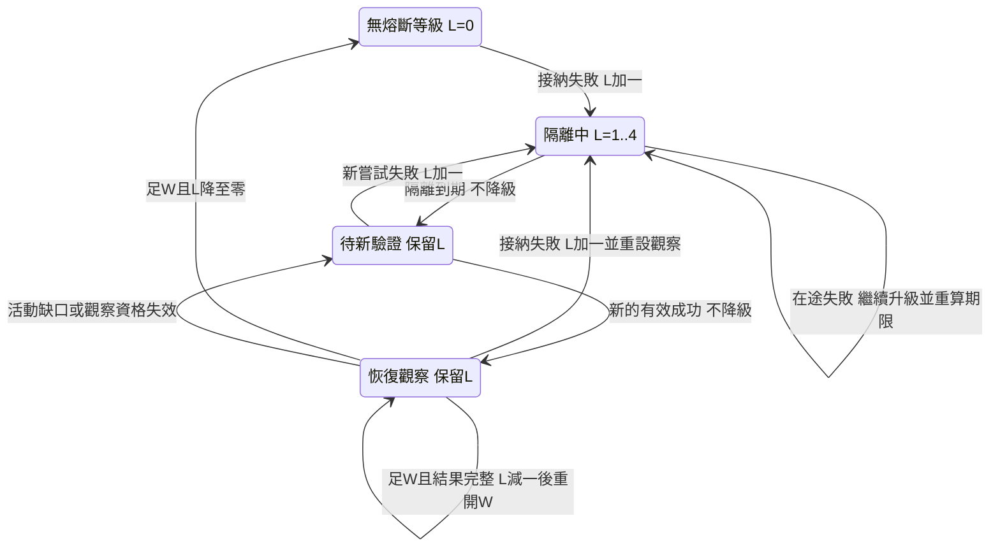
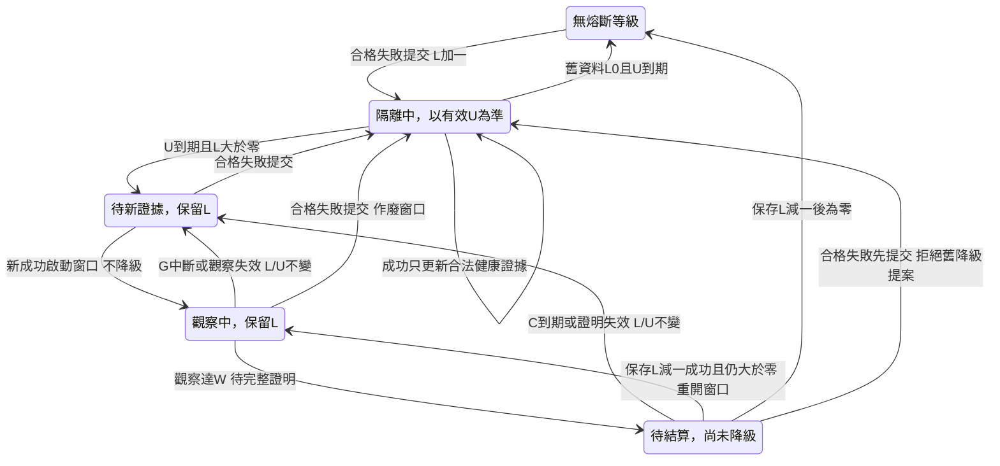

# BiliCDN_TW v2.2.10 熔斷研究 — 2026-11-05

本報告以 main `aadbc4873a1b244d51545684bc45cb5de0c75215` 凍結產品來源，研究快速隔離、升級與恢復。只保存研究及文件，不修改產品、正式測試、介面、設定、儲存格式或 Release，不提交推送、升版或發布。目前工作狀態由 [TODO](../../../docs/TODO.md) 維護，既有安裝驗收由 [TEST_REPORT](../../../docs/TEST_REPORT.md#驗收結論) 維護。

## 研究結論

最優先的方向是**保留第一次立即隔離，限制同一故障波的重複升級，並讓到期來源有受限的再驗證機會**。目前沒有足夠證據選定新的隔離分鐘數，也不建議直接把主機共享限制全面改成內容限制。

| 問題 | 本次結論 | 證據分類 |
| --- | --- | --- |
| 首次隔離 | 合格普通傳輸的 network、body、timeout、5xx 失敗可立即開啟十分鐘隔離；取消、資源拒絕及主動探測失敗走不同路徑 | 確認機制；真實產品元件的受控輸入 |
| 並行升級 | 四筆隔離開啟前已送出的請求，失敗依序提交即可升至六小時；不需要四輪新的探測或播放嘗試 | 確認機制問題；是否在現場造成損害未識別 |
| 重複與晚到 | Store 的樣本去重沒有讓熔斷更新冪等；同 request ID 直接提交兩次會升兩級。適配器另有完成一次防護，不能據此推定網站正常事件必然重複提交 | 確認內部契約缺口；正常入口可達性分開判讀 |
| 影響範圍 | 同主機、同影音類別跨內容共享；影片失敗不會直接熔斷音訊。單次本機斷線無法由目前失敗分類辨認為全域網路問題 | 確認機制；真實跨分頁時序未實測 |
| 到期恢復 | 到期不等於已有新容量證據。健康探索另有六小時年齡限制，可能錯過十分鐘到期來源；起播與自然傳輸仍可能提供其他再接納機會 | 確認健康探索路徑的限制；不是「所有恢復都要六小時」 |
| 同步一致性 | 同毫秒、亂序通知可使兩個真實 Store 的本地值倒退；相同時間戳的清除與舊通知也有反例 | 模擬通知條件下確認；真實 GM 是否產生該順序證據不足 |

三層證據中，離線契約與模型已完成；IAB 拒絕直接載入 `file:`，來源隔離沒有執行案例，因此相依的安裝版自然觀察也未啟動。這不改判既有 R3／R4 驗收，不證明本次自然觸發了熔斷。原 R3 的 `circuit-open` 排名文字仍只作線索。

## 凍結基準與證據範圍

| 項目 | 實際結果 |
| --- | --- |
| 產品 | v2.2.10；上述 main 提交；研究前工作區乾淨 |
| 工具 | Node 26.8.1、npm 11.19.0；既有鎖定依賴，沒有新增執行期依賴 |
| 發行腳本 | `Release/v2.2.10/BiliCDN_TW.user.js`，488,579 bytes；SHA-256 `361b8d22a3b62b72fc671e3c440b4b089e8d3cc96a77050baf011b2b7aa5812f` |
| 既有完整基線 | 十八套件／2,048 個展開後名稱；第一次 2,039 PASS、9 個 tooling FAIL，原因是暫存 Git fixture 的 `.git/config` 寫入權限 |
| 受限套件複核 | 在獲准的暫存 Git 權限下，tooling 203／203 PASS；名稱與原 tooling 清單完全相同。保留第一次失敗，不將兩次執行寫成單次全綠 |
| 私有元件實驗 | 38 筆結果；使用真實 domain、EvidenceStore、RouteCoordinator 等非入口元件，以及受控時鐘、記憶體儲存與通知 |
| 模型核對 | 四個送出／四個完成的 2,520 種合法八事件順序；另有主機／影音／內容分組的 2,520 種順序；合計 20,160 次轉移核對。種子 0–99 共 10,000 次混合成功／失敗核對，總計 30,160 次與正式純函式一致 |
| 政策模型 | 24 筆隔離、8 筆既有探測名額再接納、24 筆外生自然重試、240 筆播放供需結果；70 筆在觀察上限內未完成，明列 censored |
| 瀏覽器 | 來源隔離未載入、安裝版未啟動；沒有新增原生 XHR 故障、GM 提交或自然熔斷證據 |

原案例名稱、選擇器、參數展開、位置與結果保存在私有 `BASELINE.json`。關鍵字選出的 164 個名稱只是尋找契約的索引，不等於已逐一證明所有熔斷交錯均有正式案例。研究沒有新增或刪除正式案例。

## 現況流程與狀態模型

完整流程為：原生終止／串流結束 → 適配器完成一次防護 → 結果分類 → generation／epoch／授權及模式檢查 → 取得儲存鎖後再次檢查 → 讀取最新持久狀態 → 更新與寫入 → 當前資格下排除／恢復 → 到期後再接納。

| 步驟 | 定義與成立條件 | 拒絕／限制及現有契約 |
| --- | --- | --- |
| 原生終止 | [XHR](../../../src-v2/adapters/xhr-hook.ts) 的 metadata／settled 與 [Fetch](../../../src-v2/adapters/fetch-hook.ts) 的 settled 保護同工作只完成一次 | 受控提前重試的終止轉為 abort；不將自有控制取消當主機網路故障。Node 適配器套件驗證程式行為，不替代本次原生事件證據 |
| 結果分類 | [transport-result](../../../src-v2/application/routing/transport-result.ts) 分開普通失敗、Native 失效、Catalog 資源限制及忽略 | abort、未知影音及弱歸因不建立一般速度／熔斷證據；已知 4xx 不能籠統算成主機死亡 |
| 資格 | [RouteCoordinator.observe](../../../src-v2/application/route-coordinator.ts) 核對世代、內容週期、停用、authority revision 及 Catalog 觀察合法性 | 舊內容／撤銷授權拒絕；合法但失去控制所有權的舊決策仍可能保存健康證據，不能改寫當前親和 |
| 鎖與保存 | [EvidenceStore.record](../../../src-v2/state/evidence-store.ts) 在鎖內重驗 valid，讀持久最新值後計算、寫入，再替換本地快照 | 寫入拋錯不安裝新的本地 payload；有效鎖等待不等同取消。正式 [Storage](../../../src-v2/platform/storage.ts) 使用 Web Locks，缺能力時直接執行 |
| 更新 | [addEvidenceSample](../../../src-v2/domain/evidence.ts) 使用提交當下牆鐘，按主機及影音類別更新 level／until | 樣本去重與熔斷升降級是不同步驟；有界樣本集合不是冪等提交帳本 |
| 排除 | [route-restrictions](../../../src-v2/application/routing/route-restrictions.ts) 把目前 host／kind 的 circuitUntil 交給純政策 | 硬隔離以 `circuitUntil > now` 判定；排名中的舊文字不是最新持久狀態證明 |
| 到期再接納 | `evidenceMetrics` 令 `until <= now` 的既有隔離成為 revalidation；起播可保留再驗證名額，健康 challenge 另受資格限制 | 到期解除時間排除，沒有自動產生速度或主動啟動工作；健康探索的六小時條件不可當成所有路徑的期限 |

### 失敗與成功分類

| 輸入 | 現行處理 | 是否增加一般主機熔斷 |
| --- | --- | --- |
| 合格普通 network／body／timeout／5xx | 保存 failure，必要時依當前所有權重選 | 是 |
| 網站 abort／受控提前重試終止 | ignore／abort | 否 |
| Catalog 403，有 streamKey | 當前串流／主機不相容、來源主機鎖定與起播恢復等專用流程 | 否；這是既有資源處理，與已撤除的原線對照功能無關 |
| Catalog 404／410，有 streamKey | 當前資源／主機不相容及合格恢復 | 否 |
| 其他 4xx，例如 429 | request-rejected；不建立無界重試 | 否 |
| Native 精確來源失效 | 撤銷相應 Vault 來源，依資格恢復 | 否 |
| 主動 challenge 失敗 | 有界嘗試帳本及 Native 失效處理；不保存普通播放 failure | 否 |
| 未知媒體種類／弱歸因 | 不形成一般主機證據；專用資源分類的前置順序另按程式 | 否 |
| 成功但無合格速度 | 可達性樣本 | 不升級，也不靠短成功解除再驗證 |
| 合格速度成功 | 至少 64 KiB、新樣本速度有效；舊格式按既有相容規則 | level 減一；到期時清除 until，未到期時保持 until |

### 公式與狀態語意

設 `L` 為 0–4 的等級、`U` 為隔離截止牆鐘、`t_commit` 為鎖內提交時鐘：

```text
接納失敗：L' = min(4, L + 1)
          U' = t_commit + D[L']
D[1..4] = {600, 1800, 7200, 21600} 秒

合格速度成功：L' = max(0, L - 1)
              U' = 0（U <= t_commit）或 U（尚未到期）
其他成功：L' = L，U' = U

時間排除：U > now
待再驗證：U != 0 且 U <= now
```

因此 `L=0` 並不保證沒有時間隔離：隔離中的晚到合格成功可把 level 降成 0，但保留原 until。到期瞬間不再時間排除，仍須新證據，短成功不能把舊速度改成充分近期容量。

每 host／kind 最多十二筆，24 小時 TTL，恰好 TTL 有效。解析持久資料時，沒有保留樣本且該紀錄 updatedAt 已超過 TTL，才清掉舊 level／until；不能將「最新速度過期」等同「所有熔斷欄位立即歸零」。

## 六個問題的反例與覆蓋

| 編號 | 最小受控反例／結果 | 判讀及覆蓋缺口 |
| --- | --- | --- |
| C01 並行升級 | 真實 Routes 先派送 1／2／4／8 筆同主機請求，再逐筆失敗：隔離分別 10／30／360／360 分鐘，下一筆改選其他合法主機 | 確認機制問題。第一筆已隔離，後續在途失敗仍可升級、延長；沒有四輪新的外部驗證 |
| C02 重複 ID | 真實 Store 對同 ID record 兩次：最終只保留一筆樣本，level=2 | Store 缺冪等保障。Fetch／XHR 的 settle 防護仍存在；正常入口發生重複的機率未知 |
| C03 成功／期限 | 隔離中成功：level 1→0、until 不變；恰好到期：短成功仍待驗證，合格速度成功清 until | 現行規則確認，維持快速隔離的保守方向；不能只檢查 level |
| C04 鎖等待 | 有效請求等鎖 60 秒後提交，十分鐘自提交起算，距原失敗為十一分鐘；等待中失效則不寫 | 提交延遲會延後恢復時點；沒有實際 GM 鎖等待分布，不能宣稱現場延遲為 60 秒 |
| C05 同毫秒通知 | 兩個真實 Store 序列寫到 level 1、2；把通知按新→舊送至 B，B 從 2 退回 1，而持久值仍為 2 | 確認模擬通知契約缺口；真實通知可達性未知，沒有宣稱 Tampermonkey 必然亂序 |
| C06 清除交錯 | 同毫秒 clear 後再送舊通知，本地復活為 level 1、持久值仍缺；clear 晚 1 ms 時拒絕舊通知 | 清除世代／同時間戳問題，應與普通新工作分開 |
| C07 無鎖回退 | 明確安排兩個端點都讀舊值再寫，只有其中一組 host 紀錄留下 | 條件式 lost update。正常 metadata 匹配頁面同為 www.bilibili.com；不能據此指控正常同源 Web Locks 已失效 |
| C08 牆鐘 | 重載時牆鐘回退一小時：新近樣本被排除，但原十分鐘 until 尚在，看似剩七十分鐘；前進超過一天則舊紀錄過期 | 確認牆鐘敏感性；未量測真實系統跳時發生率 |
| C09 寫入／清除 | 注入 set 拋錯，本地沒有新 circuit；clear 後仍有效的在途完成可以重新保存 | 前者既有正確保障；後者為現行清除語意，不直接判成過期授權漏洞 |
| C10 老輸入 | 直接向 Store 提交超過 TTL 的 failure：樣本被剔除，仍可更新 level／until | 防禦性契約缺口；未證明端到端存在等鎖 25 小時仍有效的真實請求 |
| C11 範圍 | 同 host 的影片 X 失敗後，影片 Y 改用另一主機；同 host 音訊仍可用 | 確認跨內容共享與影音隔離；沒有將本地斷網識別成主機故障的獨立事實 |
| C12 健康再接納 | 只留下到期來源供 challenge：10 分鐘後無候選，6 小時後才選到；同輪未增加探測 | 確認六小時健康資格會壓過較短隔離；起播保留名額及自然流量仍是其他路徑 |

正式既有覆蓋包括 [domain](../../../tests-v2/suites/domain.ts) 的十分鐘／六小時上限、[v227-evidence](../../../tests-v2/regressions/v227-evidence.ts) 的到期短成功與再失敗進程、[v227-startup](../../../tests-v2/regressions/v227-startup.ts) 的到期待驗證名額，以及 [state](../../../tests-v2/suites/state.ts) 的退休 hint、較新遠端清除。普通影音失敗／轉址隔離另由 [native-routing](../../../tests-v2/suites/native-routing.ts) 與 [progressive-routing](../../../tests-v2/suites/progressive-routing.ts) 保護。

本次 C02、C05–C08、C10 的最小交錯只新增於私有研究，不冒稱正式套件已具備同等保障。故障的原生產生、真實跨分頁通知、長時間鎖與本機網路故障歸因仍有缺口。

## 候選政策與模型結果

### 固定候選與資料字典

| 候選 | 研究定義 | 尚未採用的部分 |
| --- | --- | --- |
| B0 | 每筆接納 failure 升級、從該次提交重算期限；成功沿現行降級規則 | 固定基線，逐轉移與正式函式核對 |
| B1 | 第一筆仍立即隔離；用抽象 episode／request ID 排除開啟前在途與隔離中失敗的再次升級；到期後新嘗試失敗才再升級 | episode 的持久相容、清除邊界、並行半開許可及成功歸屬尚未實作 |
| B2 | 在 B0／B1 上使用 D×0.1、D×0.5、D×1 | 敏感度，不選定新分鐘數 |
| B3 | B1 加上到期來源可競爭既有健康探測名額，不被舊證據的六小時年齡單獨排除 | 仍須滿足原健康、來源、冷卻、下載及名額限制；不是新增探測 |
| B4 | B1 先限制 content／host；60 秒內兩個不同內容失敗才擴為主機共享限制 | 「兩內容／60 秒」純研究參數，未校準；本機斷網及未知歸因不能藉此取得更大權限 |

模型逐事件只使用當時已完成的資料。播放從四筆起始失敗全部完成後才開始，不讓未來結果提前進入決策。所有合成成功均只供研究，不寫回 GM。

| 參數／指標 | 單位、來源與意義 |
| --- | --- |
| sent、completed、commit、U | 秒；合成事件時鐘，與真實持久毫秒分開換算；實際隔離公式仍使用牆鐘 |
| recoverAt | 秒；受控環境已知真值，自然觀察未知，不用缺值補成誤隔離 |
| 隔離反應 | 首筆合格 failure 終止到保存成功；模型不含真實 GM 排程延遲，只有一次轉移即隔離的邏輯保證 |
| 故障暴露 | 已派送失敗數、失敗部分 bytes；不能將被排除而未送出的請求算成成功或失敗 |
| 過度隔離 | 受控來源恢復後仍被時間排除的區間積分；簡單單區間為 max(0, U−recoverAt) |
| 恢復延遲 | 首次合法再驗證成功時間−recoverAt；未成功為未知／截尾，不填成 0 |
| 表示軌跡 | 固定 4 Mbps／30 FPS；外生 Auto 4／20／8／20 Mbps、30／60 FPS；40 Mbps／120 FPS 的 VBR 壓力軌跡 |
| 分段 | 每段四媒體秒，大小=碼率×時長÷8×外生 VBR 因子；固定因子 1，Auto 因子 1／0.6／1.8／1.2，VBR 因子 0.5／2／0.75／1.75 |
| 倍率／緩衝 | 1／2 倍，初始六媒體秒；消耗=倍率×牆鐘耗時，完成才加入四媒體秒。FPS 作軌跡標籤，不再乘入已含畫面影響的碼率 |
| 服務與成本 | 主機 A 50 Mbps、B 12 Mbps，各加 50 ms 等待；失敗耗時一秒、部分浪費假設為該段 10%；均非實測 |
| 比較界線 | 同為九十段、最多 1,200 秒觀察與 2,000 次嘗試；網站外生重送未完成段，不是腳本自行 retry。未完成結果標 censored |
| 播放代價 | 供需模型輸出停滯、換站、下載量；起播 gate 固定 0、不代表已模擬起播；沒有 RecoveryController，重載數為 null／未知 |

### 並行升級與期限敏感度

四筆起始請求在 1、1.01、1.02、1.03 秒失敗，真實恢復時間固定 2 秒：

| 政策 | 最終等級 | 隔離截止（秒） | 恢復後時間排除（秒） |
| --- | --- | --- | --- |
| B0 | 4 | 21,601.03 | 21,599.03 |
| B1 | 1 | 601 | 599 |
| B2：B0×0.1 | 4 | 2,161.03 | 2,159.03 |
| B2：B1×0.1 | 1 | 61 | 59 |

這證明 B1 在同波反例中保留第一次隔離，又避免把同波四筆失敗解讀成四次重新失敗；沒有證明 1 分鐘或 10 分鐘適合所有真實故障。

再固定網站每 60 秒有一次自然請求機會，沒有增加腳本探測或重送：

| 真實恢復時間 | B0：延遲／失敗數 | B1：延遲／失敗數 | B1×0.1：延遲／失敗數 |
| --- | --- | --- | --- |
| 2 秒 | 21,658.1 秒／4 | 658.1 秒／4 | 118.1 秒／4 |
| 1,200 秒 | 20,460.1 秒／4 | 1,320.1 秒／5 | 2,160.1 秒／7 |
| 7,200 秒 | 14,460.1 秒／4 | 2,580.1 秒／6 | 600.1 秒／9 |

中間一列是重要反例：更短隔離因再次失敗、升級與外生請求相位，反而比 B1 恢復更晚，且多兩筆失敗。不能只挑瞬斷場景決定新期限。

### 到期名額與範圍

在第一筆失敗後，既有健康名額每十分鐘出現一次，來源於第 2 秒恢復：保留六小時年齡條件的模型到 21,601.1 秒才驗證；B3 在 601.1 秒驗證，兩者各只用一筆探測。這是固定名額子模型，加上真實 Routes 的 C12 支持，不是完整 MeasurementController／網站閉環的實測收益。

B4 可讓內容 X 專屬故障不先排除 Y，但主機真的整體故障時，Y 會多承受驗證失敗。兩內容門檻也不能自動區分「主機故障」與「本機斷線」。依快速隔離優先，不建議此時全面採用 B4。

### 播放代價與未識別部分

240 筆包含瞬斷、持續 A 故障、全主機故障、內容局部故障及復發，分開固定表示與外生 Auto。70 筆未完成，不計入全量完成平均，也不把未觀察來源的缺值算成失敗。

一個反例是 40 Mbps VBR、2 倍、瞬斷後切到 B：即使 B1／較短期限讓 A 提早解除隔離，模型仍沿用健康 B，因此 B0、B1、B1×0.1 均只完成 72／90 段、約 1,058.6 秒停滯並截尾。**解除隔離更早不保證播放變好**，因健康親和與回切政策是另一個因素。

模型不重建網站 ABR、不估計解碼率、不包含真實重載控制，也沒有足夠外部故障資料校準分布。其停滯及下載數只證明列明條件下的供需計算，不能作真實 Auto、恢復控制或換站效益的通過結論。

## 來源隔離與安裝版執行情況

來源隔離準備使用非入口產品元件、獨立記憶體 StoragePort、CSP `connect-src 'none'` 的本機 HTML，不接 GM 學習、不播放媒體。私有觀察器為固定 20,000 列、90 秒截止、增量游標、ID 代碼化及清理；離線 VM 已核對截止排除、續讀、穩定代碼、停止冪等、計時器釋放，以及兩個執行作用域共享同一 document registry。這不能替代 IAB 校準。

2026-11-05 22:54:35.650（Asia/Taipei）開始來源能力檢查。IAB 明確拒絕 `file:`，只允許 http／https，並禁止以替代路徑繞過。自有 HTML 未載入、案例未執行。失敗導覽留下的自有 about:blank 已關閉，37.037 秒內完成清理，IAB 自有分頁清單為空。

依計畫停止該層；不啟動本機服務、其他瀏覽器或間接替代載入。安裝版所需的觀察器作用域／續讀／清理前提未建立，故十五分鐘自然觀察輪次沒有開始，也沒有為等自然故障反覆導覽。沒有本次來源隔離的原生 Abort／ReadableStream／XHR 結論，沒有新增管理器、本體、singleton、hooks 或自然 GM 保存證據。

沒有注入故障、修改 timeout、固定 CDN、清除學習、設定更動、預算重設或播放，因此也沒有待復原的媒體／設定；未安裝瀏覽器觀察點、計時器或攔截。真正雙分頁即時同步依單一 IAB 限制未執行，雙 Store 模型不冒稱 Tampermonkey 跨分頁實測。

## 開源機制比較

| 參考 | 可借鑑機制 | 本專案取捨 |
| --- | --- | --- |
| [Resilience4j CircuitBreaker](https://resilience4j.readme.io/docs/circuitbreaker) | 明確的閉合／開啟／受限半開狀態、滑動樣本及最小樣本條件 | 借鑑 episode 與受限再驗證；不移植「累積多次才首次隔離」作新預設 |
| [Envoy Outlier detection](https://www.envoyproxy.io/docs/envoy/latest/intro/arch_overview/upstream/outlier) | 分開本地／上游錯誤，明確隔離範圍，區分主動健康與資料面成功 | 瀏覽器缺少伺服器端網路視角，不能用一次 network error 證明主機全域死亡；保留現行資源專用 4xx 分類 |
| [Polly Circuit breaker](https://www.pollydocs.org/strategies/circuit-breaker.html) | 樣本門檻、隔離時間與受限恢復；熔斷不等於重試 | 新名額只能替換既有預算，不能藉研究擴張重送或探測 |
| [W3C Web Locks 草案](https://www.w3.org/TR/web-locks/) | 同源資源鎖協調多個執行脈絡 | 只支持正常同源鎖的設計依據，不證明 GM 通知全序；無鎖退路另列條件式風險 |

以上為 2026-11-05 讀取的一手文件，沒有直接採用其伺服器預設值、失敗比例或秒數；未從 Tampermonkey 文件取得足以排除本次同時間戳／亂序模型的通知順序保證。

## 後續優化順序與相容影響

| 順序／建議 | 可減少的負擔／代價 | 風險及相容影響 | 後續必要驗證 |
| --- | --- | --- | --- |
| 1．提交冪等、單調版本與清除世代 | 防止同請求重複升級、本地通知倒退及清除後舊通知復活 | 新 revision／tombstone／有界提交 ID 的位置及舊 schema 讀取要另定；不能用無界集合補洞 | C02、C05–C07、同毫秒、亂序、清除、跨 Store、寫入失敗與鎖等待；適配器只完成一次仍保持 |
| 2．B1 每隔離輪只升一次 | 首次隔離速度保持，避免同波在途失敗把十分鐘推至六小時 | 必須識別隔離前送出、到期再驗證許可及成功所屬輪；晚到成功不能錯誤復活半開資格 | 1／2／4／8 並行、重複 ID、逆序成功／失敗、兩主機、影音、換片、授權失效；原生取消不懲罰 |
| 3．B3 到期待驗證優先權 | 消除健康資格與短隔離期限不一致的等待 | 必須替換既有名額；不能突破穩定播放條件、冷卻、候選數、Native 精確授權或下載上限 | 健康探索與起播分開；名額不足、全失敗、短成功不解除、合格成功不搶親和；主動探測失敗仍不得默默升格成播放熔斷 |
| 4．時間異常與過老輸入防護 | 限制跳時、過老失敗產生新期限的反直覺結果 | 持久跨分頁 TTL 仍需牆鐘；單調時鐘不能直接持久比較，真實故障不應被任意抹除 | C04、C08、C10；回退／前進、重載與跨分頁、提交時間與觀察時間分開 |
| 延後．B2 調短期限 | 瞬斷可更早再試 | 反例顯示可能增加暴露並延後恢復，尚無可採用的新期限 | 多種恢復分布及外生請求相位，逐項報告暴露、期限與恢復，不設掩蓋退步的綜合分數 |
| 延後．B4 範圍分層 | 減少內容局部故障波及其他內容 | 主機真的故障會增加其他內容暴露；未知歸因與本機斷線仍難辨識；新增內容索引也有記憶體／隱私負擔 | 真實故障分類、兩內容與共同斷網、影音分離、來源撤銷；未識別真值不得稱誤隔離 |
| 維持．4xx／取消分類與資源上限 | 保留已確認的隔離邊界及控制所有權 | 不因 B1–B4 重新擴張授權、探測、重載或傳輸重播 | 原十八套件及有效斷言、精確 Native、政策／授權撤銷、清理及晚到工作 |

此排序依「授權及隔離正確 → 快速隔離與暴露 → 播放代價 → 過度隔離及恢復延遲」，沒有任意加權總分。上述均為後續方案建議，不是已採用產品規則；持久欄位、公開內部介面或版本發布如需變更，另立實作方案。

## 原始數字與重現索引

私有研究目錄：`.work/circuit-research-2026-11-05/`。正式工具不匯入該目錄；本次也未匯入網站 bundle、歷史產品或正式 GM 資料。

| 檔案 | 用途 |
| --- | --- |
| `baseline.mts`、`BASELINE.json`、`BASELINE_FAILURES.json` | 原十八套件、2,048 案與首次環境失敗 |
| `tooling-baseline.mts`、`TOOLING_BASELINE_RECHECK.json` | 相同 203 案的權限修正複核，不覆寫首次結果 |
| `experiments.ts`、`run.mjs`、`EXPERIMENTS.json` | 38 筆真實非入口元件／受控記憶體輸入 |
| `build-domain.mjs`、`models.mjs`、`MODELS.json` | B0–B4、合法交錯、種子與固定場景；逐步核對正式純函式 |
| `collector.js`、`prepare-observer.mjs`、`OBSERVER_PREPARE.json` | 私有有界觀察方法、六個來源位置與離線校準；未安裝於網站 |
| `build-source.mjs`、`source.html`、`source.js` | 準備好的無網路來源隔離；未在 IAB 執行，準備成功不算驗證成功 |
| `BROWSER_RESULT.json` | 協定拒絕、37.037 秒清理與相依自然輪次未執行 |
| `COVERAGE.json` | 原案例名稱的關鍵字索引，不是完整語意覆蓋證明 |
| `audit.mjs`、`AUDIT.json` | 名稱／數量、模型邊界與私有檔案 SHA-256 索引；不含真實簽名請求 |

重現使用鎖定 Node，依序執行 `run.mjs`、`build-domain.mjs`、`models.mjs`、`prepare-observer.mjs`、`build-source.mjs`、`audit.mjs`；這些命令只作本機計算／封裝，不啟動網站服務。瀏覽器拒絕紀錄是當次實際結果，不由重跑程式生成新的實測。

文件登記、追加日誌及 docs／archive／差異核對由本次維護記錄保存。未執行新的完整 verify、安全掃描、安裝驗收或公開發行；現有產品與原驗收判定保持。

## 交付核對

2026-11-05 文件檢查通過，273 份 Markdown／4,046 個連結／568 個保護項目，零 findings；外部網址及既有私有證據不由該檢查器連線驗證。封存檢查 484 項、零 findings。`git diff --check`、原三份日誌完整前綴、舊文件保護基準及正式腳本原始大小／SHA-256 核對通過。變更範圍僅本報告、導覽、文件清單、TODO 與追加日誌；HEAD 不變，不提交推送。

模型成本另作明確界定：起始四筆在途失敗是固定前置輸入，只計已知失敗筆數；其 bytes 未識別，不含在 `extraBytes`。該欄只累計播放模型後續失敗的假設部分下載，因此不是整個窗口的實際總浪費量。整個模型沒有真實網站、原生錯誤或解碼測量，其改善數字維持合成場景結論。

## 後續討論與熔斷狀態機逐入口盤點

使用者不將同波升級本身視為問題。原文 C01 的「確認機制問題」描述已確認的升級機制，但沒有實機損害證據支持將它直接判成產品缺陷；B1 現保留為政策取捨候選，不再預設必須採用。隔離多久與到期驗證如何配合仍值得研究，尚未決定替代數字。本次補充只追查現行程式與核算轉移，不恢復瀏覽器工作或修改產品。

### 全部寫入入口

重新搜尋正式來源的 `circuitLevel`、`circuitUntil`、`evidence.record` 及 `addEvidenceSample`，結果如下：

| 入口 | 能否增加持久等級 | 原因 |
| --- | --- | --- |
| `RouteCoordinator.observe()` → `EvidenceStore.record()` | 能；僅通過分類及資格的普通傳輸 failure | 正式失敗升級接線只有這一條；成功也由此保存 |
| `recordStartupSuccess()` → `EvidenceStore.record()` | 不能 | 只接成功；不足 64 KiB、耗時不合法或速度資格無效時先拒絕 |
| `recordChallenge()` → `EvidenceStore.record()` | 不能 | failure 先返回；Native 失效可撤銷 Vault 來源，但不增加主機熔斷 |
| `startupCapacity()` → `addEvidenceSample()` | 不能 | 當次純預覽，沒有 Store 寫入，不提交熔斷狀態 |
| Store 初次解析／遠端通知／合併 | 可載入另一個已提交值，但不是本地新 failure 升級 | 載入保留或過期的資料，通知按 updatedAt 接納；條件式亂序反例沿用 C05／C06 |
| `clearLearning()` → `EvidenceStore.clear()` | 清除 | 清除全部學習；只重設設定或換片不呼叫 EvidenceStore.clear |

底層 `addEvidenceSample()` 本身只看 `sample.outcome === 'failure'`，沒有最小失敗 bytes、連續失敗次數、失敗比例或「隔離中不可升級」門檻。正式入口的分類負責把不應懲罰主機的結果擋在它之前。

### 什麼原生事件能到達升級

| 實際事件／結果 | 分類與後果 |
| --- | --- |
| XHR `error` | network failure；合格即可增加一級 |
| XHR 網站原生 `timeout` | timeout failure；合格即可增加一級。若是有效提前重試動作所擁有的 timeout，適配器改記 abort，排除升級 |
| Fetch 原生呼叫拒絕 | signal 已 aborted 或 DOMException AbortError 時為 abort；其餘由接線記 network failure |
| Fetch 網站消費串流時 `reader.read()` 拋錯 | signal 已 aborted 時為 abort；其餘為 body failure，仍須通過狀態碼等後續分類 |
| 一般媒體回應 `status >= 500` | `responseFailure()` 記 http-5xx。程式實際條件是大於等於 500，不只字面 500–599；`native-signed` 的 403／451／959 先走 Native 失效例外 |
| Fetch 有 body 的 HTTP 錯誤 | 在既有串流讀取結束／錯誤處才提交，不是剛收到標頭就必然提交；取消讀取仍按 abort |

全部普通 failure 都還必須滿足：generation／epoch 與 Session 相同、Session 未停用、有適用的表示與 authority revision 時核對仍相同、能取得 host、影音種類已知，且存在 request 時 attributionStatus 為 matched。Catalog-only 另外要求 Catalog 目標及相符回應主機，或無回應主機的失敗。取得儲存鎖後再驗資格，讀最新持久值，寫入成功才成為該次已保存狀態。

這個證據提交資格不等於 `controlsCurrent()`。在相同有效內容／授權下，舊主機、舊路線或舊表示的在途完成，仍可更新主機健康；它們沒有因此取得目前親和、確認表示或恢復控制權。所以「已經換到別台 CDN」不代表舊請求後續失敗不會升級。

### 明確不升級的事件

- 網站 abort、Fetch 串流 cancel、Fetch 的 AbortError，以及受控提前重試終止。
- XHR 原生 send 在被接受前拋例外；接線以本地錯誤／abort 釋放，不算 CDN 網路失敗。
- Catalog 有資源識別的 403、404、410：走資源／主機不相容與合格恢復；Native 精確來源的專用失效走 Vault 撤銷；其他 4xx 為請求拒絕。它們不是一般主機 failure。
- 起播與健康探測的失敗、探測逾時、候選用盡、沒有足速節點。
- 單純吞吐不足、缺值、量測標頭矛盾或速度樣本不合格；不合格成功不取得速度降級資格，也不自動變成 failure。
- 單純低緩衝、停滯、播放器錯誤、SDK 重載或換站決策；後續普通請求真的失敗，才按該請求另外判定。
- 不認得影音、歸因未匹配、已換內容或授權失效，以及鎖等待後資格不成立。

### 三種時間狀態與等級的完整轉移

以下只看熔斷時間排除；黑名單、dead、使用者關閉節點等仍可另外禁止來源。設 `L` 為目前等級、`U` 為截止、`t` 為本次鎖內處理時鐘，`D={10 分鐘、30 分鐘、2 小時、6 小時}`。

| 時間狀態 | 事件 | 等級／期限與下一狀態 |
| --- | --- | --- |
| 未被時間隔離：U=0 | 接納 failure | L'=min(4,L+1)，U'=t+D[L']；進入隔離 |
| 隔離中：U>t | 接納 failure | 同一公式，不要求隔離先到期；仍隔離 |
| 到期待驗證：0<U<=t | 接納 failure | 同一公式；保留的舊 L 繼續升級，重新隔離 |
| U=0 | 合格速度成功 | L'=max(0,L−1)，U 保持 0 |
| U>t | 合格速度成功 | L'=max(0,L−1)，U 保持原截止；仍隔離 |
| 0<U<=t | 合格速度成功 | L'=max(0,L−1)，U'=0；解除待驗證標記，但 L 不必為 0 |
| 任何狀態 | 只有可達性的短成功／速度缺值成功 | L、U 都不變 |
| U>t | 牆鐘到達 U | 讀取時視為到期待驗證；不主動改 L、不寫入、不自行啟動探測 |
| 任何狀態 | 取消、拒絕歸因、失效或未被接納的結果 | 不執行本次熔斷轉移 |

合格速度成功的數值門檻是有效正數速度與適用的 64 KiB 規則，**不要求達到播放需求**；歷史無 bytes 的合法舊樣本按相容規則。因此「成功降級」與「來源已足速」是兩個不同判斷。

L 與 U 不是同一狀態欄位：L=0 仍可處於隔離，U=0 也可保留 L>0。恰好到期便不再由時間熔斷排除；到期本身不把下次失敗重設為十分鐘。現行沒有獨立的 half-open 許可狀態或每輪只升一次帳本，不能將這些候選設計當成既有保障。

### 期限覆寫交錯的補充核算

以正式 domain 純函式另外完成三種時間狀態×三種結果的九筆轉移，以及一筆成功／失敗交錯，共十筆私有核算，結果保存 `STATE_MACHINE_AUDIT.json`，程式為 `state-machine-audit.mjs`。

新增交錯：10:00 為 L4、U=16:00；10:01／10:02／10:03 三筆仍有效的晚到合格速度成功，令 L 依序降至 1，但 U 仍為 16:00。10:04 再接納失敗，L 升為 2，U 覆寫為 10:34。**因此失敗並非在所有交錯下都延長舊截止**；先前對話「截止會持續往後推」只適用等級未先被成功降低等前提，精確規則始終是 t+D[L']，不是 max(舊U,t+D[L'])。

### 持久化、同步與獨立限制

熔斷按 `host + video/audio` 共用，跨影片、表示與分頁沿用，影音分開。換片或設定重設只清當前工作／路線，不清持久 Evidence。一般持久紀錄解析在沒有保留樣本、且 updatedAt 已超過 24 小時時清掉 L／U；日常 get 或 UI 讀取不替它建立清理工作。有限主機容量淘汰與資料解析也可讓舊紀錄不再保留。

遠端通知可把已保存的更高／較低等級帶到本分頁，即使本分頁沒有新失敗；這不是本分頁重新計算一次升級。通知的同時間戳、清除及無鎖回退限制仍依原 C05–C09，真實雙分頁未執行。

黑名單、dead、Catalog 開關、資源不相容與熔斷互相獨立；時間到期或成功降級不會解除其他禁止，第四級也不會自動轉成永久黑名單。排名的 `circuit-open` 還可由 watchdog／verified-failure 的當次 failedHost 暫時排除產生；看到這個文字不等於 Store 剛完成升級。

## 2026-11-06 降級速度的假設情境推演

依使用者對成功次數降級的疑慮，使用現行 EvidenceStore、domain 與獨立記憶體 StoragePort，另執行十三組情境：七組主要情境與六種兩成功／兩失敗的完成順序。固定 main aadbc48，全部斷言通過；原始輸入、每步 L／U、來源 SHA-256 與假設保存於私有 `DOWNGRADE_SCENARIOS_2026-11-06.json`，重現入口為 `run-downgrade-2026-11-06.mjs`。這是直接提供已分類／授權輸入的儲存與純政策推演，不是原生網站請求或完整 Routes 端到端實測。

所有主要案例使用不同請求 ID，同一主機的 video 紀錄，假設上游世代、授權與歸因檢查均通過。沒有使用重複提交製造快速降級，不增加網站流量、探測、重試或預算。表中時間是 2026-11-06 Asia/Taipei 的合成事件時鐘，不是實際觀察時間。

### A：到期後四筆新成功，可以數秒內消除等級

初始 10:00 為 L4，截止 16:00；假設網站到期後自然送出四筆不同請求，各成功交付 1 MiB／100 ms。

| 事件時間 | 事件 | 新等級 | 隔離截止 |
| --- | --- | --- | --- |
| 16:00:00 | 時間到期 | 4 | 16:00，待驗證 |
| 16:00:01 | 第一筆有效速度成功 | 3 | 清除 |
| 16:00:02 | 第二筆有效速度成功 | 2 | 無 |
| 16:00:03 | 第三筆有效速度成功 | 1 | 無 |
| 16:00:04 | 第四筆有效速度成功 | 0 | 無 |
| 16:00:05 | 新的合格失敗 | 1 | 16:10:05 |

四秒內完成 4→0；若同樣四筆成功分散在 16:00:01、16:10:01、16:20:01、16:30:01，等級序列仍完全相同。另一組四筆同時呼叫 Store、共用同一合成牆鐘值的不同 ID 成功，在模擬共享鎖內依序提交為 3→2→1→0。這證明現行降級沒有最低穩定時間或每輪降級上限；不證明實際網站會在該時點送出四筆指定主機請求。

### B：隔離前的晚到成功，也可以先消除等級

初始仍為 10:00 的 L4、U=16:00。另有四筆在 09:59:55 已送出的請求，於 10:00:01–04 合法成功；再有一筆同樣先前送出的請求於 10:00:05 失敗。全部工作保持相同有效內容與授權。

| 事件 | 等級 | 截止 |
| --- | --- | --- |
| 原隔離 | 4 | 16:00 |
| 四筆晚到有效速度成功 | 3→2→1→0 | 每一步仍保留 16:00 |
| 隨後在途失敗 | 1 | 覆寫成 10:10:05 |

成功本身沒有提前放行原隔離；下一筆失敗才因低等級覆寫成較短期限。這些成功沒有證明「隔離後的新流量已穩定恢復」，但它們確實是合法傳輸成功，與在途失敗同樣具有證據價值。若希望恢復信用必須來自隔離後的新嘗試，須另立非對稱恢復政策，不能把它當成現行規則。

### C：成功一筆、失敗一筆，可以反覆停留第一級

10:00 首次失敗為 L1，截止 10:10。每次到期後，網站有一筆有效速度成功，接著另一筆普通傳輸失敗：

```text
L1 → 等待十分鐘 → 成功降為 L0 → 失敗升為 L1
   → 再等十分鐘 → 成功降為 L0 → 失敗升為 L1
   → 再等十分鐘 → 成功降為 L0 → 失敗升為 L1
```

實際輸入保留毫秒：第一次成功 10:10:00.100、失敗 10:10:00.200；第二輪 10:20:00.300／.400；第三輪 10:30:00.500／.600，最終截止 10:40:00.600。這個模式可沿相同規則延續，並非「累計幾輪反覆故障就必然升至六小時」。它適合快速恢復信用，但不表達跨輪持續不穩定的額外記憶。

### D／E：成功門檻會使兩種結果差很多

| 條件 | 四筆成功後 | 下一筆失敗 |
| --- | --- | --- |
| 每筆 64 KiB、耗時 2 秒，吞吐 0.262144 Mbps | 到期後 L4→0 | L1，十分鐘 |
| 每筆 32 KiB，沒有有效速度資格 | L4 不變，保留待驗證 | L4，六小時 |

若假設影片碼率 4 Mbps、2 倍、25% 裕度，需求為 10 Mbps，第一種成功速度遠低於需求，仍能降級。它證明降級只要求合格速度成功，不要求足速；熔斷的傳輸可靠性與排名的容量判定是不同維度，低速成功本身不能直接定性為錯誤。兩組沒有改動 64 KiB 門檻、測速預算或播放政策。

### 完成順序與適用結論

初始 L4，於到期後同一批已送出的四筆請求，固定兩成功 S、兩失敗 F，列舉六個完成順序。每秒提交一次；成功有效、ID 不同。

| 完成順序 | 最後等級 | 最後截止 |
| --- | --- | --- |
| SSFF | 4 | 22:00:04 |
| SFSF | 4 | 22:00:04 |
| SFFS | 3 | 22:00:03 |
| FSSF | 3 | 18:00:04 |
| FSFS | 3 | 22:00:03 |
| FFSS | 2 | 22:00:02 |

因 0／4 級邊界、成功保留未到期截止及失敗覆寫，結果會依實際完成順序不同；給定相同順序時結果確定，不是隨機狀態。不能只用整段成功率重建終態。

本次可確認：降級沒有穩定時間門檻、沒有要求成功屬於隔離後新嘗試，也沒有每輪降級一次限制。若產品政策是「故障快速隔離、恢復信用需持續穩定」，現行每筆成功減一的規則不保證該目標。若接受按請求對稱加減，它也有一致的解釋；「過快」仍是恢復政策選擇，未由本次模型識別真實播放損害。

後續可研究隔離後成功資格、持續穩定時間及每輪信用恢復幅度，並把「是否允許傳輸」與「保留多久的故障等級」分開設計；本次不選新數值、不修改程式、不提交推送或發布。沒有新的瀏覽器窗口，也未恢復先前受限方法。

## 2026-11-06 無失敗觀察期的候選狀態機

依使用者提出「一段時間內不再失敗才降級」，建立研究用替代政策。此節描述候選，與前文現行每筆成功減一不同；沒有修改產品、正式測試、設定或版本。推演保留同波失敗可以升級及原四級隔離時長，不預設 B1。

### 先界定無失敗的意義

單純計算「距最後一次失敗多久」，會把隔離期間沒有請求、切走主機或長時間閒置也算成恢復。研究採較保守解釋：**隔離後已有合法新嘗試成功，且一段有足夠近期成功觀察的期間沒有接納失敗，才降一級**。成功觀察不等同已識別真實服務狀態；仍受傳輸歸因與工具能力限制。

定義 `W` 為每級恢復所需觀察跨度，`G` 為合格成功回應的最大容許間隔。本次算例 `W=300 秒`、`G=60 秒`，只用於檢查狀態轉移，不是已採用或已校準的參數。正常填滿緩衝後的請求靜默也可能超過 G，因此 G 必須另按自然請求節奏評估；超過 G 只中斷恢復信用，不算來源失敗。

有效成功沿用適用的 64 KiB／有效正數速度語意，不額外要求足速；可達性與播放容量分開。無請求、取消、短成功、未知或失效結果不提供新恢復信用。隔離前的在途成功可保存合法健康資料，但不開始本輪降級；仍有效的在途失敗照原政策接納。

### 四個狀態與完整轉移



| 事件／條件 | 控制轉移 |
| --- | --- |
| 任何狀態接納普通傳輸 failure | L'=min(4,L+1)，U'=提交時間+D[L']；進入隔離、清除觀察期並更新失敗修訂。取消、4xx 專用處理及主動探測失敗不變成這種 failure |
| 隔離中成功 | 不降級、不提前清 U，不給本輪觀察信用；資料合法時仍可更新健康證據 |
| 隔離期限到達 | 保留 L，轉待驗證；不主動新增探測或重送，不直接判定健康 |
| 待驗證取得第一筆合格新成功 | 清除已到期的 U、保留 L，從成功接納時間開始 W；之後可依既有授權及選路正常使用，不必等 L 歸零 |
| 觀察中新的合格成功 | 更新近期成功時間，沒有滿 W 就不降級；仍不採計最新失敗邊界前送出或舊修訂的成功 |
| 觀察跨度滿 W、成功間隔均不超過 G，且截至窗口截止前已送出的有效工作沒有未知結果 | 只降一級；L>0 從本次提交重新開始下一個 W，L=0 回無熔斷等級。單次事件不補發多級信用 |
| 到 W 仍有截止前的有效請求未結案 | 保留觀察及等級、標示等待結果；其中任一失敗照常升級。截止後新派送的正常流水線請求不阻擋這個已凍結窗口 |
| 合格成功間隔超過 G、暫停／切換導致觀察失效、無法確認時間年齡 | 丟棄本輪未完成觀察，保留 L；下一個合格新成功重新開始 W，不把閒置折算成多級恢復 |
| 取消、短成功、失效或重複終止 | 不提供信用、不另懲罰；移除已知未決工作後，只有既已滿足完整窗口條件才可結算 |
| 使用者清除學習／既有歷史資料過期政策生效 | 回到無歷史 L0，是獨立清理原因，不宣稱通過穩定觀察。仍有效的在途失敗之後可以重新形成 L1 |

此處「新嘗試」至少要求在最近失敗所屬隔離到期後送出，且修訂有效；每次降級後下一個窗口以新提交邊界為準，舊完成不能重用。外層仍先核對目前內容、授權、模式與影音歸因，不擴張 Native 精確來源或主動測速能力。

窗口完整性不要求所有後續請求永遠都清空，而是在固定截止點凍結當時已送出的工作界線。否則持續播放的流水線永遠有新在途請求，可能永遠不能降級。長本文／未消費完的 Fetch 仍可延後信用結算，這是保守代價；它不延長已解除的時間隔離，也不阻止其他正常播放。

### 具體推演

假設合成時間從 10:00 開始，原 L4、U=16:00；每分鐘有一筆符合資格的自然成功，沒有增加腳本探測。

| 時間 | 事件 | L | 時間隔離 |
| --- | --- | --- | --- |
| 16:00:00 | 到期 | 4 | 已到期，待驗證 |
| 16:00:01 | 第一筆新成功，開始觀察 | 4 | 清除；可依正常政策使用 |
| 16:05:01 | 第一段完整五分鐘無失敗 | 3 | 無 |
| 16:10:01 | 第二段完整五分鐘無失敗 | 2 | 無 |
| 16:15:01 | 第三段完整五分鐘無失敗 | 1 | 無 |
| 16:20:01 | 第四段完整五分鐘無失敗 | 0 | 無 |

如果在 16:05:00，也就是第一段滿期前一秒發生合格失敗，L 仍為 4，重新隔離到 22:05:00。如果先於 16:05:01 降至 L3、在 16:05:02 才有新失敗，則升回 L4，截止 22:05:02。符合一個完整窗口後才恢復一級，不保證下一秒永不失敗。

同樣的四筆新成功集中在 16:00:01–04，候選仍為 L4；16:00:05 再失敗為 L4、截止 22:00:05。對照前節現行規則，同樣事件會先降至 0，再升 L1、截止 16:10:05；這是相同短事件前綴的政策差異，不是實測播放效益。

原 L1 且每次到期只成功一筆、隨即在 W 前失敗時：

| 輪次 | 到期後一筆成功 | 接著失敗 | 新隔離 |
| --- | --- | --- | --- |
| 1 | 保留 L1，開始觀察 | L2 | 30 分鐘 |
| 2 | 保留 L2，開始觀察 | L3 | 2 小時 |
| 3 | 保留 L3，開始觀察 | L4 | 6 小時 |

若第一筆成功後不再有請求，等級不下降；返回時重新觀察。若一直有成功但間隔每次都超過 G，也不累積為連續 W。這會比按成功次數恢復慢，並可能讓低頻使用的主機長期保留較高故障等級；來源仍可在 U 解除後依法使用，較高 L 只影響下一次失敗的處罰。是否接受這個取捨及 G 的值，尚未決策。

窗口截止的競態另推演：原 L1，在觀察截止前已送出一成功 S、一失敗 F；兩者同時點交回。S 先返回時因 F 未決不降級，接著 F 升 L2；F 先返回則直接升 L2，S 的舊修訂不提供信用。兩個順序均為 L2／三十分鐘隔離。若失敗請求是在窗口結算後才新送出，它按已恢復後的等級處理，不能用未來故障倒推抹除已完成窗口。

### 覆蓋、狀態資料及未實作部分

研究程式 `quiet-recovery-model-2026-11-06.mjs`、原始結果 `QUIET_RECOVERY_MODEL_2026-11-06.json` 及執行輸出均位於同一私有研究目錄。二十九組具名情境及固定種子 0–99、合計 20,000 個模型步驟的狀態不變量檢查通過。包含 W／G 邊界、晚到成功、隔離中失敗、到期首筆失敗、單成功後再失敗、閒置、短成功、取消、觀察失效、未決窗口、截止順序、並行結案只降一級、長等待不補發多級、資料清理及主機／影音隔離。

首輪私有支架曾因先建立長等待請求、使成功間隔超過 G，導致支架預期的觀察窗口已中斷；已修正情境順序，補足該段既定成功前置後完整執行。它不是產品失敗，原 G 邊界與未知不得當成功的條件沒有放寬。

候選只保留目前 L／U、觀察起點／固定截止／最近成功、失敗修訂及既有在途工作界線，不需要產品事件歷程或診斷錄製。正式實作還必須決定有界去重、共同鎖內的單次窗口提交、跨分頁同一窗口修訂、單調時間與持久牆鐘的分工，以及重新載入後不能重建的觀察期如何撤銷；不能讓多分頁各自降一級。研究原型使用單一合成時鐘與單一邏輯狀態，未驗證真實 GM 同步或真實跨時鐘重建。範例研究集合與 trace 不作正式儲存設計。

現有 24 小時歷史過期仍是獨立清理政策：只有符合既有解析條件才失去歷史，不算通過 W。若後續要求「故障等級只能經穩定觀察消除」，便須另外調整這條清零路徑；本次不默默改變其語意，也不新增資料遷移。

閉合／開啟／到期後受限驗證的區分可參考 [Resilience4j](https://resilience4j.readme.io/docs/circuitbreaker)；[Polly](https://www.pollydocs.org/strategies/circuit-breaker.html) 也將隔離與後續驗證分開，熔斷本身不替代 retry。此處逐級 W、活動 G 與截止前未決工作規則是本研究候選，沒有宣稱來自它們的預設值。所有結論只證明列明事件下的確定轉移，不宣稱現場效益已驗證。

最終補充將「觀察信用失效」與「傳輸授權失效」明確分開：暫停、活動缺口或切走主機只撤銷觀察，仍有效的在途 failure 必須照原政策升級；換內容／授權真的失效時才拒絕舊 failure。研究原型早期把兩種失效一起撤銷，已分離並加入兩個反向案例，沒有修改產品。上述二十九組為前一檢查點，最終完整重跑為**三十一組具名情境與 20,000 個模型步驟通過**。原型與結果保留觀察修訂、傳輸 valid 條件及不同結局，不能以「只中斷觀察」掩蓋應接納的失敗。

## 2026-11-06 觀察期的啟動中斷與結算邊界

使用者指出「五分鐘內有成功」不足以形成可實作規格。本節補充可執行語意與工程落點；前節三十一組只驗證當時模型定義，不能證明參數合理或正式實作已準備完成。本節仍是候選研究，不修改產品、正式測試、schema、設定、版本或 Release，不提交推送。

### 直接回答兩個無成功情境

| 情境 | 明確結果 |
| --- | --- |
| 到期後五分鐘完全沒有合格成功，也沒有失敗 | 還沒有資格開始觀察；進度為零、等級保留，不額外隔離 |
| 第一筆請求下載五分鐘仍未完成 | 仍是未知，不是成功；沒有先前成功時不開始觀察 |
| 上述首筆長請求第 301 秒才合法成功 | 從成功接納的第 301 秒開始，候選截止第 601 秒；不倒推送出時間給信用 |
| 只有第 0 秒成功，之後五分鐘無成功或失敗 | 成功缺口超過 G 時，本輪觀察不再有效；五分鐘時進度仍為零，等級不變 |
| 第 0 秒與第 300 秒各成功一次，中間都沒有結果 | 間隔超過 G；第二筆若為中斷後新送出的請求，只能開新窗口，不能替舊窗口結算 |
| 舊窗口的一筆長請求在中斷後才成功 | 合法健康證據可保存；不能復活已作廢窗口，也不能拿舊請求當新窗口起點 |
| 五分鐘沒有成功，但出現合格失敗 | 不等待觀察期，立即按保留等級升級並重新隔離 |
| 只有取消／短回應／歸因未匹配 | 不降級、不因此判主機失敗；沒有合格成功就不啟動或續接信用 |

這裡「重置」只指**作廢本輪觀察進度與 token**，不是把 L 清零、不是重開隔離期限，更不是重設產品預算。沒有成功證據不等於 CDN 故障，不因此否定獨立成立的正常播放。

### 三個時間參數必須分開

| 參數 | 語意 | 本次算例 |
| --- | --- | --- |
| W | 一次降一級所需的觀察跨度 | 300 秒 |
| G | 相鄰合格成功以及目前距最後成功的最大容許缺口 | 60 秒 |
| C | W 滿期後，等待期末證據／本輪未決結果的最長寬限 | 60 秒 |

令第一筆合格新成功為 s，窗口 D=s+W，硬結算上限 H=D+C。成功缺口**恰好 G 仍可接續，超過 G 作廢**；結算必須在 **t<H** 完成，恰好 H 亦不能給信用。G 與 C 這次數字相同但不是同一政策，前節共用缺口值作結算上限的寫法在本輪明確分開。

另一個新反例是：自然成功每次間隔 G+1 毫秒，即使完全沒有失敗，也會不斷重新開窗口、一直不降級。低頻流量、填滿緩衝後靜默與長本文下載都可能遭到同樣保守對待。因此 W=5 分鐘、G=1 分鐘、C=1 分鐘都只是例子；先前「每級五分鐘」不能當成已完成校準的採用建議。

### 五個控制狀態與嚴格結算

| 狀態 | 進度與允許動作 |
| --- | --- |
| 無熔斷等級 | L0；其他禁止規則仍獨立適用 |
| 隔離中 | 保留 L／U；晚到合法失敗仍可升級，成功不降低等級 |
| 等待新證據 | U 已到期或為零，但沒有有效窗口；正常合法請求可用，觀察進度零 |
| 觀察中 | 已有合格新成功，尚未滿 W，持續檢查 G 與失敗修訂 |
| 待結算 | 已滿 W，但尚缺期末合格成功或本輪截止前的未知結果；尚未降級 |

候選結算條件全部成立才可降一級：

```text
同一合法 host/kind、生命週期及本地觀察 token 仍有效
共享熔斷 generation/revision 未改變
本地單調觀察跨度 >= W，現在仍早於 D+C
成功觀察沒有出現 >G 的缺口，最近成功仍在 G 內
已接納至少一筆位於 D 或之後的合格成功作期末證據
本輪送出時間 <D 的已納入請求均已結案
取得共用儲存鎖後，再核對以上條件及最新 L/U
保存成功且結果可確認
```

第一筆成功只開始窗口，不降低等級；同一 callback 或同批並行 callback 最多結算一級。降級後重開新的 W，舊已完成請求不再提供下一輪信用。短成功／取消不獨立提供信用，但可以移除已知未決屏障；先前已經完整成立的其他證據才有機會結算。

若到 H 還不完整，窗口結案為「證據不足」，L 保持，之後要用新送出的成功重新開始。不延長網站 timeout、不取消網站下載、不重送、不新增探測。舊作廢窗口的未決工作不永久卡住新窗口；其晚到成功不回填，仍合法的晚到失敗依舊升級。這是**新流量的恢復證明**，不宣稱所有歷史在途工作都已成功。

### 按秒推演幾個容易混淆的邊界

以下 s=0、D=300、H=360，表格只討論 L 的恢復信用，沒有正常播放的額外等待。

| 事件序列 | 結果 |
| --- | --- |
| 0 秒成功後完全靜默 | 第 60 秒仍在缺口邊界；其後邏輯上中斷。300 秒不降級 |
| 0、60、120、180、240、300 秒均合格成功，結果完整 | 300 秒可提交降低一級 |
| 最近成功 299 秒，300 秒沒有期末成功 | 轉待結算；不靠倒數到零直接降級 |
| 上例在 301 秒有新的合法期末成功，且沒有未決工作 | 可結算；不能把 301 秒這筆回填成另一個已完成窗口 |
| 300 秒已取得期末成功，但某個本輪請求未決 | 等待該結果；未完成不視為成功 |
| 該請求在 359.999 秒成功，且 G 仍滿足 | 最晚可結算一級 |
| 該請求恰好 360 秒才交回 | 先作廢窗口，不給信用；失敗仍按原規則處理 |
| 本輪截止後又送出其他正常流水線請求 | 不加入舊窗口的結算屏障，避免持續播放永遠無法降級 |
| 暫停、切走主機或關閉觀察資源 | 作廢窗口；仍合法的在途失敗沒有因此豁免 |
| 換內容／授權真正失效 | 舊工作由既有 valid 規則拒絕，不能開新窗口或提交降級 |

G 提早到期可以比 H 更早關閉窗口。例如最近成功在 299 秒，若後來一直無成功，到 359 秒尚在 G 邊界，超過 359 秒即中斷，不必等到 360 秒。

### 如何接入現有程式，及目前缺少哪些資料

| 位置 | 後續正式實作的責任與缺口 |
| --- | --- |
| `TransportContext`／XHR／Fetch | 在真正傳輸派送處攜帶內部觀察戳記，起播 gate 等待不計；沿既有取消、原生 send 例外與一次終止處理，不另包一套傳輸框架 |
| `RouteCoordinator` | 唯一擁有本地恢復窗口、觀察 token 與該 host/kind 的活動工作界線；`requestStarted()` 與 `observe()` 提供事件。現行 `#pendingMedia` 只有 ID 的 Set，不能直接證明主機、時間或本輪集合完整，需要重整既有活動 metadata |
| domain | 純轉移與資格計算；所有時間、工作界線及共享版本明確傳入，不讀 DOM、GM 或環境時鐘 |
| `EvidenceStore` | 只在共用鎖內重讀最新控制版本、重新驗證本地證明，提交一次 L−1；健康樣本成功寫入不能每次都使降級基準版本失效 |
| Runtime／既有 Observer 失效通知 | 轉交觀察中斷；只有真正內容／授權失效才撤銷普通傳輸結果資格 |
| UI 讀模型 | 純衍生「等待新證據／觀察中／待結算／活動不足」與進度，不讀取快照就降級，不新增輪詢、診斷頁面或歷程 |

本地只需目前窗口的 `observationId`、最近合法邊界、單調開始／末次成功／D／H、共享基準 token，以及有上限的本輪活動請求 metadata。請求自己攜帶戳記並沿原資源所有者清理，完成即移除；不是永久請求紀錄。研究 cap=16 只是檢查有界行為，正式容量未決。容量超限就作廢觀察，不阻擋或取消網站請求；超限前後的合法 failure 仍須接納。

不需要另外建立第 60 秒／第 300 秒的計時器。每次送出、終止、現有失效事件及既有一秒控制更新先處理過期。UI 可以按時間純衍生出「已中斷」，即使底層下一個控制事件才清掉舊窗口物件；提交時必須再檢查，所以沒有事件也不會自動降級。

### 分頁、儲存等待與未確認寫入

候選採**本地單調觀察＋共享原子提交**，不把不同頁面的原始 performance.now 數值直接拼接。共享資料至少需要不會因毫秒相同而混淆的 generation／控制 revision；失敗、降級及清除會換版本，普通健康樣本更新不必換這個控制版本。

```text
onQualifiedSuccess / onTerminal:
  檢查當前窗口及本輪活動集合
  條件完整 → 產生一次性 proof（共享基準版本＋本地窗口身分）

withLock(routeEvidence):
  讀取最新持久 generation/revision/L/U
  重新核對 proof、生命週期、G、D、H、未決結果
  完整且版本相同 → 寫入 L−1 與本次 commitId
  不完整或版本改變 → 拒絕，不使用等待前快照
```

兩個分頁都觀察滿 W，只有第一個仍有效的版本提交成功；第二個舊版本被拒絕，不能再扣一級。遠端通知只作提早失效提示，沒有收到通知也不能省略鎖內重讀；不能依通知 payload 的 updatedAt 相等就判定它更新。

代價是**不跨頁拼湊稀疏成功**：A 每兩分鐘成功、B 在中間交錯成功，即使全局每分鐘都有成功，本地 G=60 秒時兩邊都不能取得完整信用。若要跨頁合併觀察，需要另一套有明確時間語意的共享聚合，不能偷偷把兩個不同時間原點相減。此候選暫採保守的不合併設計，真實 GM 同步未測。

沒有可保證共同互斥的鎖時，候選不允許降級提交，保留 L；原有合法播放及失敗處理不因此停用。現行 `withLock()` 缺能力時會直接執行 task，不能原樣當成多頁降級的原子保證。

清除必須變更世代，使舊 proof 失效；現行 `EvidenceStore.clear()` 是刪除鍵，尚未具備這個版本契約。若要採用此設計，需在原四鍵內決定有界世代／修訂資料與清除語意，以及舊版同時寫入缺少欄位時的保守處理，另立相容實作方案。不得以本研究宣稱 schema 相容或升級流程已完成。

鎖等待超過 G／H、期間有新 failure／清除／政策失效，都拒絕舊 proof。寫入拋錯不能假設一定沒保存：本次 commitId 標記為待確認，重讀權威值，不重複提交同一個 proof；無法確認時不再發放降級信用。研究分別覆蓋寫入前失敗與已保存但回覆未知，沒有宣稱實際 GM 會呈現其中哪種情況。

觀察時間使用本頁單調時鐘；持久隔離期限與 TTL 保持牆鐘用途，重新載入只保留 L/U、重開本地觀察。睡眠、時鐘異常或時間原點重建不能靠舊數字接續。時間原點與單調時間語意參考 [High Resolution Time 草案](https://www.w3.org/TR/hr-time-3/)；互斥範圍參考 [Web Locks 草案](https://www.w3.org/TR/web-locks/)。原型只模擬不同原點、相同有效流速的時鐘，沒有驗證真實休眠或漂移偵測。

### 本輪實驗與決策界線

研究檔 `recovery-boundaries-2026-11-06.mjs`、原始數字 `RECOVERY_BOUNDARIES_2026-11-06.json` 與輸出置於同一私有目錄。最終**四十六組具名情境、固定種子 0–99／20,000 個模型步驟檢查通過**。涵蓋無成功、只有開頭成功、長本文、缺口抖動、W/G/C 精確邊界、未決工作、舊窗口晚到、取消、容量超限、釋放、重新載入、不同時鐘原點、雙頁提交順序、寫入結果未知及純 UI 讀取。前置支架曾有亞秒案例送出時間早於上一事件，以及建立未決請求後錯用目前時刻排成功間隔，均已修正支架時間順序，未放寬候選條件。

這些是自建候選的狀態與原子儲存模型，不是真實 EvidenceStore 新功能、不是真實 GM 跨頁測試，也不是新增正式套件或現場效益。已明確的工程路徑仍需正式失敗回歸、舊版／清除相容、鎖能力及休眠校準後才能談產品實作。

目前真正要決定的政策有：稀疏使用是否可以長期不降級；G 應容許多長缺口；C 應等多久；是否接受本地觀察而不合併多頁流量；以及既有 24 小時資料清零例外。W=5 分鐘本身無法回答這些問題。本次不把任何新參數寫入產品，不新增探測、重送、計時器、持久鍵或診斷收集，也不啟動瀏覽器或發布。

## 2026-11-06 觀察與熔斷的整合狀態機

本輪把候選觀察與熔斷放入同一流程，沿用 W=300／G=60／C=60 秒與原四級時長，只做研究；不是現行 v2.2.10 已有的降級功能。新增十五條完整事件軌跡，不新增正式測試、產品或瀏覽器工作。

### 一份控制資料與統一轉移

共享控制資料是 host/kind 的 L、U 與 generation/revision；本地觀察資料是窗口身分、W/G/C 時間及本輪在途界線。熔斷判斷排除、接納失敗及處罰；觀察只產生降低一級的提案，沒有提前解除有效隔離、選路、發出探測或重載的權限。只有共同提交入口保存等級改動。

時間排除始終先看 U>now，而不是先看 L。L0 且 U 有效的舊資料必須保持隔離；L>0、U=0 的來源則可在其他資格合法時正常使用。L 是下次失敗的處罰記憶，不等於目前是否能派送。



| 事件 | L | U | 版本與觀察 |
| --- | --- | --- | --- |
| 合格 failure 成功提交 | 加一，最高四級 | 提交時間+D[新L] | 改共享版本；舊窗口及排隊 proof 失效 |
| 隔離中合法成功 | 不變 | 保留有效截止 | 不給恢復信用；合法健康證據仍可保存 |
| 隔離時間到期 | 不變 | 截止已過，不自己寫入 | 可依法重新判斷來源，不自動探測或降級 |
| 到期後第一筆合格新成功 | 不變 | 可清掉已過期 U | 開觀察，不立即降低處罰 |
| W 已滿但正在等待結果或鎖 | 不變 | 不變 | 只有提案，不能先在本地假扣等級 |
| 降級保存成功 | 減一 | 保持零 | 改共享版本；L>0 從提交後開始新 W |
| G中斷、C到期、暫停或觀察釋放 | 不變 | 不變 | 只撤銷本地窗口；仍合法的 failure 繼續接納 |
| 寫入結果未知 | 不宣稱新等級已確認 | 不假定保存成功 | 重讀 commitId，同一 proof 不重複使用 |
| 清除學習／既有歷史過期政策生效 | 無歷史 | 清除 | 另換世代；不是獲得穩定恢復信用 |

普通成功寫入樣本不應每次都改「熔斷控制版本」，否則會一邊累積成功、一邊使自己永遠無法結算。失敗即使已達第四級，仍重算 U 並改版本。黑名單、dead、Catalog 開關、Native 精確授權與內容生命週期仍獨立適用，U 解除不保證其他禁止解除。

### 具體聯動：降過一級後又失敗

假設第二級隔離截止 10:30，之後每分鐘有合格成功。

| 時間 | 事件 | 狀態／L | U |
| --- | --- | --- | --- |
| 10:30:00 | 隔離到期 | 待新證據／L2 | 已到期 |
| 10:30:01 | 新請求成功 | 觀察中／L2 | 清為零 |
| 10:35:01 | 完整窗口且降級保存成功 | 重新觀察／L1 | 零 |
| 10:36:00 | 新的合法傳輸失敗 | 重新隔離／L2 | 11:06:00 |
| 10:36:01 | 舊觀察中的另一筆請求晚到成功 | 仍隔離／L2 | 仍為 11:06:00 |

若失敗是在第一段窗口完成前的 10:30:02，L2 沒有取得降級信用，升為 L3，截止 12:30:02。觀察決定的是是否已取得一級恢復，不延後失敗處理。

另一條軌跡從 L0 先送出八筆請求：四筆於 10:00:01–04 失敗，升至 L4、截止 16:00:04；另外四筆晚到成功不降低隔離中等級。16:00:05 第一筆新成功開始觀察，其後四段完整窗口在 16:05:05／16:10:05／16:15:05／16:20:05 保存為 L3／L2／L1／L0。沒有增加主動工作，請求流量是列明的外生條件。

### 提交順序必須明確

以 L1 的降級 proof 為例：

| 共享提交順序 | 結果 |
| --- | --- |
| 失敗先保存 | L1→L2，隔離三十分鐘、改版本；舊 proof 被拒絕，不能再降回 L1 |
| L1→L0 的降級先保存，之後才接納新失敗 | 從已保存的 L0 升至 L1，隔離十分鐘；不能假裝已完成的降級沒發生 |

即使牆鐘顯示同一毫秒，仍有確定的原子提交順序；不同順序可有不同合法結果。不能把它概括為「失敗永遠優先」，也不能用尚未知的遠端結果回溯重寫已保存歷史。

同頁已知的本輪截止前未決請求，會先阻止降級。因此同頁一成功 S、一失敗 F 同時交回，S先／F先皆為 L2／三十分鐘。異頁尚未交回的未知請求不在本地屏障內，不能宣稱也保證相同結局；但異頁任何已保存的失敗，一定由鎖內版本重讀擋掉舊 proof。

### 觀察作廢與來源失敗是不同事件

三條軌跡另外確認：只有開頭成功而超過 G，L2／U0 保持、不新增隔離；W滿但未決結果超過 C，同樣保留 L2／U0；暫停只清觀察 token，原 L3／U0 不變。這些情況後來若有仍合法的 failure，分別照保留的 L 升級。真正內容／授權失效才拒絕舊結果。

觀察不改健康主機沿用、不強制切回 CDN、不補探測、不重設恢復／重載額度，也不改網站 timeout。一次探測成功不能代替整段 W 的穩定證明，不為取得更多成功而新增探測。

### 舊資料與本輪核對

新候選不在有效隔離中降 L，但舊規則可以留下 L0／有效 U 或 L1／很長 U。原研究模型的顯示曾先把 L0 當成無等級，雖派送仍會阻擋；本輪派生模型已明確改為先判有效 U。這只是研究模型修正，現行產品 hardRestriction／evidenceMetrics 原本就按 U 排除，沒有修改產品。

舊資料若是 L1、U 尚餘六小時，一筆合法晚到失敗仍按保留的現行公式得到 L2、提交時間加三十分鐘，可能覆寫成較短期限。「新觀察不縮短有效隔離」不能擴張成已解決所有舊資料的期限交錯。是否對有效 U 加下限或正規化舊等級需另定相容政策；本輪不擅自採用，也不從截止猜測失去的歷史等級。

重現入口 `circuit-observation-interaction-2026-11-06.mjs` 保留原四十六組模型與結果，讀取模型定義後建立派生核心，記錄來源及派生 SHA-256、狀態顯示優先序修正。十五條完整事件軌跡與逐步 L/U／版本／觀察資料保存於 `CIRCUIT_OBSERVATION_INTERACTION_2026-11-06.json`，全部斷言通過。

本輪只核對候選事件規則與模型相容邊界，不是正式控制器、GM 跨頁、原生網路或安裝驗收。正式參數、共享版本／清除欄位、跨頁／鎖／時鐘能力及舊資料政策仍須後續實作方案處理。不升版、發布、提交推送，也不恢復瀏覽器窗口。
