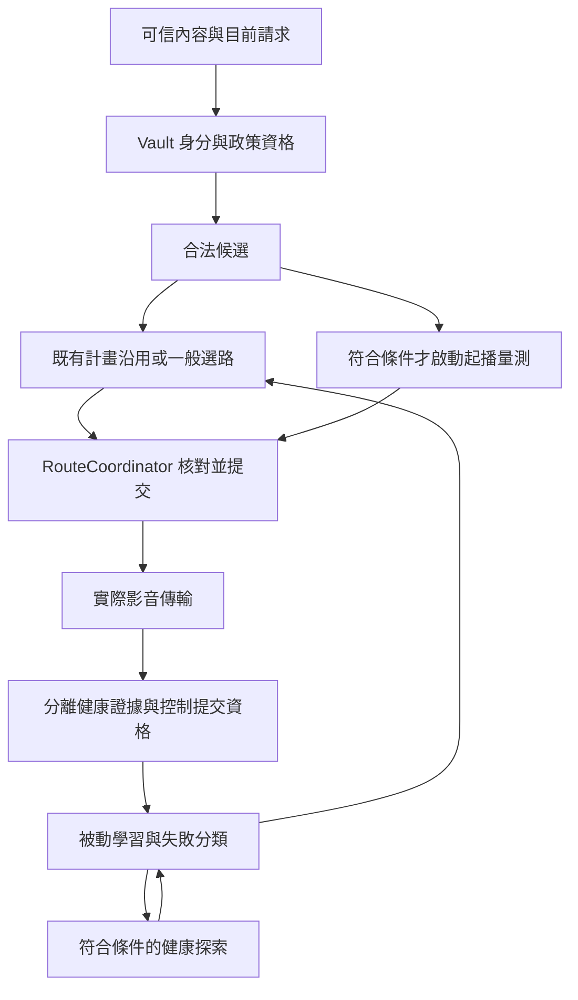

# BiliCDN_TW 選路演算法研究 — v2.2.6／2026-11-03

## 研究基準與範圍

本輪依使用者「廣泛研究、可參考任何開源方案、先不修改程式碼」的授權進行。凍結本機 `main` 提交 `1e7c87a4fc1e16ab4497efbb9542e870a31e59c4`，產品版本為 v2.2.6。這份文件是演算法檢討及後續驗證建議，沒有採用新的產品政策，也不是修復或安裝驗收報告。

研究涵蓋合法候選、證據估計、一般選路、起播量測、備援、失敗隔離、親和與提交所有權，並比較十二個開源專案及一份 ABR 原始論文。外部來源以官方儲存庫、官方文件及作者論文為限；程式比較使用本輪解析的固定提交，不把移動中的 `master`／`HEAD` 當永久證據。只閱讀來源，沒有安裝、執行或匯入第三方程式。

本次沒有修改 `src-v2/`、測試、工具、設定、依賴、版本或 Release；沒有新增探測、播放、網站服務、瀏覽器窗口、診斷或歷程收集。先前已停止的 CDN 現場實驗仍維持停止，本輪是獨立授權的原始碼及文獻研究。

本機完整追蹤檔清單與原始 SHA-256 基準保存在忽略目錄 `.work/routing-research-2026-11-03/BASELINE.json`；公開可重建基準為上述 Git 提交。實際產品驗證仍以 [最新版完整報告](../../../docs/TEST_REPORT.md#驗證階段與證據範圍) 為準；現行規則由 [架構指南](../../../docs/ARCHITECTURE.md#選路與傳輸) 與 [安全政策](../../../SECURITY.md) 維護，這份研究不取代它們。

### 判讀方式

| 標記     | 意義                                                       |
| -------- | ---------------------------------------------------------- |
| 程式事實 | 可由固定提交中的條件、資料流或公式直接確認                 |
| 靜態推導 | 在明列前提下由演算法推導，沒有宣稱已跑過新的測試或真實網路 |
| 設計建議 | 值得後續實驗或起草實作計畫，尚未證明改善播放               |
| 證據限制 | 目前材料無法支持的結論，不以工具成功或既有 PASS 補造       |

## 研究結論

建議後續以「先滿足播放需求、保留可用主機、只在有明確收益或失敗時切換」作為共同目標，先整合政策與證據語意，再比較估計器。直接換成 EWMA、隨機負載平衡或多臂賭徒，不能自行解決授權、親和、過期工作與小樣本問題。

優先方向是：

1. 將一般排名、最終選擇、舊計畫沿用與起播選定寫成同一份可驗證政策，明列來源種類的例外與決勝規則。
2. 將「速度估計」「證據新鮮度／樣本充分程度」「目前內容合法性」分開，避免舊速度或健康標籤被誤讀為現在已驗證。
3. 以既有資源上限評估穩定性、失敗後再接納與起播截止時間；先證明可減少不必要切換，再討論估計器或探索策略變更。

可確認的現況是：這套程式已有唯一提交所有者、健康親和、有界探測、影音隔離及失敗範圍區分。需檢討的是各階段政策的組合效果，並非所有既有設計都應撤除。下列例子確認演算法行為，不等同確認使用者現場多輪 CDN 切換的唯一根因。

## 現行流程與資料依據

### 固定來源索引

以下路徑均位於 [本輪固定提交](https://github.com/YUIAOI7592/BiliCDN_TW/tree/1e7c87a4fc1e16ab4497efbb9542e870a31e59c4)。以具名函式定位，避免後續 main 行號移動造成誤讀。

| 層次／來源                                                                                                                                                                           | 本輪核對內容                                                                                                                                                    |
| ------------------------------------------------------------------------------------------------------------------------------------------------------------------------------------ | --------------------------------------------------------------------------------------------------------------------------------------------------------------- |
| [domain/routing.ts](https://github.com/YUIAOI7592/BiliCDN_TW/blob/1e7c87a4fc1e16ab4497efbb9542e870a31e59c4/src-v2/domain/routing.ts)                                                 | `restrictionReasons`、`rankRoutes`、`chooseRoute`；完整檔案                                                                                                     |
| [domain/evidence.ts](https://github.com/YUIAOI7592/BiliCDN_TW/blob/1e7c87a4fc1e16ab4497efbb9542e870a31e59c4/src-v2/domain/evidence.ts)                                               | TTL、加權分位數、樣本狀態與斷路退避；完整檔案                                                                                                                   |
| [domain/playback-demand.ts](https://github.com/YUIAOI7592/BiliCDN_TW/blob/1e7c87a4fc1e16ab4497efbb9542e870a31e59c4/src-v2/domain/playback-demand.ts)                                 | UI 實際需求與控制用途缺值政策；完整檔案                                                                                                                         |
| [domain/player-output-plan.ts](https://github.com/YUIAOI7592/BiliCDN_TW/blob/1e7c87a4fc1e16ab4497efbb9542e870a31e59c4/src-v2/domain/player-output-plan.ts)                           | 最多五個備援、足速與家族分散；完整檔案                                                                                                                          |
| [application/routing/candidate-planning.ts](https://github.com/YUIAOI7592/BiliCDN_TW/blob/1e7c87a4fc1e16ab4497efbb9542e870a31e59c4/src-v2/application/routing/candidate-planning.ts) | 起播候選、Native 數量、Catalog 游標與快取速度條件；完整檔案                                                                                                     |
| [application/route-coordinator.ts](https://github.com/YUIAOI7592/BiliCDN_TW/blob/1e7c87a4fc1e16ab4497efbb9542e870a31e59c4/src-v2/application/route-coordinator.ts)                   | `startupOptions`／`startupFallback`／`#startupPool`、`plan`／`recover`、`#choose`／Catalog-only 選擇、`#currentPlan`／`#savePlan`；選讀相關方法，不宣稱整檔重審 |
| [application/measurement-controller.ts](https://github.com/YUIAOI7592/BiliCDN_TW/blob/1e7c87a4fc1e16ab4497efbb9542e870a31e59c4/src-v2/application/measurement-controller.ts)         | 起播結果收集、足速／最快／未測退路、`#probeStartup` 及健康探索準備的相關方法                                                                                    |
| [application/routing/transport-result.ts](https://github.com/YUIAOI7592/BiliCDN_TW/blob/1e7c87a4fc1e16ab4497efbb9542e870a31e59c4/src-v2/application/routing/transport-result.ts)     | 取消、403、404／410、其他 4xx 及網路／5xx 分類；完整檔案                                                                                                        |
| [adapters/range-probe.ts](https://github.com/YUIAOI7592/BiliCDN_TW/blob/1e7c87a4fc1e16ab4497efbb9542e870a31e59c4/src-v2/adapters/range-probe.ts)                                     | 核對計時起點與結果建構：`elapsedMs` 從送出前起算，包含首回應等待；並非只計本文傳輸                                                                              |

### 各階段不是同一個排序器

| 階段     | 已確認的處理方式                                                                                               | 重要含義                                                |
| -------- | -------------------------------------------------------------------------------------------------------------- | ------------------------------------------------------- |
| 資格     | 禁止規則、內容／表示、Vault 精確授權、政策、固定設定及斷路資格先行                                             | 速度不能使不合法來源取得權限                            |
| 舊計畫   | `plan()` 在非失敗／watchdog／設定邊界，若舊決策仍合法便直接返回                                                | 每筆請求不一定重新排名；這是既有穩定機制                |
| 一般排名 | 合法、固定、足速、需求比例、狀態、TTFB、Catalog 順序                                                           | 排名第一不保證被最終選中                                |
| 一般選擇 | 固定；合格健康親和；非 root 原始來源的 proven 足速；非 root 的成功足速；任一有成功速度；原始來源；Catalog 退路 | 來源種類與穩定性仍在排名外影響結果                      |
| 起播候選 | 合法完整池依歷史足速／速度及穩定原順序排序，取至多三個                                                         | 有界抽樣，不能宣稱找到所有節點的全域最快者              |
| 起播結果 | 本輪足速、否則最快有效、否則一次合法未測退路                                                                   | Catalog-only 的既有開關另允許首個足速結果提前放行       |
| 備援輸出 | 最多五個，優先有效足速，再用既有家族分散與未驗證退路補足                                                       | 家族名稱只是分散代理，不能證明不同實體 PoP 或獨立故障域 |
| 健康探索 | 符合穩定播放及冷卻後，最多三個依序探測                                                                         | 只更新學習，不直接切掉流暢播放的主機                    |

控制需求由同一函式計算：影片最低 2 Mbps、音訊最低 0.5 Mbps，正常公式為 `bandwidth / 1e6 × playbackRate × 1.25`；缺資料時保留既有控制預設。UI 不使用這些缺省值填數字。

速度證據仍為每主機／影音類別至多十二筆、24 小時 TTL；一筆有效速度乘 0.7、兩筆取小值、三筆以上取兩小時半衰權重的 25% 分位數。一般傳輸速度需至少 64 KiB；成功狀態與具有效速度的成功樣本不是同一件事。

起播共用三秒、最多三個探測。五分鐘內符合條件的 Catalog 快取速度只用 16 KiB 驗證，不提交新的完整測速；其他探測通常上限 256 KiB，高需求為 512 KiB，至少 64 KiB 才形成有效速度。這些配額不因本研究改變。

## 可確認的演算法行為與檢討

### F01：排名、來源偏好與計畫沿用是三層政策

**程式事實：** `rankRoutes()` 先比較速度比例，但 `chooseRoute()` 的前兩個足速尋找條件排除 `root-original`；`plan()` 又可能在兩者之前沿用原物件。

**靜態推導：** 假設沒有固定／目前親和、兩個不同主機均合法且 proven，需求 5 Mbps，原始來源安全速度 20 Mbps、Catalog 為 10 Mbps。排名可將原始來源置前，但最終選擇會先命中 Catalog 的足速條件。這不是「不合法 Native 被放行」，也不代表每次都會如此；例子明列了進入重新選擇的前提。

**設計建議：** 先確認原始來源降序是否仍為產品政策。若目標是足速證據優先且來源種類不另降序，未來計畫應消除這個例外；若要保留，應在單一政策表及正式案例中明列。不能只改比較器，否則其餘兩層仍會改變結果。

### F02：兩小時半衰權重不等於閒置後速度自動降低

**程式事實與靜態推導：** 在沒有新樣本、未跨 TTL、保留集合不變且樣本時間不在未來時，各權重為 `2^(-(now - sampleTime) / H)`。時間前進為所有權重乘上同一常數；加權分位數的相對權重及門檻同比縮放，因此不會僅因時鐘前進而改變所選速度。一筆及兩筆分支也不隨閒置時間降速。

這套權重會影響新舊樣本同時存在時的相對份量；24 小時後排除也有效。它沒有提供「最近未驗證」的連續信心衰減。hls.js／Shaka 的雙 EWMA 同樣主要在新樣本到達時更新，單純換估計器不能補上閒置時效語意。

**設計建議：** 將速率估計與新鮮度資格分開。後續可比較「保留 24 小時學習、較舊證據僅作候選排序，不自稱目前足速」等政策；具體時間窗須驗證，不在研究中直接新增另一個任意 TTL。缺新證據不應偽造較低的實測數字。

### F03：保守係數會疊加，應整體校準

**靜態推導：** 在影片需求最低值未生效、新探測直接用 `raw × 0.7`、足速條件為安全速度至少需求 1.35 倍時，需要的原始探測速度至少為 `bandwidthMbps × rate × 1.25 × 1.35 / 0.7`，約為未加裕度播放碼率的 **2.4107 倍**。這是特定分支的合成門檻，不適用於所有歷史樣本或每種需求。

例：4 Mbps、2 倍速，控制需求為 10 Mbps，安全速度須至少 13.5 Mbps，新探測原始速度須約 19.286 Mbps 才算足速。低於門檻仍可能透過「最快有效」被選中；不等於當場阻擋播放。

**設計建議：** 比較總體保守程度，避免分別調低三個數字造成過度放寬。以相同流量預算比較可播放性、錯選風險與切換次數。不能把單樣本折扣、百分位數或 `safe` 命名當成具有統計保證的信賴下界。

### F04：起播同速決勝與提前放行應分清

**程式事實：** 起播結果依完成順序加入集合，普通結果排序只比較 `safeMbps`。在速度完全相同時，穩定排序保留加入順序，因此不同完成順序可以選出不同主機。

這與 Catalog-only「第一個足速便放行」的刻意低延遲政策不同：後者原本就接受完成順序影響。確定性也不代表必須忽略所有網路事件順序。

**設計建議：** 對等待本輪結果後的同分情況，使用候選固定序號／既有主機／明確來源次序作決勝；對提前放行維持獨立政策及測試。預期能減少的是相同有效結果下無意義的選擇差異，尚未量測播放收益。

### F05：短快取驗證與新速度估計回答不同問題

**程式事實：** 符合快取條件時的 16 KiB 驗證沿用 `cachedSafeMbps`，不把那次短讀換算成新的完整速度或提交新樣本，這是正確的證據邊界。

**設計建議：** 候選比較及畫面語意應維持「目前可達、沿用歷史容量」與「本輪有有效速度」的區分。雙方共用數值排序時，應驗證歷史高速但當前變慢的情況；不能為更新日期而將短驗證升格成完整速度，也不能增加探測數來掩蓋問題。

### F06：健康、速度充分與重試資格不能互換

**程式事實：** `proven` 使用成功樣本數及近期失敗判定；成功可能沒有有效吞吐數值。因此兩次成功不必然是兩次合格完整速度樣本。提前重試另有同內容／表示／授權／政策、六十秒內兩筆不同實際影片請求的帳本，主動測速或跨片學習不能取得該控制資格。

**設計建議：** 未來政策表分列可達性、容量可用性、時效與控制資格，不把同一個健康標籤當成所有問題的答案。盡量從既有有界樣本與狀態衍生，避免建立新的歷程錄製器或平行授權資料庫。

### F07：失敗隔離已有範圍，仍須比較恢復接納方式

**程式事實：** 取消不算主機失敗；Catalog 403、資源／主機的 404／410、其他 4xx 拒絕、Native 失效、網路／本文／逾時／5xx 分流處理。主機斷路退避為 10 分鐘、30 分鐘、2 小時、6 小時；成功降低層級，但尚未到期的隔離不立即解除。

**設計建議：** 比較「到期即可一般參選」與「到期先有限再驗證」的影響，保留資源與主機故障的不同範圍。若新增半開狀態，必須使用既有 Measurement 所有權及配額，不啟動新的計時器或無界探測。未證明現有退避過長或過短，不在此任意替換為其他專案的預設秒數。

### F08：有限探索不是完整排名，也不能由少量 PASS 證明最優

**程式事實：** 起播只取至多三個；健康探索受穩定播放、三十秒緩衝、共用十分鐘冷卻、六小時候選限制等條件限制，且不直接改目前親和。這避免探索干擾，但未被選入的來源缺少同期反事實結果。

**設計建議：** 後續離線比較可研究固定配額中保留一個未知候選位置，或沿既有游標覆蓋；不能聲稱這一定優於全部依舊證據排序。探索會犧牲一個已知候選位置，必須列為產品取捨，而非把未知來源一律當較差或較好。

### F09：安全吞吐是估計，不是完成期限

**程式事實：** 一般排名在需求比例之後才比較 TTFB；Range 探測的總耗時包含首回應等待。同等總速度的來源仍可能有不同回應啟動時間及傳輸波動。

**設計建議：** 在已知請求大小且可分離有效傳輸速率時，才適合研究 `TTFB + bytes / payloadRate` 與可播放緩衝期限。直接把目前含 TTFB 的整體速率再加一次 TTFB 會重複計價；未知大小不能猜一個大小來控制網站請求。先保留此項為模型比較，不能直接搬進選路公式。

## 開源方案比較

本節逐項列出實際參考的機制與移植界線。串流 ABR 決定畫質，CDN 選路決定來源；服務端負載平衡還能看到全體連線與後端負載。三者可以提供設計概念，不能視為相同問題。

### 串流播放器與多來源選擇

| 專案及一手來源                                                                                                                                                                                                                                                                                                                                                                                                                                                                                                                           | 已讀機制                                                                                | 可借鏡                                           | 不直接採用的原因                                                                                        |
| ---------------------------------------------------------------------------------------------------------------------------------------------------------------------------------------------------------------------------------------------------------------------------------------------------------------------------------------------------------------------------------------------------------------------------------------------------------------------------------------------------------------------------------------- | --------------------------------------------------------------------------------------- | ------------------------------------------------ | ------------------------------------------------------------------------------------------------------- |
| [hls.js 雙 EWMA](https://github.com/video-dev/hls.js/blob/598ebdd7e7c220d07c49b711648c712b354ae446/src/utils/ewma-bandwidth-estimator.ts) 與 [Content Steering](https://github.com/video-dev/hls.js/blob/598ebdd7e7c220d07c49b711648c712b354ae446/src/controller/content-steering-controller.ts#L198-L309)                                                                                                                                                                                                                               | 快／慢估計取較低值，另估 TTFB；路徑錯誤懲罰與優先清單分離                               | 不同時間尺度反應、暫時隔離與重新接納             | ABR 頻寬通常不是每主機容量；伺服器提供的路徑清單不會替本專案授予 Native URL 權限                        |
| [dash.js ThroughputModel](https://github.com/Dash-Industry-Forum/dash.js/blob/23f755d41fcb4a63d57f39da0013407f7b928cce/src/streaming/models/ThroughputModel.js#L78-L133)、[DVB 選擇](https://github.com/Dash-Industry-Forum/dash.js/blob/23f755d41fcb4a63d57f39da0013407f7b928cce/src/streaming/utils/baseUrlResolution/DVBSelector.js#L45-L140)、[Steering 選擇](https://github.com/Dash-Industry-Forum/dash.js/blob/23f755d41fcb4a63d57f39da0013407f7b928cce/src/streaming/utils/baseUrlResolution/ContentSteeringSelector.js#L55-L88) | 載入樣本處理與 BaseURL 選擇分層；DVB 先優先群組再權重抽樣；steering 跳過黑名單          | 區分資格、群組政策與群組內選擇                   | 權重是發布者意圖，不是本機足速證據；不新增遠端 steering 服務或任意 URL clone                            |
| [Shaka 估計器](https://github.com/shaka-project/shaka-player/blob/6ff033137ab725fbf60c608c538601aa5dcf545c/lib/abr/ewma_bandwidth_estimator.js) 與 [ABR 切換](https://github.com/shaka-project/shaka-player/blob/6ff033137ab725fbf60c608c538601aa5dcf545c/lib/abr/simple_abr_manager.js#L548-L588)                                                                                                                                                                                                                                       | 快／慢 EWMA、最少樣本量、小樣本過濾；切換間隔及緩衝檢查；另過濾疑似快取載入             | 樣本資格與切換抑制分開；先問數據是否夠用         | 不接管 B 站 Auto；樣本到達驅動的 EWMA 不能單獨解決閒置舊證據問題                                        |
| [AndroidX Media3 BaseUrlExclusionList](https://github.com/androidx/media/blob/8c6678b657ede1e7883fc164ef73ed483c7796c3/libraries/exoplayer_dash/src/main/java/androidx/media3/exoplayer/dash/BaseUrlExclusionList.java#L62-L177) 與 [錯誤政策](https://github.com/androidx/media/blob/8c6678b657ede1e7883fc164ef73ed483c7796c3/libraries/exoplayer/src/main/java/androidx/media3/exoplayer/upstream/DefaultLoadErrorHandlingPolicy.java#L99-L161)                                                                                        | 排除 service location／priority；同優先集合按權重選一次並快取；錯誤與位置／軌道退路分開 | 同一候選集合內維持選擇，隔離期限不被較短期限縮短 | 位置與軌道退路的優先序受 steering 是否啟用影響；其 HTTP 狀態清單不能直接覆蓋本專案的 403 與資源失敗規則 |

hls.js 的估計器註明受 Shaka 啟發；兩者相似不能算成兩份獨立實驗證明。這些來源支持的是結構與公式比較，沒有證明換入本專案後必然更快。

### 多鏡像下載

[aria2 AdaptiveURISelector](https://github.com/aria2/aria2/blob/9e7273583f83e881e3ec067b523ba88724088d2f/src/AdaptiveURISelector.cc#L126-L210) 將最佳鏡像、尚未測試鏡像及稍後再測試分開；速度在最佳值附近的群組可隨機選擇，另有依既有次數拉長的重測條件（[L311–L343](https://github.com/aria2/aria2/blob/9e7273583f83e881e3ec067b523ba88724088d2f/src/AdaptiveURISelector.cc#L311-L343)）。

可借鏡的是「足夠接近的速度不值得無限追逐」及顯式探索預算。不可照抄的是額外連線、切片並行及未測主機優先程度：aria2 擁有下載排程，本腳本須保留網站請求、精確授權與既有探測上限。其 25% 群組寬度及重測天數是該程式的政策，不是本專案已驗證門檻。

### 負載平衡與健康隔離

| 專案及一手來源                                                                                                                                                                                                                                                                                              | 已讀機制                                                           | 本專案的適用範圍與限制                                                                                                                                                                                |
| ----------------------------------------------------------------------------------------------------------------------------------------------------------------------------------------------------------------------------------------------------------------------------------------------------------- | ------------------------------------------------------------------ | ----------------------------------------------------------------------------------------------------------------------------------------------------------------------------------------------------- |
| [NGINX OSS round robin](https://github.com/nginx/nginx/blob/67290bfea61c81347464539f5e6d0a7cebec1fc8/src/http/ngx_http_upstream_round_robin.c#L866-L924) 與 [失敗後權重](https://github.com/nginx/nginx/blob/67290bfea61c81347464539f5e6d0a7cebec1fc8/src/http/ngx_http_upstream_round_robin.c#L1056-L1086) | 被動失敗排除；降低有效權重，再於符合條件的選擇過程逐步回復         | 可研究重新接納不要立即全量優待；不能把 round robin 當作影片足速選擇。[官方文件](https://nginx.org/en/docs/http/ngx_http_upstream_module.html) 中的 `slow_start` 屬商業功能，不能混稱 OSS 已有同一功能 |
| [HAProxy 3.0.30-2 官方手冊](https://docs.haproxy.org/3.0/configuration.html) 的 `slowstart`、`option redispatch` 與 `retries`                                                                                                                                                                               | 曾失敗伺服器恢復後逐步加權；限定重試條件下打破既有綁定             | 可借鏡「穩定綁定正常保留、失敗才有界重選」。本輪該專案大文件的 GitHub 內容介面返回空值，改讀版本手冊；沒有宣稱完整閱讀當前 HEAD。伺服器啟動 ramp 也不等於每次影片冷起播                               |
| [Caddy 選擇政策](https://github.com/caddyserver/caddy/blob/98b0bbd4774611c133463420d4cd047aa4622a51/modules/caddyhttp/reverseproxy/selectionpolicies.go#L185-L265) 與 [官方 retry／被動健康說明](https://caddyserver.com/docs/caddyfile/directives/reverse_proxy)                                           | 隨機子集後比較負載；重試有期限、間隔與請求條件；被動健康須配置啟用 | 可借鏡把重試資格和健康更新分離；本分頁連線數不能代表整個 CDN 的負載，不能因此推導跨 CDN least-connections 政策                                                                                        |
| [Envoy outlier detection](https://github.com/envoyproxy/envoy/blob/4c43cfc09b14ca6c7ae2a27d852fe87674420712/docs/root/intro/arch_overview/upstream/outlier.rst#L19-L96)                                                                                                                                     | 區分連線端失敗與伺服器回應失敗；退避、排除比例及恢復條件分開       | 可研究故障範圍與有限再接納。其 panic 可在特定配置下重新使用不健康節點，是可用性政策；絕不能套用成放行被禁止、失效或無授權來源                                                                         |

### 延遲與壅塞自適應

| 專案及一手來源                                                                                                                                                                                                                                                                | 核心機制                                                                     | 對本專案的意義                                                                                                         |
| ----------------------------------------------------------------------------------------------------------------------------------------------------------------------------------------------------------------------------------------------------------------------------- | ---------------------------------------------------------------------------- | ---------------------------------------------------------------------------------------------------------------------- |
| [Tower Peak EWMA](https://github.com/tower-rs/tower/blob/df06d70dbea345facbffb5881fe8647f53bf424d/tower/src/load/peak_ewma.rs#L135-L159) 與 [估計更新](https://github.com/tower-rs/tower/blob/df06d70dbea345facbffb5881fe8647f53bf424d/tower/src/load/peak_ewma.rs#L227-L279) | 成本為 RTT 估計乘 `(pending + 1)`；慢回應立即拉高、改善較慢；讀取時計入衰減  | 可借鏡壞消息快、好消息慢；這是延遲／排隊成本，不是安全吞吐。其閒置成本降低用於重新探索，不能搬成「閒置越久容量越可信」 |
| [Linkerd balance](https://github.com/linkerd/linkerd2-proxy/blob/42decf7657b593682010c35c761ce457a7bae5a2/linkerd/proxy/balance/src/lib.rs#L22-L57)                                                                                                                           | 使用 Tower 的 Peak EWMA；新端點的預設 RTT 設下界，避免接近零成本吸走過多流量 | 冷啟動未知來源不能視為免費最佳者；與 Tower 共享實作血緣，不算獨立效能證據                                              |
| [Netflix Gradient2](https://github.com/Netflix/concurrency-limits/blob/78a74b9878d38c4c048b0304ce12a162ab7b7222/concurrency-limits-core/src/main/java/com/netflix/concurrency/limits/limit/Gradient2Limit.java#L278-L320)                                                     | 比較短／長 RTT 調整並行上限；應用沒有送足負載時不盲目提高上限                | 可借鏡樣本受應用限制時不能當容量測試。本腳本不擁有全體網站下載排程，不採用其並行控制器或額外請求                       |

### ABR 論文提供的目標，與不能跨越的邊界

[BOLA 作者論文 v3](https://arxiv.org/abs/1601.06748v3) 將緩衝與畫質效用放進控制目標，不需要預測可用頻寬。它提醒本研究應以連續播放與切換代價評價方案，而非只最大化測速數字；但 BOLA 選擇每段碼率，本專案不因此取得 B 站畫質控制權，也沒有重現論文的效能結果。本輪閱讀摘要及問題定義，不宣稱重現其證明或模擬。

另嘗試讀取作者站的 MPC 論文 PDF，但該入口返回 502；本次不以未讀內容支持建議，不將它算入已完成的一手來源比較。

## 建議排序與相容影響

以下是研究結論，全部尚未實作。排序依可驗證性與對現有結構的適配程度，不依專案知名度或單純行數減少。

| 編號／排序  | 建議方式與可減少的負擔                                                                                 | 主要風險與相容影響                                                                                   | 後續驗證方法                                                                           |
| ----------- | ------------------------------------------------------------------------------------------------------ | ---------------------------------------------------------------------------------------------------- | -------------------------------------------------------------------------------------- |
| P01／優先   | 建立單一選擇規格：資格、證據群組、健康親和、群組內比較、確定決勝、提交；列明 root 與固定例外           | 若移除 root 降序，屬行為政策變更，不能當純重構。沿用 RouteCoordinator，不新增總管或 Native 索引      | 同一候選集對照一般、起播、恢復；禁止／固定／Native／Catalog 與舊計畫交錯；明列舊新預期 |
| P02／優先   | 分離容量值、樣本充分程度、新鮮度及內容所有權；沿既有有界樣本衍生                                       | 不把「舊」顯示為虛構低速；保留 UI 缺值及控制預設。若未來需新增持久欄位，必須另列遷移，本次不預設必要 | 單／雙／多樣本、無速成功、快取短驗證、24 小時邊界、跨片合法學習與當前內容授權分離      |
| P03／優先   | 普通起播同分使用固定決勝；提前放行另立規格；比較不同主機的明顯收益才切換                               | 過強親和會錯過改善；過弱抑制仍抖動。新增最小停留或切換增益門檻均需政策驗證                           | 相同結果逆序完成、速度接近／突降、固定變更、真正失敗；決策身分與提交事件不漂移         |
| P04／優先   | 校準總體保守度及失敗後再接納，用同一播放需求評分                                                       | 調低門檻可減少表面不足速，也會增加錯選；半開若接線不當會突破配額                                     | 固定候選／探測／重載上限比較；失敗資源範圍、取消、不足速但可播放、隔離到期及晚到結果   |
| D01／可延後 | 比較現行加權分位數、快慢 EWMA 與非對稱更新                                                             | 樣本少時模型排名不穩；雙 EWMA 不修復閒置時效。不能用估計器名稱宣稱信心保證                           | 同樣輸入、樣本資格及預算；升降速、離群值、快取命中、首回應延遲、長空白與低負載         |
| D02／可延後 | 在既有三個候選中比較固定探索位置／游標；研究有足夠輸入時的完成期限模型                                 | 探索會排擠已知候選；未知 bytes 或重複計 TTFB 會誤判。維持原主動網路上限                              | 使用有完整候選結果的離線資料或合成場景；分開比較可用性、起播延遲、流量及切換           |
| K01／維持   | 唯一所有者、精確 Native、禁止優先、固定語意、影音隔離、兩筆實傳重試資格與健康探索不切主機              | 這些是安全與功能契約，不能以模擬速度更好取代                                                         | 既有授權、重入、並行、取消、晚到、鎖等待與換表示契約保持                               |
| N01／不採用 | 每段 round robin、全域 least-connections、無界多線競速、遠端 steering、接管網站 ABR、直接上 ML／bandit | 缺全體負載、反事實與精確分段輸入，或破壞網站／授權／資源邊界                                         | 不以「開源已有」當採用證據；除非未來有獨立需求、輸入與授權，否則不進實作               |

P01–P04 的順序應先規格、再證據語意、再比較政策；不在尚未釐清目標時先替換估計器。這次不指定修補版號，也不承諾任何未量測的速度、卡頓或記憶體收益。

## 後續驗證設計

### 先保護契約，再比較算法

後續若批准實作，先凍結現行套件的案例名稱及參數清單；既有有效案例完整保留。明確變更的選擇政策才逐案建立舊新對照，不能刪除案例、減少斷言或靠空值替身換取通過。

驗證應同時涵蓋：

- 空候選、單候選、全部被禁止、固定不合法、Native 精確授權與 Catalog-only；合法原樣放行不等於任意退路。
- 兩個主機、兩個表示、並行與逆序完成；等速決勝、同步重入、等待儲存鎖、generation／epoch／policy／authority 與選擇修訂失效。
- 同一主機的短／長樣本、只有可達性沒有速度、音訊不補影片、跨片歷史不授予控制、清除／遠端更新及寫入失敗。
- 原上限下的足速、最快有效、合法未測退路與無合法選擇；不能以新增探測或恢復額度達到較好結果。
- 失敗後重選與親和一致、舊成功只保存合格證據、健康探索不改正在播放的主機、提前重試與恢復各自保持資格。
- 總覽與詳細狀態同份快照、唯讀取樣無控制副作用；不新增歷程、匯出或收集管線。

### 公平比較與指標

| 設計       | 必須遵守的條件                                                                                                     |
| ---------- | ------------------------------------------------------------------------------------------------------------------ |
| 對照       | 現行政策為基線；每次只比較明列的候選政策，不能同時更換探測量、門檻與網站畫質後歸因於估計器                         |
| 資料       | 合成場景先涵蓋反例；若後續使用離線傳輸資料，需有合法來源與必要欄位，不持久化簽名 URL、權杖、IP 或播放器物件        |
| 無未來資訊 | 選擇時只讀當時已合法提交的樣本；完整候選結果可作離線評分參考，不能提前餵給被評估的策略                             |
| 偏差       | 未被選中的主機沒有結果時，不把缺值算失敗或零速；已取消／快取回應與合法成功分開；並行探測共享瓶頸不能當三條獨立容量 |
| 收益       | 起播時間、停滯時間、可避免切換、額外流量、探測／重載次數與有界結案；畫質或速率變化須另列，不能拿降畫質冒充選路改善 |
| 安全回歸   | 任何方案都先通過原授權與生命週期契約；若有傳輸／授權修改，再依原流程執行必要安全差異掃描                           |
| 實機       | 離線通過與安裝版分開。沒有新的當輪案例、期限與必要前提，不自行恢復已結束的 IAB 窗口                                |

本研究沒有執行上述演算法對比、實機測速或新產品測試。表中指標是後續驗證設計，不是本次已取得的結果。

## 來源固定版本與閱讀範圍

查閱日期為 2026-11-03。本表的提交是外部來源的凍結點，並非本專案新增依賴或宣稱採用的版本。主文連結均指向對應固定提交；HAProxy 則明確使用版本手冊。

| 來源                        | 固定提交／文件版本                         | 實際閱讀範圍                                                                             |
| --------------------------- | ------------------------------------------ | ---------------------------------------------------------------------------------------- |
| video-dev/hls.js            | `598ebdd7e7c220d07c49b711648c712b354ae446` | EWMA 估計器全文；steering 錯誤懲罰及優先序方法                                           |
| Dash-Industry-Forum/dash.js | `23f755d41fcb4a63d57f39da0013407f7b928cce` | ThroughputModel 樣本加入與 XHR 計算；BaseURLSelector、DVB 優先／權重與 steering 選擇方法 |
| shaka-project/shaka-player  | `6ff033137ab725fbf60c608c538601aa5dcf545c` | EWMA 估計器全文；ABR 快取樣本過濾及建議切換方法                                          |
| androidx/media              | `8c6678b657ede1e7883fc164ef73ed483c7796c3` | BaseUrlExclusionList、DefaultLoadErrorHandlingPolicy 全文                                |
| aria2/aria2                 | `9e7273583f83e881e3ec067b523ba88724088d2f` | AdaptiveURISelector 主選擇、最佳群組及未測／重測方法；FeedbackURISelector 結構輔讀       |
| nginx/nginx                 | `67290bfea61c81347464539f5e6d0a7cebec1fc8` | round robin 的資格、有效權重選擇及失敗更新方法；官方 upstream 文件核對商業界線           |
| haproxy/haproxy             | 3.0.30-2 官方配置手冊                      | slowstart、redispatch、retries；本輪 HEAD 中繼資料已查，但空內容不能算程式閱讀           |
| caddyserver/caddy           | `98b0bbd4774611c133463420d4cd047aa4622a51` | random_choose 選擇方法；健康配置結構與官方有界重試／被動健康文件                         |
| envoyproxy/envoy            | `4c43cfc09b14ca6c7ae2a27d852fe87674420712` | outlier 官方來源中的錯誤分類、排除與重新接納；proto 結構輔讀                             |
| tower-rs/tower              | `df06d70dbea345facbffb5881fe8647f53bf424d` | Peak EWMA 成本及更新方法；P2C 選擇結構輔讀                                               |
| linkerd/linkerd2-proxy      | `42decf7657b593682010c35c761ce457a7bae5a2` | balance 的 Tower 接線及新端點 RTT 下界；不宣稱全文審查服務網格                           |
| Netflix/concurrency-limits  | `78a74b9878d38c4c048b0304ce12a162ab7b7222` | Gradient2 `_update` 與應用受限判斷                                                       |
| BOLA                        | arXiv `1601.06748v3`，2020-06-18 修訂      | 作者摘要、問題定義與 ABR／CDN 邊界；未重現論文結果                                       |

## 證據限制與交付邊界

本輪固定來源足以確認 F01–F09 的程式條件、公式與結構差異；不能據此推斷某個真實 CDN 當時可用、某個係數一定過度保守，或另一種估計器必然改善起播。

既有 v2.2.6 R1 基本驗收只支持其凍結案例。R1 顯示的起播狀態為 `preflight-skipped:xhr-explicit-timeout`，不能拿它宣稱三個起播候選完整競速已實測，也不以基本播放 PASS 證明三十五項自然分支或全域最優。

研究及導航記錄依文件流程檢查；不改寫原始調查、六案結果、三十五項閉環、R1、FAIL／INVALID 或 Release 快照。本次沒有新產品採用決定；後續只有另行批准的計畫才會修改演算法。

## v2.2.7 實作銜接（2026-11-03）

本篇以上研究原文與當時未實作邊界保留。使用者後續已批准完整採用 F01–F09、P01–P04、D01–D02；現行規則與逐項案例見[新版完整驗證](../../../docs/TEST_REPORT.md#研究項目完成對照)，工作與發布狀態只見[TODO](../../../docs/TODO.md)。本篇不改寫成當時已完成，也不把離線合成結果稱為實機改善。
